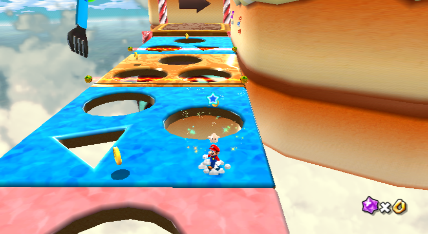

# Chocolate frontier: bounded assisted exploration

Owner-authorized October 28, 2026. The immediate question is whether a short
exclusive-action sequence from the previously verified first-chocolate snapshot
can reach a new, alive-grounded location beyond the mapped opening. This is
scripted exploration from an assisted state, not a learned full-start success.

The initial physical screen has six isolated Dolphin workers, each with 24
pre-generated seeded schedules of up to 48 decisions at 12 frames per decision;
30 minutes is an absolute shared deadline. Actions remain the existing eight
exclusive inputs. Schedules use short persistent directions, jump, spin,
crouch and no-op. Workers restore the exact same anchor before each attempt,
which is a documented moving-conveyor state, not an independent environment.
There is no learner, training replay, imagination or genetic update.

At most six snapshots per worker are retained. A single alive-grounded sample
with unchanged HP at least 150 world units beyond the opening endpoint and in a
bounded horizontal/vertical corridor is marked as an **unverified candidate**.
It is not automatically a safe state or route waypoint. Screenshots, complete
action prefixes, RAM telemetry, physical decisions and all failed trajectories
are retained locally. The coordinate corridor is a search heuristic, not a
measure of mission completion. Full-start and near-star fixtures are never
counted as successes in this screen.

Review worker logs and checkpoints after the block. For a promising candidate,
repeat its exact actions from the anchor at least twice, measure platform motion
and health, and test a bounded stability probe with full disclosure of any drift.
Record a video of the actual inputs. Reproduce the anchor and the candidate
from the original full-start slot with the exact action schedule before calling
it a full-start path. Small, recorded timing perturbations are additional checks,
not independent training seeds. Only then consider new immutable archive states
and a separately signed, controlled learning comparison. Any training successor
must have finite budgets and be reviewed separately; no automatic long run is
authorized by this script.

The supervisor ledger is `.local/chocolate-frontier-search-20261028/state.json`.
It records pending commands, PIDs and creation times before or at dispatch. A
failure preserves partial data and does not auto-retry. Creating its `STOP`
file requests a stop between actions. Original ROMs, slots, user profiles and
checkpoints remain untouched and are never committed.

## Conditional replay comparison

The screen returned grounded candidates beyond the opening; four exact action
prefixes were replayed from the canonical full-start slot and reproduced their
candidate positions. Two of these remained beyond the endpoint after a
two-decision timing perturbation. All four failed the pre-existing stable-state
screen: three were displaced more than 250 units in 60 idle frames, and one
lost grounded contact. Therefore no candidate is promoted as a stable archive
start. An exact partial full-start trajectory can nevertheless be recorded as
real demonstration experience without restoring an unstable state in training.

Capture the deepest reproducible path with delay 0 and 2 decisions as training
examples, and delay 1 as a held-out timing check. All start at the original
slot, stop at a grounded nonterminal point and use exact policy observations,
actions and the existing signed reward; a collector cut is not a success.

The initial learning screen compares two independently seeded source-checkpoint
copies, each with 128 offline IQN updates on retained signed real replay.
Control samples all batches from the original replay; treatment samples every
fourth batch from the two newly recorded demonstration trajectories. Both use
the same optimizer source, reward, model, update count, batch size and seed
schedule. Demonstration decisions are counted separately from historical real
decisions and are not inserted into the source replay. This is standard IQN
TD learning on a small mixture, not DQfD or behavior cloning. Neither branch
is assumed better. Evaluate each frozen checkpoint on the same canonical-start
greedy and three noisy action draws; seed labels do not vary the Wii state.
An extra training block requires a reviewed, repeatable improvement in both
seeds and no star regression; otherwise stop. Specifically, for each paired
training seed the demonstrated arm must improve the mean alive-grounded X/Z
goal-axis projection across the three noisy canonical-start episodes by at
least 0.5 percentage points, and at least one such episode must reach the
declared grounded region beyond the mapped endpoint. Recompute these metrics
from real CSV telemetry; the video recorder's generic `best_progress` is not
itself a grounded-contact guarantee. Two seeds and three draws are only a
heuristic screen, not statistical evidence for a general advantage.

## Search and physical validation results

The six workers completed 144 scripted assisted attempts and 2,779 real
decisions: 137 deaths, seven horizon cuts, six unverified candidates and zero
assisted RAM stars. Four selected candidates were each reproduced twice from
the anchor and exactly once from the canonical full start. The deepest reached
`(450.23, -50.00, -2328.65)` with full health and grounded contact. Two of the
four remained beyond the endpoint after adding two no-op decisions at the
anchor. However, none passed the unchanged stable-archive screen: the three
that remained grounded during the full idle probe drifted 346–494 units, and
the fourth lost contact. A moving conveyor is not necessarily unsafe, but these
snapshots cannot be represented as stationary validated archive states.

The [evidence summary](assets/performance/chocolate-frontier-search-20261028.json)
records separate physical counts: 414 decisions for replay/stability validation
and 144 for three full-start demonstration captures. Delay 0 and delay 2 are
the only examples supplied for offline fitting; delay 1 is held out as a timing
check. No star was collected, and the demonstrations end as nonterminal cuts.
The source recordings and scripted validation video under
`runs/chocolate-frontier-validation-20261028/validate-20261028-093109-247390/`
are local-only and are not reproducible from Git alone. The candidate below is
an observed frame, not a frozen-policy result.

## Completed demonstration comparison

All four cases completed 128 offline updates each, including 32 demonstration
batches per treatment case and none per control. The source checkpoint and its
replay, captured demonstration hashes, all four signed checkpoint/replay pairs,
and frozen evaluator policy hashes passed integrity checks. There were 512
offline updates and no new online training decisions. The sixteen frozen
full-start evaluation episodes consumed 1,161 additional physical decisions;
13 ended in death and three in timeout. No RAM-confirmed star was recorded.

| Training seed | Control: mean grounded goal-axis projection | Demonstration: mean grounded goal-axis projection | Difference |
| --- | ---: | ---: | ---: |
| 142 | 3.477% | 3.361% | -0.116 percentage points |
| 143 | 3.685% | 2.856% | -0.829 percentage points |

Each mean covers three noisy action draws from the same canonical Wii savestate.
Neither demonstration case reached the selected grounded beyond-opening region
in those draws. Each control did so once, followed by death; control seed 143
also entered that region in its greedy episode, again followed by death. These
are frozen-policy observations, not star completions. The straight-axis
projection is geometric and does not measure the fraction of the winding level.

The preregistered threshold required a gain of at least 0.5 percentage points
and at least one beyond-opening noisy episode for **both** training seeds, with
no star regression. Neither pair passed. Consequently no longer training was
started. This small, two-seed offline screen does not show that demonstrations
are generally ineffective; it says this particular partial trajectory mixture
did not justify its allocated continuation. The [full audit](assets/performance/chocolate-demo-ab-results-20261028.json)
preserves individual episodes, physical decision counts, grounded measurements,
checkpoint hashes and local video references.
