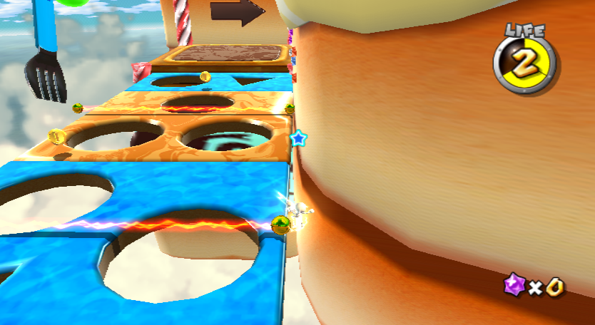
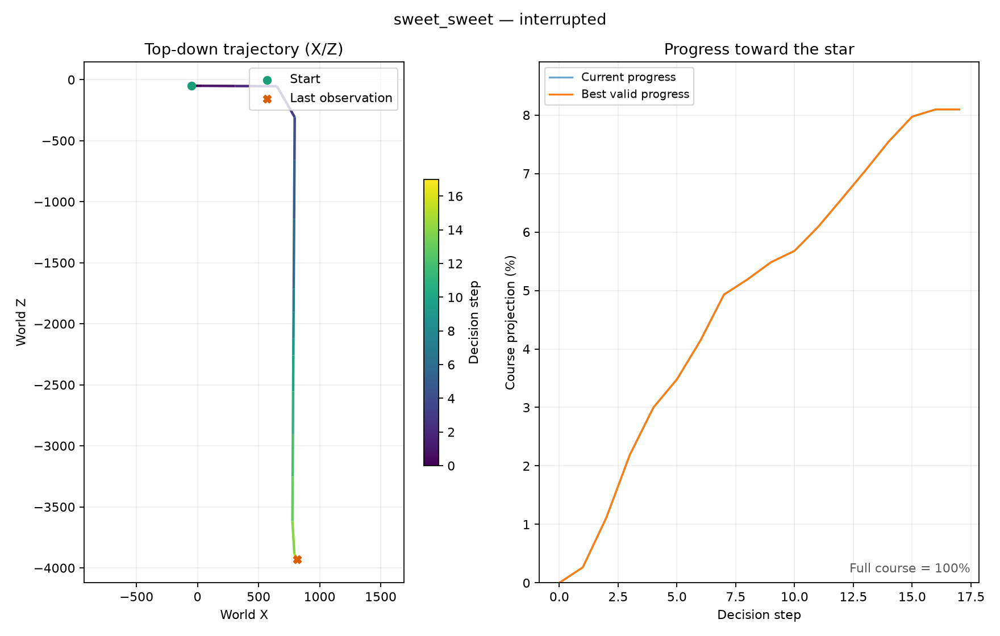

# Galaxy 1 health supervision and learner recovery

**Native backend update (2026-10-22):** the local learners now use
`config/native.yaml` and `config/smg1-native.yaml`, with shared-memory RGBA
capture and bounded frame stepping. The stock hotkey/PNG backend remains a
fallback. See [native controls, profiling, benchmarks, and migration](native-backend.md).
The older measurements below retain their original backend/timing context.

## Read-only health telemetry

For the supported USA Galaxy 1 executable (`RMGE01`), the dynamically resolved
MarioActor contains two big-endian unsigned 32-bit fields:

| Field | Wii address expression | Meaning |
| --- | --- | --- |
| `health` | `mario_actor + 0x380` | Current HP |
| `max_health` | `mario_actor + 0x3E0` | Current maximum HP |

These offsets come from the pinned
[Petari class layout](https://github.com/SMGCommunity/Petari/blob/bfa933645d969a8f0b4fea24f490370ee85e7c29/include/Game/Player/MarioActor.hpp)
and [health update implementation](https://github.com/SMGCommunity/Petari/blob/bfa933645d969a8f0b4fea24f490370ee85e7c29/src/Game/Player/MarioActor.cpp).
They are not host addresses or a fixed heap allocation. The existing executable,
stage, scenario, pointer and scene guards still apply. Accepted maximum values
are 1, 3 and 6, with current health between zero and the maximum. Unsupported or
implausible values fail closed. Both supplied Sweet Sweet baselines were read
as 3/3 during the live investigation.

Zero HP now triggers the Galaxy 1 death predicate even before its game-over
nerve becomes visible. Abyss deaths can retain nonzero HP; existing nerve-based
death detection therefore remains necessary. Galaxy 2's profile has no health
offsets enabled and continues to use its verified death predicates.

## Reward semantics

At reset, the damage tracker takes the restored HP as a fresh baseline. For
consecutive decision samples:

$$
L_t=\max(0,h_{t-1}-h_t),\qquad
r_t^{damage}=-0.25L_t\,\mathbf1[\neg dead_t\land\neg complete_t].
$$

The coefficient is `rewards.damage` in both Galaxy 1 configurations. Examples:

| Transition | Additional damage reward |
| --- | ---: |
| 3 to 2, alive | -0.25 |
| 2 to 2, still in hurt animation | 0 |
| 1 to 3, healing | 0 |
| Reload starting state | 0; baseline is reset |
| Health reaches zero / any death | 0 damage addition; the existing -2 death penalty applies |

No novelty bonus is earned on a sampled health-loss transition. The ordinary
progress reward and step cost remain in effect. No positive reward is added for
healing, and an unchanged hurt animation does not repeatedly charge damage.
Health, maximum health, sampled HP loss and damage penalty are stored in CSV/info
but never added to the policy observation. Policy input/action shapes are
unchanged, so existing paired checkpoints can resume with the new reward.

This detector measures **net health loss between decision samples**, not a
perfect event history. A loss and recovery occurring entirely between two samples
can cancel out. It does not claim frame-exact capture of every hit. It also does
not distinguish hazard types from the health counter alone.

## Recovery after observed infrastructure failures

The previous Galaxy 1 run failed at timestep 2224 and the Galaxy 2 run at 38096
after pause acknowledgment errors. Last complete recovery pairs were available
at 2048 and 37512 respectively. These failures are retained in their original
run logs rather than relabeled as successful training.

Pause commands now hold their dedicated DSU button for 120 ms, release for 35 ms,
and allow six bounded acknowledgment attempts. The longer pulse increases the
chance that Dolphin's hotkey poll sees the press under a transient scheduling
stall, at some throughput cost. Running-state acknowledgment now requires two
separate observed counter changes: a single queued screenshot/frame-advance tick
must not masquerade as an unpaused emulator. It is still asynchronous control.

The new `train-supervised` command launches a learner as an owned child. If it
fails, the supervisor selects the highest-timestep complete checkpoint pair,
checks policy metadata and curiosity ZIP integrity, and starts a fresh run with
the remaining decision budget. Policy-only emergency snapshots and incomplete
pairs are excluded. Retries back off up to 30 seconds. Missing status updates for
240 seconds trigger cleanup of the owned child process tree and recovery.

```powershell
.\.venv\Scripts\smg-rl.exe --config config/smg1-training.yaml train-supervised --workers 1 --steps 997952 --resume runs/smg1/parallel-EXAMPLE/model-2048.zip
.\.venv\Scripts\smg-rl.exe --config config/parallel.yaml train-supervised --workers 4 --steps 963628 --resume runs/parallel-EXAMPLE/model-37512.zip
```

The paths are examples; select an existing matching pair. `--steps` is additional
to the supplied checkpoint, and retries preserve the resulting total target.
There is one supervisor per learner. It records attempts and separate stdout/
stderr logs under `supervised-*`; each attempt retains its usual `parallel-*`
directory. Explicit stop markers stop the supervisor as well as the child, so
an intentional stop is not automatically undone. `status` includes supervisor
state; `report` includes supervisor liveness alongside the training evidence.

This does not fix every underlying emulator failure or guarantee uninterrupted
collection. Work after the latest completed checkpoint can be lost, and retries
can repeat while an external blocker persists. No failed action is replaced
with a fabricated successful transition. Changes to the reward and controller
timing should be recorded as a new experimental condition; resuming a previous
policy is an operational continuation, not an independent seed comparison.

## Measured live damage evidence

A dedicated validation run (`damage-validation-20261021-223158-726034`) walked
and jumped from slot 1 into an electrified obstacle. It observed **3 to 2 HP**,
with no death and no completion. Two subsequent decision samples retained 2 HP.
Reloading slot 1 restored 3 HP. In that particular heap allocation the fields
were at `0x810ACA2C` and `0x810ACA8C`; these are examples, not constants to hardcode.

The measured telemetry is retained in
[`damage-validation.json`](assets/smg1/damage-validation.json). Replaying those
measured states through the real `GalaxyEnv` reward code with intrinsic learning
disabled produced exactly one -0.25 damage addition; subsequent unchanged-HP
samples produced zero damage additions. The hit's total reward was approximately
-0.228728 because progress shaping and step cost also applied. This is **live
health validation plus a reward replay of measured states**, not a claim that
this validation route was learned by the policy.





The trajectory CSV preserves measured game coordinates/scene counters and the
replayed reward components. Replay host timestamps are deliberately omitted.
Validation artifacts are excluded from training success/progress reports. Input
timing is asynchronous, so replaying its action list on another run can require
adjustments near platform edges; the recorded trace is the evidence for this
specific observed transition.

The first supervised Galaxy 1 attempt subsequently stopped advancing frames. Its supervisor recovered automatically from the complete 2816-step pair, launched attempt 2 and continued collecting experience without manual intervention. This is observed live recovery, in addition to the controlled recovery/budget tests; it is not a claim that the underlying emulator can no longer stall.

The Galaxy 2 configuration now spaces emulator initialization by five seconds per worker index. This affects startup only; it reduces simultaneous controller/graphics initialization after intermittent verified-RAM boot timeouts. A failed startup remains an explicit failed attempt and is retried by its supervisor.
