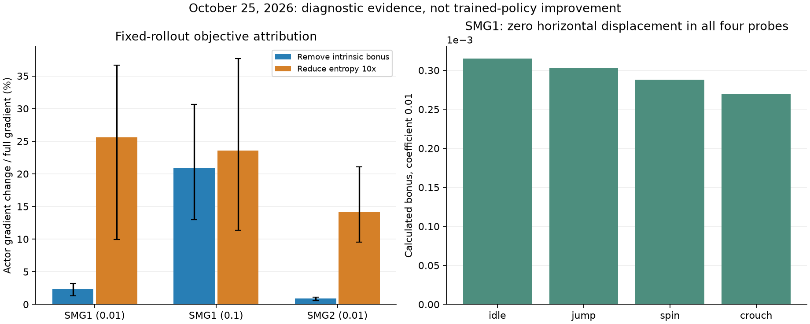

# Exploration and navigation failure analysis

> **Historical context:** Experiment status, authorizations, schedules and live counters in this document refer to their stated dates. Later work may supersede them; consult [current evidence and next experiments](current-status.md) and check actual process state before acting.

Date: October 25, 2026. Scope: retained Gaussian-RSSM world-model policies,
recorded full-start evaluations, read-only actor-objective attribution, and
bounded actual-game control fixtures. No policy was fitted during this audit.

## Assessment

The owner's hypothesis identifies a real mismatch: visual uncertainty is not
equivalent to useful spatial exploration. The current disagreement module
returns positive bonuses while Mario remains at exactly the same horizontal
position. However, the available evidence does **not** establish intrinsic
reward as the main cause of the current failure. At coefficient 0.01, removing
it from a fixed-rollout actor calculation changes the gradient much less than
reducing the entropy regularizer. The policy's short directional persistence,
action-space prior, weak progress target, and world-model/control limitations
also require investigation. More hours of unchanged collection are not an
evidence-based response to the observed plateau.

The practical recommendation is a controlled zero-intrinsic baseline, followed
by an independent entropy comparison, together with progress/control validation.
Do not globally delete curiosity and claim that navigation has been repaired.
No zero-intrinsic **trained-policy** comparison has yet been completed.

## What reward is actually active

There are two different exploration implementations:

- Legacy PPO combines inverse-dynamics visual features, episodic novelty and
  RND. Its environmental intrinsic reward has an episode budget and stall decay.
- The current world-model profiles set `use_legacy_curiosity: false`. Their
  replay targets contain extrinsic rewards. During imagined actor training,
  the reward is `predicted_extrinsic + disagreement_scale * disagreement`.
  The ensemble predicts the next learned visual embedding from latent state
  and action; its output standard deviation is the disagreement bonus.

Consequently, zero `intrinsic_reward` in a world-model episode CSV does not
mean that its actor was trained without curiosity. The legacy spatial-stall
budget does not apply to the imagined disagreement bonus. In addition,
`world_model.entropy: 0.003` rewards action-distribution entropy in the actor
objective, and `epsilon: 0.05` injects uniformly random actions at execution.
Neither is disabled by setting `disagreement_scale: 0`.

The implementation is an original compact Gaussian-RSSM baseline, not a
reproduction of NGU, Plan2Explore or DreamerV3. The conclusion here applies to
this implementation and these checkpoints, not to those methods generally.

## Primary research and interpretation

[RND, Burda et al.](https://arxiv.org/abs/1810.12894) distinguishes lack of
data, stochasticity and approximation error as sources of prediction error.
Its qualitative analysis also describes repetitive interaction with moving
objects after readily available task rewards have been exhausted. This makes
the owner's observation a useful diagnostic, not proof of a particular cause.

[Pathak et al., disagreement exploration](https://arxiv.org/abs/1906.04161)
specifically studies robustness to stochastic observations. Ensemble output
disagreement differs from next-image prediction error: it aims to measure
reducible model uncertainty rather than unavoidable noise.
[Plan2Explore](https://arxiv.org/abs/2005.05960) develops imagined exploration
using this distinction and subsequently trains task-oriented behavior. A small,
finite ensemble with changing learned features is not automatically a calibrated
information-gain estimator. A moving platform is also structured, potentially
predictable motion, not necessarily aleatoric noise. No platform-only masking
or causal image intervention was performed in this audit.

[DreamerV3, Hafner et al.](https://www.nature.com/articles/s41586-025-08744-2)
uses return-range normalization and an entropy coefficient of 0.0003. This
project uses a per-batch advantage standard deviation floored at one and entropy
0.003. The tenfold coefficient difference motivates an isolated test; differences
in architecture, return estimation and reward scale prevent treating the paper's
coefficient as an automatically correct replacement.

[Temporally extended epsilon-greedy, Dabney et al.](https://arxiv.org/abs/2006.01782)
identifies lack of temporal persistence as a limitation of dithering exploration.
This is directly relevant to the recorded short directional runs, but does not
show that blindly holding every action longer will solve platforming.

[Potential-based shaping, Ng et al.](https://people.eecs.berkeley.edu/~russell/papers/icml99-shaping.pdf)
establishes policy-invariance conditions for reward transformations. The current
positive high-water geometric reward is not generally the discounted potential
difference `gamma * Phi(next) - Phi(current)`. Its intended objective and failure
modes must therefore be tested rather than assumed to preserve the mission goal.
The high-water mechanism already prevents repeatedly collecting the same
forward/backward progress reward; the concern is not a trivial repeatable loop.

## Read-only objective attribution

Three retained policies were examined: SMG1 coefficient 0.01 at 298773 real
decisions, SMG1 coefficient 0.1 at the same counter, and SMG2 terminal-weight-5
policy at 895272 real decisions, coefficient 0.01. Their source hashes are in
the raw audit files. No original or trial checkpoint was overwritten.

For each policy, seeds 11, 23 and 47 selected four ordinary held-out replay
batches of eight sequences, length 32 and burn-in 8, with no terminal-tail
oversampling. Up to 128 nonterminal posterior states were selected uniformly
per batch; posterior context used mean latents, followed by eight sampled prior
steps. Each SMG1 audit used 12288 imagined diagnostic transitions; SMG2 used
11968 because some batches contained fewer eligible nonterminal states.
These are diagnostic computations, not training steps.
Each policy uses its own compatible retained replay, so differences between
policies are descriptive and are not a shared-data causal comparison.

On each **identical fixed rollout**, the diagnostic recomputed the actual actor
loss with the original critic, lambda returns, continuation weights, advantage
normalization and clipping. It used `autograd.grad` without an optimizer to
compare the original gradient with (a) zero intrinsic coefficient and (b) entropy
divided by ten. Modules and source file digests remained unchanged.

| Diagnostic mean over 12 batches | SMG1, 0.01 | SMG1, 0.1 | SMG2, 0.01 |
| --- | ---: | ---: | ---: |
| Actor entropy, nats; maximum is ln(54) = 3.989 | 3.514 | 3.490 | 1.836 |
| Posterior probability of an action containing jump/spin/crouch | 92.59% | 92.65% | 47.63% |
| Weighted disagreement bonus per imagined transition | 0.000436 | 0.004300 | 0.000459 |
| Gradient change when removing intrinsic / original gradient norm | 2.35% | 20.95% | 0.88% |
| Gradient change when reducing entropy 10x / original gradient norm | 25.58% | 23.58% | 14.19% |
| Cosine between original and zero-intrinsic gradients | 0.999724 | 0.977473 | 0.999977 |



Bars are means and whiskers are the minimum/maximum over the 12 diagnostic
batches, not confidence intervals or independent training replications.
Gradient change is `norm(g_original - g_counterfactual) / norm(g_original)`;
it is not a percentage of blame, explained behavior, performance or reward.
The critic remains fitted to its original objective. Removing intrinsic reward
would eventually change the critic, policy, replay distribution and model.
Historical cumulative effects and rare unseen states remain possible. These
measurements cannot replace a trained zero-intrinsic ablation.

Raw results:
[SMG1 control](assets/performance/smg1-objective-audit-20261025.json),
[SMG1 stronger curiosity](assets/performance/smg1-curiosity10x-objective-audit-20261025.json),
[SMG2 candidate](assets/performance/smg2-objective-audit-20261025.json).
These are reused validation data, not newly unseen test sets.

## Actual-game stationary and control fixtures

A dedicated hidden Dolphin profile loaded the SMG1 initial state separately
for idle, jump, spin and crouch. Each input lasted 24 decisions of 12 frames,
4.8 seconds at 60 game frames/s. RAM confirmed **zero X/Z displacement** in
all four sequences. The diagnostic observed actual captured images using the
frozen model's mean posterior and computed the bonus for the fixed input.

| Fixed input | Mean calculated weighted bonus | Mean successive image MSE |
| --- | ---: | ---: |
| Idle | 0.0003150 | 0.005443 |
| Jump | 0.0003034 | 0.005753 |
| Spin | 0.0002883 | 0.006225 |
| Crouch | 0.0002700 | 0.005499 |

This confirms that image changes and positive disagreement exist without
horizontal exploration. It does **not** show a special preference for jump,
spin or crouch: idle had the largest mean bonus in this short fixture. These
numbers are calculated bonuses, not intrinsic payments in an environment log.
No optimizer ran, so persistence over this 4.8-second observation is not a test
of how quickly ensemble fitting would eliminate uncertainty. Dynamic scenery,
Mario animation, camera effects, latent context and approximation error were
not separately identified. See [the complete 96-decision trace](assets/performance/smg1-stationary-bonus-20261025.json).

A separate fixture tested all 54 actions for one decision from an identical
initial state and all nine directions for up to 24 decisions, stopping on RAM
death/completion, for each of the three missions. This consumed 635 physical
decisions, under its maximum budget of 810. Inputs moved Mario: held directions
produced horizontal distances above 1000 world units in each mission. Most
straight walks fell and died; these distances are not route traversal evidence.
The controls are not globally disconnected or immobilized.

From the same cold-start mean latent, one-step reward prediction MAE was
0.00194 for SMG1, 0.00540 for Spinning and 0.00647 for Double Time. The actual
maximum reward contrast across those 54 actions was respectively 0.00386,
0.00326 and 0.00231. This raises a task-relevant calibration concern, especially
for SMG2: aggregate prediction gates can pass while errors are large relative
to the small action-dependent progress signal. Mean-latent predictions from
one initial context are not an estimate of stochastic population calibration
or proof of incorrectly ranked actions at all states.

The same traces also contain positive high-water progress increments after
Mario descends more than 50 units below initial Y: 22 steps in SMG1, seven in
Spinning, 15 in Double Time. This height threshold is a diagnostic, not a
ground detector; descending can be legitimate in other parts of a course.
The existing global -1800 cutoff does not establish safe platform contact.
Route/contact verification is necessary before interpreting geometric maxima
as useful navigation. Death penalties still apply; these samples do not prove
that falling is the policy's preferred net-return strategy.

All 731 physical fixture decisions are excluded from training counters and
mission-success claims. No replay was recorded, no learning occurred, private
profiles were used, and the owned Dolphin instances were closed. Raw evidence:
[control traces](assets/performance/control-probe-20261025.json),
[compact summary](assets/performance/objective-control-summary-20261025.json).

## Other concrete bottlenecks

1. **Action prior and temporal coherence.** There are nine directions times
   six modifier combinations. A uniform policy includes jump/spin/crouch in
   45/54 = 83.33% of actions before learning anything about novelty. The SMG1
   control videos contain 1045 decisions: 91.48% include a modifier, 52.44%
   include jump, 37.70% spin and 37.99% crouch; combinations overlap. The longest
   identical non-idle direction in the three episodes lasted four, six and four
   decisions, or 0.8, 1.2 and 0.8 seconds. This is consistent with dithering and
   poorly timed composite inputs. It is not a deterministic one-action collapse.
   A carefully tested directional/motor-skill prior and explicit press/release
   timing may help. Reducing frame skip alone or holding every button longer
   can instead worsen jump timing.
2. **Weak, path-agnostic progress.** Reward is five times positive high-water
   linear X/Z projection toward the goal, minus 0.001/decision, with death -2,
   timeout -2 and SMG1 damage -0.25/HP. Projection ignores course topology and
   actual platform contact. The SMG1 control video's total progress rewards are
   only 0.104, 0.145 and 0.144 per episode, versus step costs of 0.246, 0.340
   and 0.459, before the -2 timeout. This is not intrinsically wrong, but the
   useful action signal is small. A reported 2% need not mean leaving the
   initial platform, and no native mission percentage was found.
3. **History-dependent targets.** High-water progress and the 180-decision
   stall timer depend on episode history. Only pixels/scenario enter the
   model, with eight replay burn-in steps, so identical-looking local states
   can have different reward/timeout labels. A recurrent state could learn
   history but is not guaranteed to recover it from short replay context.
   The -2 stall reset is currently a truncation with continuation target one.
   External time limits and task-defined failure resets should be reviewed
   separately; blindly marking every truncation terminal would also be wrong.
4. **Prediction gates are necessary, not sufficient.** Pixel MSE and aggregate
   reward/continuation errors do not establish counterfactual action ranking,
   hazard/contact understanding or long-term navigability. The short action
   probe above exposes the gap between reward-error tolerance and task signal.
   Keep existing gates and add task-specific checks rather than loosening them.
5. **Limited effective policy improvement.** In the last paired SMG1 10000-step
   blocks, 1248 world-model updates yielded only 113/115 actor updates because
   imagination is gated. The control checkpoint's 298773 real decisions
   correspond to 1231 actor updates, not 298773 actor updates. Updating a model
   for hours does not guarantee that its policy receives useful gradients.
6. **Horizon and task learning.** Eight imagined actions cover 1.6 seconds
   directly, with the critic bootstrapping beyond them. The completed 8/16
   comparison showed no consistent navigation benefit. Longer imagination
   alone is not a remedy. The reward head also cannot invent the unseen +20
   star reward because predictions are clipped to observed reward support.
   Near-star detector fixtures must remain excluded from learned completions.

SMG1 recorded zero HP loss in the recent paired training/video evaluations;
this is consistent with failing to reach hazards. It does not establish learned
damage avoidance or make the correctly detected HP penalty the demonstrated
cause of the initial-platform plateau.

## Interpretation of previous experiments

The 10000-new-real-decision SMG1 comparison of coefficients 0.01 and 0.1
showed no clear navigation gain and less robust terminal calibration for 0.1.
This argues against increasing curiosity again. It does not answer 0 versus
0.01. SMG2 terminal weighting improved model prediction gates and actor-update
availability without observed navigation improvement. Frontier pilots verified
savestate mechanics, not curriculum effectiveness. Throughput improvements
reduced execution time, not demonstrated time to mission completion.

No full-start mission has been learned. Long plateaus justify changing the
experiment, but there is no universal number of hours or steps at which a
visual RL agent must solve a new 3D platforming task.

## Recommended bounded experiment, not launched by this audit

First validate a manually specified safe initial-platform exit or short motor
sequence using actual telemetry/video. This is a control fixture or demonstration,
not a trained success. Establish a waypoint/contact-aware evaluation criterion;
keep geometric projection separately labeled. Do not reward any apparent pixel
change or total traveled distance as progress, because both admit local loops.

Then use a paired 2x2 diagnostic: intrinsic coefficient {0, 0.01} and entropy
{0.003, 0.0003}, initially on SMG1. Preserve the original checkpoint and critic,
use independent copies per arm, equal fitting/collection budgets, identical
predeclared seeds and start schedules, unchanged gates, and separate online
replay. Include critic adaptation to the changed objective in equal declared
budgets; turning a reward coefficient off during evaluation alone cannot undo
a learned policy. Three actor/collection seeds from one retained world model
are not three independently trained world models.

Use a small initial health block, then 2000 new real decisions per eligible arm
and review safe exits, modifier frequency, direction persistence, reward
components, deaths/HP and model ranking. Extend to 10000 only for a justified
comparison; do not infer convergence from an unchanged short warm-start policy.
Confirm any promising result in both SMG2 missions with fresh bounded budgets.
If all arms still dither, stop extending them and test a direction-focused
action prior or short temporal skills as a separate intervention. Those changes
require explicit action semantics/signature versioning and new compatible data.

Progress-reward changes also need a new reward revision and replay/checkpoint
compatibility handling. Existing replay contains images and scalar rewards,
not RAM trajectories for reliable route/contact relabeling. Do not silently
mix a new reward target with old replay or erase legitimate progress whenever
an episode eventually dies. A route potential must be validated with terminal
handling and the chosen discount before claiming policy invariance.

This ordering tests the owner's hypothesis directly while avoiding another
large mixed intervention whose cause cannot be identified.

## Reproduction and checks

From the project root, use the project virtual environment. The audit does not
start Dolphin or invoke an optimizer:

```powershell
.venv\Scripts\python.exe -m smg_rl.objective_audit --config config/staged-smg1-control.yaml --checkpoint runs/staged-smg1-exploration/control/world-model-20261025-004551-267957/world-final.pt --output .local/reproduced-smg1-objective.json
.venv\Scripts\python.exe -m smg_rl.objective_audit --config config/staged-smg1-curiosity_10x.yaml --checkpoint runs/staged-smg1-exploration/curiosity_10x/world-model-20261025-013015-684847/world-final.pt --output .local/reproduced-smg1-curiosity10x-objective.json
.venv\Scripts\python.exe -m smg_rl.objective_audit --config config/staged-smg2-terminal_reward_weight.yaml --checkpoint runs/staged-smg2/terminal_reward_weight/world-model-20261025-010019-701413/world-final.pt --output .local/reproduced-smg2-objective.json
```

Optional repeatable actual-game fixtures use dedicated project-owned profiles,
load initial states and close their emulators. They do not write replay or fit:

```powershell
.venv\Scripts\python.exe scripts/probe_controls.py --output .local/reproduced-controls.json
.venv\Scripts\python.exe scripts/probe_stationary_bonus.py --output .local/reproduced-stationary.json
.venv\Scripts\python.exe scripts/summarize_objective_audit.py
```

The source scripts retain the dated scenario/checkpoint definitions. Outputs
refuse to overwrite prior raw evidence. Default audits use three seeds and
four batches; `--recording RUN_DIRECTORY` optionally adds existing video-trace
statistics. Portable tests check loss equivalence with the current trainer,
zero-bonus attribution, and unchanged model weights/counters. At completion,
130 portable tests and Ruff passed. No continued training is scheduled.
