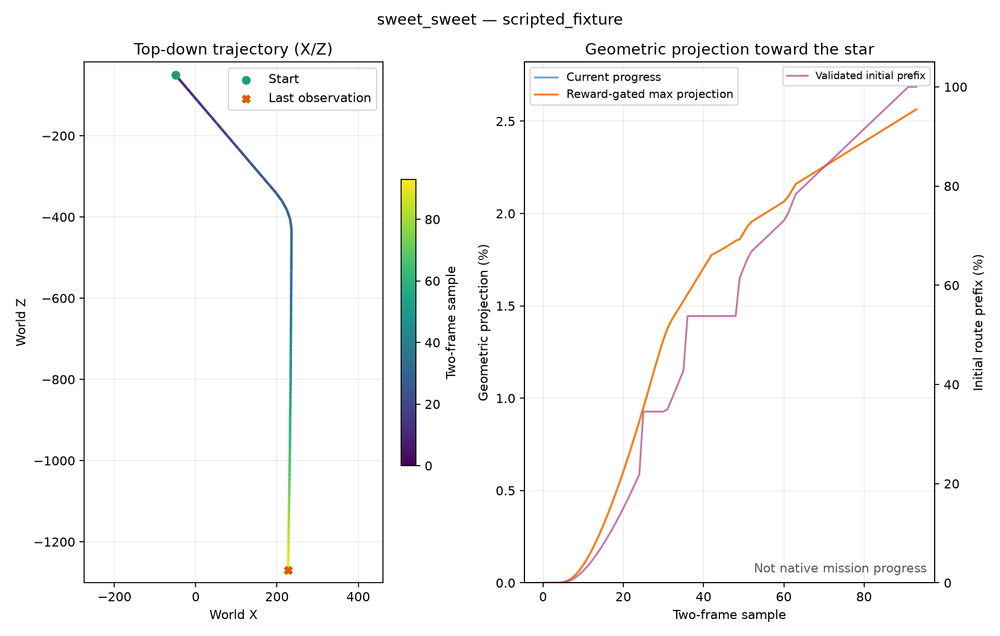

# Reviewed exploration, motor control and route interventions

> **Historical context:** Experiment status, authorizations, schedules and live counters in this document refer to their stated dates. Later work may supersede them; consult [current evidence and next experiments](current-status.md) and check actual process state before acting.

**Superseded action plan:** later on October 25 the owner requested exactly eight
exclusive actions in both games. Remaining legacy54 factorial and motor16 stages
were stopped/superseded, with all collected data and checkpoints retained. See
[the current motor8 protocol](motor8-and-algorithms.md). Historical observations
below do not imply that the superseded full factorial finished.

Authorized on October 25, 2026 after the owner requested implementing the
[failure-analysis recommendations](exploration-failure-analysis.md). This is
a finite staged experiment, not permission for indefinite training. Live state
is in `.local/exploration-trial-state.json` and `.local/motor-intervention-state.json`.
All original PPO/world-model checkpoints, ROMs, savestates and emulator profiles
remain retained. Current results below are explicitly dated; use the local state
and run artifacts for subsequent stages.

## Findings that changed the experiment

The SMG1 initial path runs mostly in the negative-Z direction. The original
goal vector is approximately (+26731, -11935) in X/Z. A straight projection to
the final star therefore favors lateral X motion, even while the safe initial
route requires turning into a forward lane. This is a concrete course-topology
mismatch, not evidence that all past geometric progress was useful navigation.

A private manual survey found a safe initial exit. A fresh scripted validation
then reproduced it from slot 1: diagonal forward/right for 54 emulated frames,
then forward for 132 frames. Mario reached approximately (227.36, -50.00,
-1269.68), on the first pink belt, with 3 HP and contact with the ground.
No star was collected. The survey and validation are **scripted fixtures**,
not learned policy successes or training replay.

The game includes a legitimate roughly 95-unit descent from the initial platform
to the belt. Consequently, replacing progress with a simple initial-height
cutoff would wrongly reject this safe exit. Contact and route context matter.

## New RAM contact measurement

For the verified USA RMGE01 executable, resolve `MarioActor` through the existing
object graph, then read its `Mario*` at actor + 0x230. The first movement-state
word is at Mario + 0x008; big-endian mask 0x40000000 is the ground-contact flag.
The source layout is the locally pinned Petari revision described in
[the Galaxy 1 report](smg1.md). Its movement update assigns this flag from
`checkGround()` and clears it for jump/fall transitions.

Fresh actual-game traces verified initial grounded contact, airborne samples
during jumping, renewed contact after landing, airborne falling, and grounded
contact along the scripted exit. Pointer bounds/alignment and executable checks
still apply. This measurement is logged as `grounded`; it is not a neural-network
input. SMG2 has no verified contact offset here and reports `None`; the SMG1
address is never assumed valid for SMG2.

[Complete scripted contact/route validation](assets/performance/smg1-initial-route-validation-20261025.json)
and its local video `runs/scripted-initial-exit-20261025/scripted-fixtures.mp4`
are retained. Samples in the plot are two emulated frames apart, not twelve-frame
learner decisions.



The left scale on the right-hand chart is the original global geometric
projection. The independent right scale is the fraction of the **short validated
initial prefix**. Reaching 100% of that prefix is not completing the mission.

## Sixteen motor actions and exact timing

`actions.profile: motor16-v1` contains nine walking/idle directions, five jump
actions (stationary and four cardinal directions), stationary spin, and
stationary crouch. It removes diagonal jump combinations, jump/spin composites
and the Cartesian product with crouch. The legacy54 profile remains available
for existing checkpoints and the isolated curiosity/entropy comparison.

Each motor decision advances exactly twelve emulated frames. Jump and spin
hold their button for eight frames and release it for four while retaining the
requested directional input. Walking and crouch hold their inputs for all twelve.
This release occurs **inside emulation**, so consecutive jump choices include
a new button edge. Native frame accounting must still report twelve frames.
The video backend captures the same 8+4 timing in two-frame samples. Other
backends and frame lengths are rejected for this profile.

The replay/checkpoint signature includes the sixteen action names and explicit
execution revision. Loading a legacy54 checkpoint as a motor16 checkpoint is
rejected. `motor_transfer.py` is an explicit, recorded transfer: it selects the
corresponding GRU/ensemble action columns and retains visual/latent dynamics.
The actor, critic, reward predictor/support and optimizers start fresh, with an
initial action prior of 80% walking/idle, 15% jump, and 2.5% each spin/crouch.
New counters start at zero; provenance separately retains the source's 298773
real decisions. This is pretrained representation reuse, not training from
scratch or an isolated test of action count alone.

`warmup_epsilon: 0.15` keeps this motor prior active during initial collection;
the legacy default remains uniform exploration until the first actor update.
Prediction gates remain unchanged. Transferred predictions must be revalidated
against **fresh compatible replay**, since button timing changed.

Native motor validation confirmed exact frame counts and reproduced the scripted
safe exit with integer twelve-frame motor decisions. An initial validation-script
attempt used a noncanonical tuple order for a diagonal action and stopped with
`tuple.index` before that sequence; it was corrected and the fresh retry passed.
The partial validation run is retained and never counted as learning.

## Ordered route-prefix evaluation and optional reward

`config/routes/smg1-initial-exit.json` defines the validated four-waypoint prefix.
`RouteProgress` enforces segment order, a horizontal corridor, interpolated
height tolerance, current RAM ground contact, and initial HP preservation.
Two grounded samples near the final waypoint confirm a safe initial exit.
Airborne movements and unrelated distant geometry cannot earn prefix progress.
High-water credit prevents repeated forward/backward payments. Resets outside
the route start are ineligible, preventing assisted-teleport reward gifts.

The prefix evaluator is present in all new SMG1 experiment logs, including arms
that still use the original reward. It does not change their policy inputs,
reward target or legacy replay signatures. `route_prefix_progress` and
`route_prefix_exited` are separate from geometric projection and RAM star
completion in CSV, episode summaries and status snapshots.

Only `config/motor16-smg1-route.yaml` enables route reward. It disables global
projection reward and adds five times positive grounded prefix advancement.
The route JSON SHA256, weight and new reward revision are signature-protected.
Its independent replay cannot be mixed with the motor control or legacy data.
This is an initial-exit curriculum reward, not claimed policy-invariant shaping
or a complete full-course reward map. After a learned exit is established, later
segments require new actual route validation before extension.

## Experiment A: curiosity and entropy factorial

Four arms change only imagined curiosity coefficient and actor entropy scale:

| Arm | Disagreement coefficient | Entropy coefficient |
| --- | ---: | ---: |
| control | 0.01 | 0.003 |
| no_intrinsic | 0 | 0.003 |
| low_entropy | 0.01 | 0.0003 |
| no_intrinsic_low_entropy | 0 | 0.0003 |

All start from the same SMG1 retained control checkpoint. Seeds are 11, 23 and
47: twelve warm-start cases, **not twelve independently trained world models**.
Each case first gets 64 critic-only imagined updates for its objective, followed
by 128 actor/critic imagined updates. All use equal budgets and paired RNG
schedules. World weights and real/model counters remain unchanged during this
adaptation. Imagined-transition counts include critic-only rollouts; actor counts
include only actor updates. Original actor weights are checked unchanged at the
critic-only boundary.

Eight frozen reused held-out batches and all three validation seeds must pass
the unchanged source model gates before any arm is fitted. All twelve initial
adaptations completed and the source audits passed 3/3. These are reused audit
data, not unseen external tests.

Each online case starts with its own immutable hardlinked replay snapshot;
new files, retention and subsequent collection are independent. Hardlinks share
read-only source bytes, not mutable experience streams. The controller has an
OS writer lock plus recorded PID/creation time and rejects duplicate dispatch.
Each command starts exactly one finite block and stops. No command automatically
starts its successor.

Stages are 256 new real decisions for initial health, then **2000 cumulative**
new decisions per eligible case, after recorded review. The first comparison
therefore totals at most 24000 new decisions. Reviews inspect errors, timestamps,
replay rejection, gates, real/model/actor/imagined accounting, route exits,
geometric traces, deaths, HP and modifier frequency. A failing final gate does
not imply a process failure; it blocks actor updates and requires inspecting
its specific prediction errors before extending a block.

Only after the complete first comparison may a justified, matched control and
candidate pair extend to 10000 cumulative new decisions per case across the
same three seeds. The maximum extra allocation is 48000 real decisions. Require
actual safe exits or a clear consistent navigation improvement without a new
failure mode; a slightly larger global projection alone is insufficient.
Otherwise stop the factorial and review the motor/route intervention instead.

Initial seed-11 health observations: control and zero-intrinsic each completed
256 decisions without death, HP loss or replay errors, with final gates passing.
Their sampled traces and 34.53% maximum **local-prefix** progress matched; neither
confirmed the safe exit. This is no evidence yet of navigation improvement from
turning curiosity off and is too small to establish equivalence.

## Experiment B: compatible motor collection and route reward

Two matched motor16 branches use the same transferred world and fresh policy
prior, zero intrinsic coefficient and entropy 0.0003. One retains the old
geometric reward; the other enables the prefix reward. Their checkpoints,
profiles and replay are separate. This is a single-seed engineering pilot, not
a substitute for the three-seed factorial or proof that any one motor change
caused a result.

Each bootstrap collects at most 4096 real decisions. With fresh replay, model
gates can initially block updates; bootstrapping is not described as learned
improvement. Review collection health and trajectory metrics before a bounded
offline block of 128 cycles, at most 512 model and 128 eligible actor updates.
Review those gates before collecting 2000 additional decisions per branch.
One additional 128-cycle block is permitted only after documented evidence of
improving prediction with the original gates still intact. Stop if quality
does not support policy learning rather than relaxing thresholds.

Both branches have a maximum of 6096 new real decisions in this pilot, 12192
combined. The primary first-stage total across A and B is at most 36192 real
decisions, excluding explicitly labeled fixtures and diagnostic evaluations.
Engineering bootstrap collection can overlap factorial fitting/collection;
data and objectives are isolated, and wall-clock speed is not compared as a
controlled experimental outcome under different machine loads.

## Review and continuation operations

```powershell
.venv\Scripts\python.exe -m smg_rl.exploration_trial initialize
.venv\Scripts\python.exe -m smg_rl.exploration_trial online --arm control --seed 11 --target 256
.venv\Scripts\python.exe -m smg_rl.exploration_trial review --arm control --seed 11 --decision continue --reason "Explain the completed evidence and why the next bounded stage is justified."
.venv\Scripts\python.exe -m smg_rl.exploration_trial online --arm control --seed 11 --target 2000
```

Initialization refuses to overwrite the experiment. Online dispatch requires
the previous cumulative boundary and review. Do not rerun completed jobs.
If a process fails mid-block, preserve its checkpoint/logs, count any collected
decisions, diagnose it and document recovery before launching a replacement.
Use `STOP` in the active run for graceful finite interruption, not broad process
termination. PID matches also require process creation time to avoid PID reuse.

The follow-up reviews only this finite protocol, remains quiet on unchanged
state and reports completed stages, findings, failures or required input in
Portuguese. It must retire when the authorized stages finish or the owner stops
the experiment. It cannot turn this into indefinite training or touch unrelated
jobs. A promising SMG1 result can motivate a newly documented bounded confirmation
in both SMG2 missions; route/contact measurements must be validated for SMG2
before reusing any SMG1 address or route specification.

Portable tests cover exact pulse release/counts, signature separation, ordered
grounded route rewards, unchanged actor/world during critic-only adaptation,
action-column transfer, separate counters, writer-lock exclusion, finite budgets
and mandatory review boundaries. The last completed suite passed 137 tests and
Ruff. Raw status files remain the authority for current live results.
