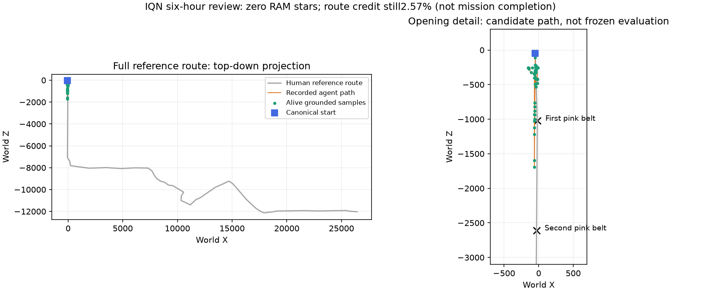

# SMG1 IQN: owner-authorized 24-hour ceiling

## Authorization and retained source

On October 29 the owner requested immediate training, at most 24 hours, and
results every six hours. This supersedes the expired two-hour allocation, not
its accounting. The new once-only supervisor is `scripts/run_iqn_day.py`.
Its local ledger is `.local/iqn-day-20261029/state.json`; `snapshot` reads actual
process identities and the latest published run status without dispatching work.

The source is the audited resource-stopped four-worker candidate at **274,494
real decisions, 3,040 completed attempts and 68,109 optimizer updates**. Its
checkpoint is retained under
`runs/model-free/density-four-worker-20261029/dqn-20261029-100929-298752/checkpoint-final`.
It had zero RAM-confirmed full-start stars. The source audit is
`docs/assets/performance/density-four-worker-stop-20261029.json`; the new
supervisor rechecks the checkpoint, replay, ancestry, reward and CSV accounting.
The older supervisor ledger's last reviewed count of 263,486 excludes its
subsequently audited partial block and must not replace the 274,494 source.

No source file is overwritten. Online/target networks, optimizer, replay,
sampling RNG and counters resume exactly. Each later checkpoint is checked
before a successor starts. Four collectors preserve the existing replay worker
layout; no six-worker migration or action-head transfer is introduced.

## Method and configuration

`config/iqn-day-smg1-20261029.yaml` retains the source learner/reward/action/start
signatures and changes only the owned output/profile locations. The method is
model-free **IQN with Double/dueling/NoisyNet, prioritized replay and three-step
targets**, using a trainable **IMPALA CNN**, **four stacked 84x84 grayscale
frames**, eight exclusive motor actions and frame skip 12. It has no recurrence,
world model, synthetic transitions, genetic updates or novelty bonus. Collection
continues at epsilon 0.1 with NoisyNet exploration. Replay capacity is 50,000.

The eight actions remain none, right, left, forward, backward, jump, spin and
crouch. The owner's report of a YouTube BTR agent with six actions is context,
not a requested incompatible action-space migration or a controlled benchmark.
Neither its halfway time nor its first-completion time predicts this run.

The signed full human route and grounded ordered-landing rules remain in force,
with progress scale 17.323910361805048 over the 37,872.5332-unit reference,
star +20, death/timeout -2 and nonfatal HP loss -0.25. No reward relabeling,
normalization change or optimizer reset is performed. IQN quantile targets are
not clipped to the categorical Rainbow support; the retained `v_min/v_max`
settings do not impose a fixed C51 support on this IQN branch.

The shared worker code now uses the valid `No Audio Output` backend. This is an
intentional environment repair, not bitwise uninterrupted emulation. The owner
restarted Windows before this run: pool accounting returned to low levels and
the native executable became runnable. A separate 30-second no-learning native
preflight completed 585 decisions with **no EtwD/Etwr byte growth**. Those
decisions were not inserted into replay and are not training attempts or stars.
This successful check supersedes the earlier startup rejection for this run;
no security policy was changed by the project.

## Budgets, reviews and reporting

The supervisor started at **13:12:55 BRT on October 29**, with an absolute
deadline of **13:12:55 BRT on October 30** (16:12:55 UTC). Reports are requested
around 19:13, 01:13, 07:13 and 13:13 BRT. A thread follow-up records those reports;
the local supervisor enforces the deadline independently of the scheduler.

The health block is at most 3,072 new decisions or 300 seconds. After its audit,
the next block is at most 900 seconds; subsequent blocks are at most 1,800
seconds each. Every subprocess has the same absolute deadline and a finite
decision cap. There are at most 56 dispatches and ten million new decisions;
these are ceilings, not sample targets or promises. A 180-second reserve avoids
dispatching collection into the cleanup boundary. Loading, audit and cleanup
consume wall time, so actual collection time is less than the 24-hour ceiling.

Safety retains the 2 GiB in-collection physical-memory guard, requires 6 GiB
physical/commit headroom before dispatch and checks disk headroom. ETW growth
above 64 MiB in one block requires diagnosis. A controller ignoring its normal
budget is first asked to stop and eventually has only its owned process tree
terminated; the evidence is retained and there is no automatic retry. An
exclusive supervisor lock, durable pending/running/reviewed job identities and
actual PID creation times prevent duplicate collection. Source hashes are
verified again at finalization. Healthy lack of a star alone does not terminate
the owner-authorized allocation early.

Keep all block checkpoints, trajectories, attempt ledgers and errors for this
allocation. At about 0.53 GB per checkpoint, the finite dispatch ceiling can
retain roughly 30 GB of checkpoint data plus telemetry; the preflight volume
had approximately 321.6 GB free. No automated deletion of older experiments,
ROMs, states, profiles or checkpoints is authorized by this supervisor.

TensorBoard is bound to `127.0.0.1:6006`, with the existing history at
`runs/model-free/tensorboard`. The supervisor owns a newly started server and
closes it when this allocation ends; an already-existing server is not stopped.

Every six-hour report should give actual new/cumulative decisions and optimizer
updates, completed and active attempts, throughput, reward, HP/deaths, action
occupancy, trajectories and native RAM stars. Track full human-route fractions
as route metrics, never native mission percentages. Coordinate landmark
candidates require visual confirmation. The older invalid first-section and
geometric percentages must not be reinstated. Collection maxima under
exploration are not frozen-policy evaluation results; no additional frozen
episodes are automatically allocated by this supervisor. There is no SMG2,
Center of the Universe or BTR training in this run.

At completion or an actionable stop, retain partial accounting and report the
actual outcome. Do not silently extend the deadline or retry. The six-hour
follow-up should retire after its final report. Portable validation before
dispatch passed 25 background/native/pool/supervisor tests and Ruff.

## Initial health review

The first block completed and passed its checkpoint/replay/CSV/reward audit:
3,072 new real decisions, 17 completed attempts and 768 optimizer updates.
The retained health checkpoint is at 277,566 real decisions and 3,057 attempts,
with no star. Combined EtwD/Etwr growth across this four-worker block was only
416 bytes. The main 900-second block then started; its live visual-encoder probe
confirmed changing convolution weights and a nonzero gradient. These are health
and learning-operation observations, not a new performance or completion result.
The [launch audit](assets/performance/iqn-day-launch-20261029.json) retains exact
source/configuration identities and health evidence. Subsequent results require
the live ledger and scheduled reviews.

## Six-hour review: October 29, 19:16 BRT

The [six-hour audit](assets/performance/iqn-day-six-hours-20261029.json) uses
the live acknowledged status timestamp 22:16:49 UTC. Training was still running
with four owned emulators, a live controller/supervisor and no reported error.
Thirteen closed blocks passed their mechanical audits with zero CSV/replay
decision gaps; the fourteenth was still collecting. Source and latest reviewed
agent/replay hashes matched their manifests, and the configuration was unchanged.

| Counter | New in this allocation | Cumulative in the branch |
| --- | ---: | ---: |
| Real decisions | 790,084 | 1,064,578 |
| Optimizer updates | 197,521 | 265,630 |
| Completed attempts | 4,732 | 7,772 |
| Native full-start stars | 0 | 0 |

The new attempts included 2,772 deaths and 1,960 timeouts. Nonfatal HP loss
reported by the blocks was zero. Current-block throughput was 36.71 decisions/s;
this excludes startup/audit gaps and is not end-to-end wall throughput. Loss
and gradients were finite, and the active block's visual-encoder probe showed
changed weights and a nonzero gradient. The completed-attempt return mean was
approximately -1.751; its active-block ledger tail was read after the counter
snapshot and remains provisional.

**No new credited-route maximum was demonstrated:** the best alive-grounded
recorded credit remained 0.02569997 of the full human route, equal to the
source's retained best. This is ordered waypoint/landing credit, not 2.57% of
native mission completion or an estimate of the fraction of physical terrain
covered. In the conservative landmark scan, 2,161 episodes had a first-pink-belt
coordinate candidate and 2,165 had none; 473 were excluded for nonfinite or
discontinuous observations. No eligible trace produced a second ordered
landmark candidate. These are coordinate candidates, not visually confirmed
surface visits, and excluding a trace does not prove its earlier prefix was
invalid. There was no new frozen-policy evaluation.

Across the 769,348 decisions in closed reviewed blocks, actions were about
35.0% none, 20.2% jump, 13.0% forward, 12.7% spin, 7.2% crouch, 6.2% backward,
3.2% right and 2.7% left. These collection occupancies do not establish a
deterministic final policy. The representative plot was selected by ordered
landmark count, then credited route fraction, then proximity to the next
landmark. It belongs to a closed reviewed block and ended in timeout.



Memory remained healthy: approximately 12.92 GiB physical memory and 47.53 GiB
commit headroom were available; kernel paged/nonpaged pools were about
0.93/0.72 GiB and EtwD/Etwr together were 243,088 bytes. About 298.5 GB of disk
space remained. No block or supervisor stderr output was found. The audio
correction remained effective over the first six hours rather than only in the
initial short probe. This establishes operational stability, not learning
success or immunity to every future memory issue.

The owner explicitly requested a 24-hour trial: healthy collection continues
under the unchanged absolute deadline, signatures and guards. This review does
not allocate new training, change rewards/actions or retry a failed block.
The next requested report remains around 01:13 BRT on October 30.

## Local commands

```powershell
.venv\Scripts\python.exe scripts/run_iqn_day.py snapshot
```

The once-only `supervise` command has already been dispatched. Do not execute
another copy. To request a graceful owner stop, create
`.local/iqn-day-20261029/STOP`; the current block receives its own STOP marker
and no successor is dispatched.
