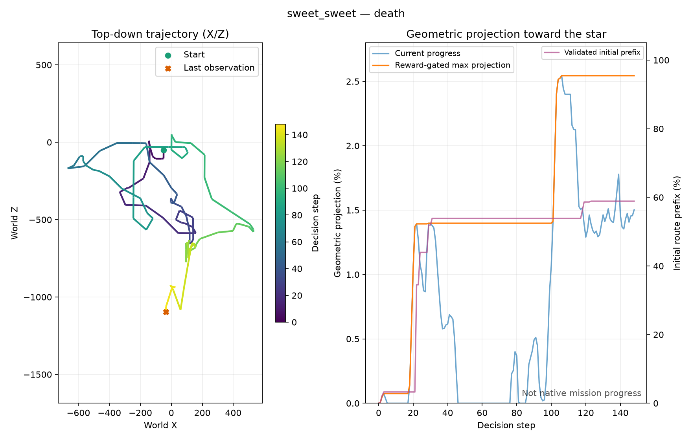

# Eight exclusive actions, visible policy inputs and algorithm comparison

Date: October 25, 2026. This is the current owner-authorized intervention,
superseding the remaining legacy54 factorial and motor16 stages in
[the previous protocol](exploration-interventions.md). All prior runs, partial
snapshots, fitted policies and original final checkpoints are retained. No
superseded experiment is declared completed because its remaining budget was
replaced. Live reviewed state is `.local/motor8-state.json`.

## Exactly eight actions in both games

The owner supplied an eight-action design based on an attached screenshot and
[a reference video](https://youtu.be/UePR1vHzWYA). The screenshot was inspected;
the fetched YouTube page did not expose the control implementation or a usable
transcript. We do not infer the video's exact timing or training algorithm from
its action-value graphic.

The versioned `motor8-v1` profile is:

| Index | Label | Applied input |
| --- | --- | --- |
| 0 | None | No controls |
| 1 | Right | D |
| 2 | Left | A |
| 3 | Forward | W |
| 4 | Backward | S |
| 5 | Jump | Wii A / configured left mouse button equivalent |
| 6 | Spin | Wii shake / configured middle mouse button equivalent |
| 7 | Crouch | Nunchuk Z / configured Shift equivalent |

There are no diagonals and no simultaneous jump/direction or other composite
actions in this profile. A decision advances twelve emulated frames. Jump/spin
are pressed for eight and released for four; all other decisions hold their
single control or None for twelve. Repeated jumps therefore have explicit
button-release edges. No direction is silently retained as a pressed control
during the jump; any horizontal movement comes from game physics/inertia and
subsequent decisions.

The live fixture checked all eight inputs, exact frame counts and a jump after
walking in SMG1 and both SMG2 missions. Horizontal displacement during the
exclusive jump was 117.19 world units in SMG1 and 75.67 in each SMG2 mission;
height gain was about 189.8. A scripted sequence of right then forward also
reproduced the grounded, undamaged SMG1 initial exit without diagonal or combined
inputs. All checks passed in **68 physical fixture decisions**. This validates
initial control, not the reachability of every later obstacle with eight actions.

See [the raw control validation](assets/performance/motor8-control-validation-20261025.json).
These are scripted fixtures, not learned mission successes or training replay.

## Configuration, transfer and compatibility

Recommended profiles are `config/motor8-smg1.yaml` and
`config/motor8-smg2.yaml`; the CLI now defaults to the latter. Historical profiles
retain their old semantics for reproducibility and protected checkpoint loading.
The low-level `load_config()` historical default remains `config/default.yaml`;
pass an explicit recommended profile in Python integrations. New recommended
profiles default to a bounded 256-decision health check rather than one million.

The eight action names and `motor8-v1:12-frames:jump-spin-8-on-4-off` execution
revision are part of replay/checkpoint identity. Existing 54/16-action replay
cannot silently become eight-action replay. Explicit motor transfer retains
visual/latent representation, projects GRU/ensemble action columns and starts
a fresh actor, critic, reward predictor/support and optimizers. Counters start
at zero for newly collected decisions, with source counts/hashes separately
retained in provenance. This is representation reuse, not learning from scratch.

The initial prior allocates 80% to the five None/directional actions, 15% to
jump and 2.5% each to spin/crouch, plus the declared warmup epsilon mixture.
The source policies/checkpoints are not overwritten. Transferred predictions
require unchanged quality gates on fresh compatible replay before actor learning.
Route specifications are byte-hashed; `.gitattributes` disables line-ending
conversion for `config/routes/*.json` so checked-out bytes remain consistent
with protected replay/checkpoint signatures on Windows and Unix.

## What the videos show

World-policy recordings now include:

- The normal rendered game.
- The exact cropped grayscale image that was supplied to the actor for the
  current decision, enlarged with nearest-neighbor interpolation. It stays
  fixed throughout that decision rather than showing a misleading newer input.
- Eight labeled input indicators updated from the controls actually applied
  during each two-frame sample, including the four-frame jump/spin release.
- For eight-action actors, the categorical action probabilities including the
  evaluation epsilon mixture. These are **probabilities, not Q values**.
- Selected action, episode/decision, source real/actor counts, RAM position,
  HP, death and star-completion evidence.

The world-model actor uses the latest grayscale frame plus recurrent latent
memory and scenario identity; its internal memory is not visualized. RAM values
in the overlay are telemetry and reward/evaluation labels, not actor inputs.
The sidecar `policy.inputs.jsonl` records applied controls and the SHA256 of each
displayed policy image, so pulse release and image retention can be checked.
Recordings of a newly transferred actor are explicitly labeled **UNTRAINED POLICY
PRIOR**. They must not be described as the old policy's retained competence.

Three such initial previews were recorded, one per mission, with seed 11. Stream
metadata, frame counts, image-digest retention and exclusive applied controls
were checked; jump/spin samples correctly show four pressed two-frame samples
and two released samples. The SMG1 panel was visually inspected. These clips
show the new instrumentation and initial prior, not improved trained agents.
See [the verified preview manifest](assets/performance/motor8-video-previews-20261025.json).

Capture uses full RGBA followed by the existing OpenCV preprocessing path, while
compact native training capture uses its checked CPU conversion. Small pixel
differences between those paths remain possible; the displayed inset is the
exact image used during that recording. Full input/encoding capture can be slower
than training; video wall-clock speed is not a training-throughput benchmark.

## Which changes apply to SMG2

| Change | SMG1 | SMG2 |
| --- | --- | --- |
| Eight exclusive actions, pulse timing and signature protection | Implemented and initial control validated | Implemented and validated in both missions |
| Policy-input inset, actual-button overlay and probability display | Shared implementation | Shared implementation |
| Frame stepping, capture optimizations, bounded jobs and checkpoint integrity | Shared | Shared |
| Zero imagined curiosity and entropy 0.0003 in new motor8 profiles | Selected for the new pilot; not proven superior | Same pilot setting; not proven superior |
| RAM death/star checks and coordinate telemetry | Verified game-specific profile | Verified game-specific profile |
| RAM health and damage penalties | Verified | Selected missions have death rather than ordinary damage |
| Ground-contact RAM flag and validated initial route reward | Verified for RMGE01 initial prefix | Not yet verified; no copied SMG1 offset or route |
| Large reconstruction weight, prior and open-loop auxiliary repair | Retained from checked SMG1 repair | Full transfer previously tested without consistent benefit; not blindly enabled |
| Terminal reward prediction weight 5 | Retained | Retained after its favorable prediction-gate comparison |

Thus, no claim is made that all SMG1 changes were copied into SMG2. General
infrastructure is shared; addresses, routes and empirically harmful/unproven
loss transfers are game-specific. SMG2 still uses geometric projection as a
reward/diagnostic with the documented falling/topology limitations. It is not
native mission percentage, and its current route/contact limitation must be
resolved before claiming a corresponding safe-route reward improvement there.

## Rainbow DQN assessment

[Rainbow](https://arxiv.org/abs/1710.02298) combines double Q-learning,
prioritized replay, dueling networks, multi-step targets, distributional returns
and noisy layers. Its published comparison is on Atari, not these Mario tasks.
Eight discrete actions are compatible with its action-value architecture.

For this project, Rainbow is a reasonable **separate model-free baseline**:
replay may reuse expensive Dolphin experience more effectively than on-policy
PPO, and a learner without an image-generating world model may have lower update
overhead. Those are hypotheses here, not measured gains. It does not speed up
Dolphin itself or repair a misleading progress reward automatically.

The active learner is currently a Dreamer-inspired Gaussian RSSM with imagined
actor/critic updates; PPO is retained as a historical alternative. Replacing PPO
does not replace that active actor/critic automatically. Replacing it with Rainbow
would create a different learner and new checkpoints. The vanilla Rainbow visual
baseline needs temporal information such as frame stacks; adding recurrence
would be a further variant and must be described as such.

A fair future comparison must hold the motor8 execution, observation processing,
reward revision, starts, real frame/decision budgets and evaluation seeds fixed.
Track wall time and optimizer work separately; count zero imagined transitions
for model-free Rainbow. Implement and test all six components before calling it
Rainbow, with correct n-step termination/truncation handling and importance
weights. Avoid silently adopting Atari reward clipping/support for the project's
+20 star and -0.25 damage scale. Use a bounded frame-sharing replay design rather
than duplicating every four-frame stack in RAM. No Rainbow training or automatic
algorithm replacement was launched in response to the exploratory question.

The [official DQN Zoo reference](https://github.com/google-deepmind/dqn_zoo) uses
JAX and documents Linux support; it is not a drop-in Windows Dolphin/SB3 learner.
Its Apache-2.0 source is a reference, not code copied into this MIT implementation.

## Finite staged continuation

New motor8 jobs start from explicit transfer checkpoints:

```powershell
.venv\Scripts\python.exe -m smg_rl.cli --config config/motor8-smg1.yaml train-world-model --resume runs/m8-smg1/initial.pt --steps 256
.venv\Scripts\python.exe -m smg_rl.cli --config config/motor8-smg2.yaml train-world-model --resume runs/m8-smg2/initial.pt --steps 256
```

Review the completed health block before advancing to 2000 cumulative new real
decisions per game, then 4096 cumulative if collection remains valid. These are
three separate budgets: 256, 1744 additional, then 2096 additional. SMG2 counts
are aggregate across its two workers/missions. Use no more than two project
emulator instances simultaneously; an SMG1 worker must not overlap two SMG2
training workers. Fresh-data model gates can block learning until replay coverage
and calibrated predictions exist; no actor learning is claimed during that phase.

After reviewing 4096 compatible real decisions, allow at most 128 offline cycles
(512 model and at most 128 eligible actor updates). Review before any further
2000 real decisions per game. One extra 128-cycle fit is allowed only after
documented improving predictions with original gates intact. Otherwise stop and
diagnose. The pilot's maximum new training budget is **6096 per game, 12192
aggregate**, with no automatic 10000/million-decision extension. Diagnostic
fixtures and video evaluations are counted separately.

Record bounded one-seed, at-most-128-decision previews to verify the new overlay;
these may show an untrained prior. After eligible learning blocks, record the
three declared seeds 11/23/47, at most 600 decisions each, for each mission and
review all attempts. This separates control/video validation from learning.
Maintain exact runs, hashes, counters, reviews and next allowed jobs in
`.local/motor8-state.json`. The periodic follow-up must remain quiet on unchanged
state, review every budget, preserve superseded runs and retire after this finite
pilot or an owner stop request. No learned full-start star collection has yet
been established.

At this implementation checkpoint, 139 portable tests and Ruff passed. Original
checkpoint hashes remain intact. The first SMG1 256/2000-decision collection
boundaries completed with zero model/actor updates, as expected below minimum
replay coverage; current progress remains prior-driven rather than learned.

## Reviewed bootstrap completion, October 25

Both new motor8 branches reached 4096 actual training decisions and closed their
emulators at their boundaries. SMG2 is evenly split into 2048 decisions per
mission. Fresh post-closure replay inspection confirmed all transitions, with
39/13 train/held-out episodes for SMG1 and 54/23 for SMG2; there were no rejected
archives. Final online diagnostics were written before the last recorder flush
and still said insufficient replay. That stale coverage message was checked
against the now-complete replay instead of lowering the 4096 requirement.

Across SMG1's three collection blocks there were 52 episodes, 48 deaths, zero
HP loss, zero confirmed initial exits and zero RAM star completions. The largest
grounded progress within the short validated prefix was 58.89%; this is not a
full-course percentage. All of these data came from the unchanged initial actor
prior: both branches finished collection with zero model, actor and imagined
updates, so these trajectories are not evidence of learned improvement.

| Mission | Real decisions | Episodes | Deaths | RAM-confirmed stars |
| --- | ---: | ---: | ---: | ---: |
| SMG1 Sweet Sweet Galaxy | 4096 | 52 | 48 | 0 |
| SMG2 Spinning | 2048 | 40 | 37 | 0 |
| SMG2 Double Time | 2048 | 37 | 34 | 0 |

SMG2's maximum geometric projections were 3.25% and 2.18%, respectively.
These are not verified route traversal or native mission percentages. No
ground-contact or safe-initial-exit measurement is available for SMG2 here.



Each branch was reviewed and given one finite 128-cycle offline fit, with no
additional emulator collection during fitting. Actor updates remain blocked
while the original prediction checks fail. The two fits can overlap; at this
stage no emulator instances are needed. Fit completion must be reviewed before
the optional final 2000 real decisions per game. The
[bootstrap review and job provenance](assets/performance/motor8-bootstrap-review-20261025.json)
retain exact run paths, checksums, replay coverage and separate counters.
The summary can be regenerated with
`.venv\Scripts\python.exe scripts/summarize_motor8_bootstrap.py`; it excludes
offline, evaluation and later runs whose real counter exceeds 4096.
