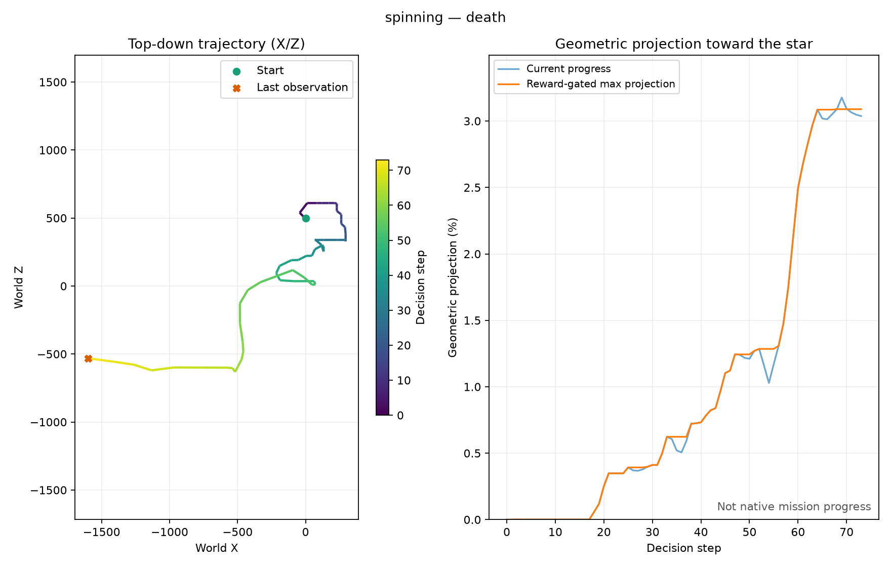
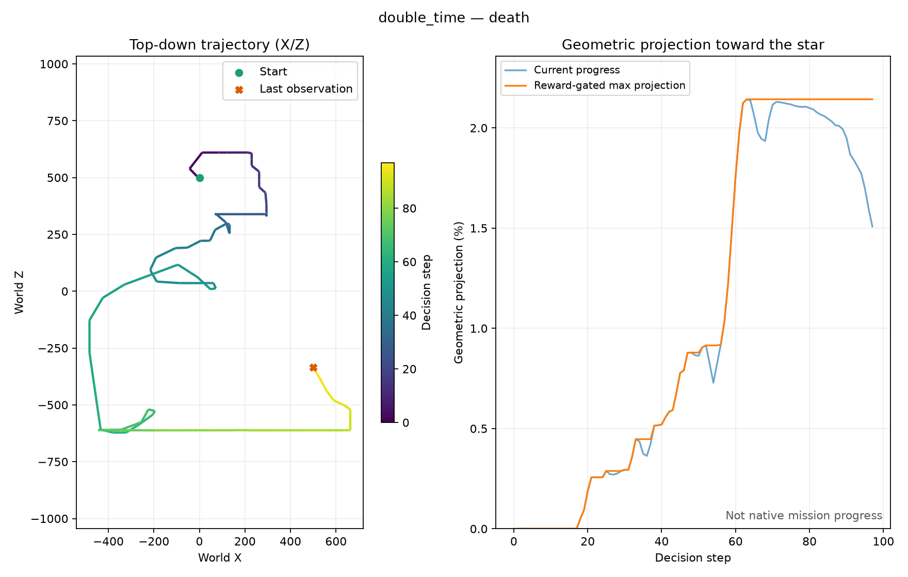

# Final motor8 evaluations and finite-pilot closure

Date: October 25, 2026. This records the six predeclared full-start SMG2 policy
evaluations after its final bounded training block. All six attempts ended in
RAM-confirmed death; none collected a star. No navigation benefit has been
established. The finite pilot is closed and its hourly follow-up is retired.
No new training, extra fitting or new reward experiment is allocated here.

## Evaluated checkpoint and accounting

The unchanged SMG2 checkpoint is
`runs/m8-smg2/world-model-20261025-133915-837384/world-final.pt`, SHA-256
`81d9c99ab880759f744a29b7094e3317869c0098c30fa001b3681c6a61b245d7`.
It contains 6096 new real training decisions, 636 model updates, 134 actor
updates and 129552 imagined transitions. Evaluation used epsilon 0.05, the
eight-exclusive-action profile and the original reward labels/gates. No
optimizer or replay recording ran, and training counters were unchanged.

The two independent evaluation processes each had an explicit maximum of
600 decisions per seed and the three seeds 11, 23 and 47. They ran at most two
isolated emulators concurrently, without overlapping training. Both controller
PIDs and both emulator processes exited normally; error logs were empty. Exact
commands, run paths, process creation times, checkpoint hashes and before/after
reviews remain in `.local/motor8-state.json`.

| Mission | Seed | Actual decisions | Outcome | Maximum geometric projection |
| --- | ---: | ---: | --- | ---: |
| Spinning and Spinning and Spinning | 11 | 73 | Death | 3.0890% |
| Spinning and Spinning and Spinning | 23 | 75 | Death | 0.2109% |
| Spinning and Spinning and Spinning | 47 | 24 | Death | 0.1575% |
| Turning Turning Double Time | 11 | 97 | Death | 2.1428% |
| Turning Turning Double Time | 23 | 75 | Death | 0.1848% |
| Turning Turning Double Time | 47 | 24 | Death | 0.1146% |

These 368 physical evaluation decisions are separate from real training and
imagined transitions. The three seeds are evaluation draws from one checkpoint,
not three independent training replications. All failures are retained. There
is no matched three-seed untrained-prior evaluation establishing an effect size
or statistical advantage/disadvantage. The earlier single-seed prior previews
validate instrumentation rather than a complete paired navigation baseline.

The percentage is a calibrated XZ projection, not a native game percentage,
verified safe traversal or a fraction of platforms completed. SMG2 ground/route
telemetry is unavailable in this branch. Directional movement before a fall can
increase the projection. Do not interpret the maxima as proof of reaching the
corresponding safe route location.





## Videos and verification

Local friendly copies are retained under `runs/motor8-evaluations-20261025/`:

- `smg2-spinning-trained.mp4`: all three Spinning attempts, 172 decisions.
- `smg2-double_time-trained.mp4`: all three Double Time attempts, 196 decisions.

Original manifests and exact-input JSONL sidecars remain in
`runs/m8-smg2/eval-world-video-20261025-144959-506962/` and
`runs/m8-smg2/eval-world-video-20261025-145022-205988/` respectively. Videos are
local ignored artifacts; neither ROM content nor emulator assets are committed.

Both panels show POLICY EVALUATION, real6096 and actor updates134. The inset is
the exact 84x84 grayscale actor input held for each twelve-frame decision; the
buttons show actual two-frame applied controls, including jump/spin release.
Bars are epsilon-mixture action probabilities, not Q values. Two-second samples
were visually inspected in both movies. Stream/sidecar checks confirmed H.264,
30fps, exact frame counts, a stable input digest per decision, exclusive
controls, correct8-on/4-off pulses and all six declared attempts.

The [machine-readable manifest](assets/performance/motor8-trained-evaluations-20261025.json)
retains attempts, hashes, stream metadata, controls/input checks and best traces.
Regenerate verification with the project Python:

```powershell
.venv\Scripts\python.exe scripts/review_motor8_evaluations.py
```

The prior-preview verifier now excludes trained actors and multi-seed
evaluations, preventing later recordings from being relabelled as prior
previews. All three original prior copies still pass their original verifier.
Validation for this artifact/tool revision: ten relevant portable video/report
tests and Ruff passed. No live mission success was inferred from those tests.

## SMG1 and next research boundary

SMG1 remains at 4096 new real decisions, 1024 model updates, zero actor updates
and zero imagined transitions. Its one extra fit failed unchanged terminal
gates, so there is no eligible learned motor8 actor to evaluate. Its original
single-seed prior video remains correctly labelled UNTRAINED POLICY PRIOR.
The [reward audit and isolated route correction](motor8-reward-review.md) remain
diagnostic work, not a newly activated reward experiment.

Before another online allocation, resolve reward geometry/scale, timeout
semantics and terminal prediction calibration. Preserve original checkpoints,
held-out gates and signatures; do not silently reuse incompatible scalar labels
under a changed reward. This closure reports an unsuccessful finite pilot,
not completed game learning or a cancellation of future owner-directed work.
