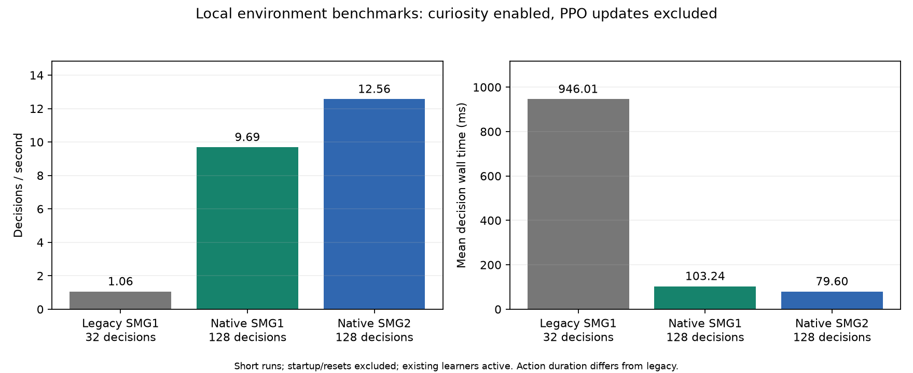

# Native capture, frame control, profiling, and failure handling

The current client uses **protocol v2**. The [optimization revision](optimization-v2.md)
records the CPU-idle acknowledgment fix, optional presentation suppression,
batched curiosity, reward audit, and newer measurements. The early measurements
below remain historical evidence and should not be read as current live counters.

## Motivation and measured baseline

The legacy backend advances through DSU hotkeys, acknowledges pause through
scene-counter probes, and reads renderer PNGs from disk. A 32-decision Galaxy 1
benchmark on 2026-10-22 measured 988.18 ms mean decision wall time, including
970.10 ms for control/capture, 17.84 ms per eligible curiosity update, and 0.23 ms
for telemetry. It achieved 1.012 decisions/s, excluding resets. This short test
ran while the original learners and a native build were active; it is an
engineering measurement, not an isolated throughput study.

The native backend removes the hotkey-based pause/capture path. It requires a
separate patched Dolphin 2609a executable. Setting `parallel.backend: native`
on an unmodified stock binary does not enable the protocol and will time out.
`parallel.backend: legacy` retains the original implementation.

## Live validation and performance evidence

The final build passed native calibration for all three tasks: both Galaxy 2
near-star collections and falls, Galaxy 1 collection and fall, movement, and
paused baselines. The refreshed native calibration files record the executable
SHA256. These are detector checks, not learned course successes.

| One-worker environment benchmark | Decisions | Decisions/s, excluding resets | Mean decision time |
| --- | ---: | ---: | ---: |
| Legacy Galaxy 1, final repeat | 32 | 1.057 | 946.01 ms |
| Native Galaxy 1, unlimited/final-frame readback | 128 | 9.686 | 103.24 ms |
| Native Galaxy 2, unlimited/final-frame readback | 128 | 12.563 | 79.60 ms |

All native decisions acknowledged exactly 12 completed frame steps. For samples
remaining in the same scene nerve, the RAM scene-counter delta was also 12.
This verifies the tested control contract; it is not proof against all future
GPU/driver failures. Full raw stage measurements are retained in
[performance assets](assets/performance/native-smg1-128-final.json), alongside the
[legacy repeat](assets/performance/legacy-smg1-32-final.json) and
[Galaxy 2 benchmark](assets/performance/native-smg2-128-final.json).



These are short local runs with existing learners active; the legacy repeat
briefly overlapped native calibration. Warmup, reset frequency, action duration,
and concurrent load differ, so the roughly 9x Galaxy 1 comparison is an observed
operating improvement, not an isolated attribution or a learning-speed claim.
The earlier native 2x-speed/every-frame-readback runs measured 8.763 decisions/s
in Galaxy 1 and 9.059 in Galaxy 2; their JSON records are also retained.

CUDA continuation smoke runs loaded old policy/curiosity pairs, collected a
128-decision Galaxy 1 rollout and a four-worker 512-decision Galaxy 2 rollout,
performed PPO updates, and saved matching final pairs. Observed aggregate rates,
including update/final-save callback lifetime, were about 8.30 and 21.07
respectively. Environment-only benchmark rates must not be substituted for those
end-to-end training rates. Smoke checkpoints are engineering evidence rather
than solved policies.

The production migration preserved the latest legacy final pairs at 160916
Galaxy 2 decisions and 36694 Galaxy 1 decisions, rather than the older smoke
checkpoints. Remaining requested budgets were 840224 and 963306, preserving the
original targets 1001140 and 1000000. The new learners retain four and one workers.
An early [production snapshot](assets/performance/native-runtime-snapshot.json)
confirmed both managers on attempt one, exactly five native Dolphin processes,
and approximately 25.0 aggregate decisions/s for Galaxy 2 and 7.3 for Galaxy 1.
These are early observed rates, not a long-run reliability guarantee.

## Build and provenance

The upstream source is pinned to tag 2609a, commit
`409881c34357d0f105fd473167d15ab0bd9c1628`. No game executable or savestate-format
change is made. Compatibility must nevertheless be checked with the supplied
states before deploying a new build. The original Dolphin installation is not
replaced. Source, dependencies, tools, and binaries live under ignored `.local/`.

Prerequisites are a compatible MSVC C++ toolchain, Windows SDK, CMake, Ninja,
Git, and the project Python environment. Follow
[Dolphin's Windows build instructions](https://github.com/dolphin-emu/dolphin/wiki/Building-for-Windows).
Run from a developer PowerShell, or pass `-ToolchainSetup` pointing to a compatible
developer setup batch file:

```powershell
powershell -ExecutionPolicy Bypass -File scripts/build_native.ps1
```

`build_native.ps1` clones pinned source if absent, fetches pinned submodules,
applies `prepare_native_source.py`, configures a Release build, compiles with
eight jobs by default, and deploys into owned `.local/native-dolphin/`. Stop any
worker using that executable before replacing its files. The source/build/tool
paths and job count are parameters. The patch script refuses another upstream
revision and is repeatable on its own patched source. `native-build.json` records
the source revision and executable/patch-script SHA256 hashes.

The Python client and original bridge files use MIT. **The resulting patched
Dolphin executable remains GPL-2.0-or-later**, with upstream dependency licenses.
The separate-process shared-memory interface does not relicense Dolphin as MIT.
See [third-party notices](../THIRD_PARTY_NOTICES.md). No binary redistribution is
performed by this repository; a redistributor must preserve the applicable
license and corresponding-source obligations.

## Protocol and ownership

Each worker creates a randomly named `Local\\SMGRL-<UUID>` page-file-backed mapping
before launching Dolphin and passes its name only to its owned child through
`SMG_RL_BRIDGE`. Stock/legacy children have that environment variable removed.
There is no TCP listener or shared fixed-name mapping. Dolphin opens an existing
mapping and verifies the magic/version; Python verifies the responding PID.

The layout is a 256-byte header of aligned little-endian 32-bit words followed
by storage for at most 1920 x 1080 x 4 RGBA bytes. The fields are defined in
`native/SMGRLBridge.h` and `src/smg_rl/native.py`:

| Word | Meaning |
| ---: | --- |
| 0-2 | Magic `0x534D4752`, protocol version 2, owned Dolphin PID |
| 3-4 | Request and acknowledged response sequence |
| 5-7 | Command, argument, held-action bitmask |
| 8-9 | Completed frame steps and renderer image sequence |
| 10-12 | Image width, height, tightly packed byte stride |
| 13-14 | Error code and actual paused-state flag |
| 15 | CPU-thread completion barrier for asynchronous savestate loads |
| 16 | Matching CPU completion sequence for the bounded action |
| 17-18 | VI field count and field count at the preceding CPU-idle acknowledgment |
| 19 | Options bit 0: skip host presentation, preserving game rendering/readback |
| 20-21 | Last readback and per-command accumulated queue-wait microseconds |
| 22-24 | Skipped presentations, state reconciliations, last rejected Core state |

Protocol v2 acknowledges an advance only after its matching CPU completion
sequence and requested frame count, then waits for CPU idle before publishing
the response. A transient running flag is reconciled only with no intervening
VI fields; unexpected advancement is error 4 and aborts the worker. Errors 1
and 3 indicate invalid commands/arguments and a refused frame-step start.
Diagnostics appear in worker infos and learner status. A v1 binary cannot be
used with the v2 client. Upgrade from a fresh pinned source checkout; the patch
script explicitly refuses the old v1 patch instead of overwriting source work.

Commands are 1 (handshake/pause), 2 (bounded advance), 3 (load slot), and 4 (pause).
An advance accepts 1-600 frames. A load accepts slots 1-4. The action bits, in
order, are W, A, S, D, jump, crouch, and spin. Input is sampled inside Dolphin's
DSU device update directly from the command mask. UDP still discovers the device
and preserves the existing controller bindings, but gameplay actions do not wait
for UDP packet delivery. Shared controls are emulator inputs, not writes to
emulated game RAM. The RAM reader remains read-only.

Python publishes command fields before the request sequence. Dolphin's host
thread dispatches the operation; it acknowledges only when the core is paused.
The CPU thread counts completed frame-step boundaries, and the GPU publishes
mapped renderer RGBA readback before returning the final observation. Host-side
polling remains, but the game does not free-run while Python waits or learns.
Savestate commands wait for an explicit CPU-thread completion barrier; the paused
flag alone does not prove an asynchronous load has finished.

The renderer uses Dolphin's existing staging-texture readback path and copies
RGBA directly to shared memory. Python crops, converts to grayscale, and resizes
to the existing 84 x 84 observation. No screenshot hotkey, PNG encoder, screenshot
directory scan, or extra screenshot-flush frame is used by native decisions.
GPU rendering and a hidden Win32 surface are still required. Intermediate action
frames render normally, but CPU image readback is requested only for the final
frame. Native configurations set emulation speed to 0 (unlimited); bounded
frame stepping, rather than real-time throttling, controls action duration.

## Frame semantics and validation

Native steps extend Dolphin's own frame-step mechanism: emulation stops after
the requested number of newly presented frame-step boundaries. These are not
CPU instructions, scene-nerve ticks, or necessarily all VI fields. The scene
counter can reset/change nerve; a separate image sequence and completed-frame
count are used for protocol checks. Python rejects a wrong PID, pending/stale
request, error response, unpaused reply, inexact frame count, stale frame, invalid
dimensions, uniform observation, process exit, or command timeout.

The 12-frame action duration has different semantics from the old approximate
12-frame setting, whose pause/capture handshakes added many frames. Continuing
old checkpoints preserves their weights/statistics, not the old action-duration
distribution. Such continuation is a changed experimental condition, not a new
independent seed or a fair sample-efficiency comparison.

```powershell
.\.venv\Scripts\smg-rl.exe --config config/native.yaml calibrate-background
.\.venv\Scripts\smg-rl.exe --config config/smg1-native.yaml calibrate-background
.\.venv\Scripts\smg-rl.exe --config config/native.yaml benchmark --steps 64
.\.venv\Scripts\smg-rl.exe --config config/smg1-native.yaml benchmark --steps 64
```

Native configurations use separate calibration files. Calibration checks the
real star/death transitions, movement, paused state, and supplied state roles.
It records executable SHA256 and backend identity. The benchmark uses a fixed
action cycle and visual curiosity; it does not optimize PPO or count toward
training success. Its run names start with `benchmark-`, so audited reports
exclude them. Use the same workload, actions, steps, and hardware conditions for
comparisons; measure startup/resets and failure downtime separately.

## Profiling outputs

Each worker writes `timings.json` every 16 decisions and at terminal boundaries.
It contains environment stages (reset, step, control/capture, telemetry,
curiosity, logging, episode output) and backend stages (startup, pause, reset,
advance, native round trip, capture).
Measurements are milliseconds from `perf_counter`, with all-call count/total/mean
and recent p50/p95 from a bounded window of 512 calls. **Nested stages overlap**:
do not add pause/capture/advance or whole-step time as exclusive percentages.
Failed operations are included in measured-call totals when their context exits.

Learner `status.json` contains recent per-worker stage values, exact native frame
counts, and cumulative learner timing for rollout collection, policy forward,
PPO optimization, and checkpoint saving. Policy-forward measurement is host dispatch time and can
understate asynchronous GPU execution. PPO optimization synchronizes CUDA once
at each boundary to measure completion. Collection includes environment waiting;
it is not a second independent cost to add to worker stages. Diagnostic snapshots
can lag the currently executing step/update.

## Recurring failures

- Legacy screenshot freshness and hotkey-pause acknowledgment remain checks in
  the fallback. Native decisions remove those mechanisms rather than shortening
  their stability probes.
- `status.json` uses uniquely named temporary files and bounded retries on
  Windows permission errors. If the destination remains locked, the previous
  diagnostic snapshot survives; learning is not aborted by a viewer lock.
- In native-enabled Dolphin, file renames retry transient access/share-denied
  errors for up to 500 ms. A local failed stock boot logged a NAND `fst.bin`
  temporary-file rename error; this retry addresses that observed path.
- Owned profiles enable `AbortOnPanicAlert`: an emulator panic exits instead of
  waiting indefinitely behind a hidden warning dialog. It does not authorize
  ignoring an invalid savestate or continuing after corrupted state.
- Boot validation, process ownership checks, command timeouts, paired checkpoints,
  and the recovery supervisor remain active. These changes do not establish
  immunity to driver crashes, invalid assets, persistent file locks, or OS stalls.

Use the same `train-supervised`, `status`, `stop`, and `report` commands with the
native game's configuration. Do not start an additional native learner while
the legacy learner for that game is still running. Preserve its final complete
pair and request only the remaining original budget when migrating.

## Controlled live recovery check

`scripts/verify_native_recovery.py` creates a separate, locally scoped one-worker
Galaxy 1 test, waits for a complete 64-step checkpoint pair, and deliberately
terminates only that test-owned Dolphin PID. It verifies process ancestry and
the configured executable before fault injection. Production learners are not
targeted. The supervisor recovered in its second attempt and completed the
original 256-decision target. The [measured recovery record](assets/performance/native-recovery.json)
preserves the injected PID/checkpoint, manager status, and elapsed time.

This integration check passed on the native build; it demonstrates recovery
from one controlled process exit, not every possible failure. To repeat it with
the local game assets and native calibration available:

```powershell
.\.venv\Scripts\python.exe scripts/verify_native_recovery.py
```

The fixture runs under `.local/native-recovery-check-*`, outside the audited
training run roots, and is excluded from course-success reports.
