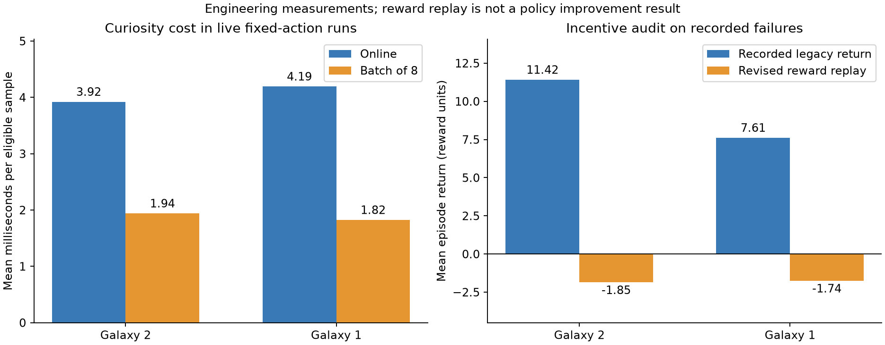

# Protocol v2 and bounded exploration audit

This revision was measured on 2026-10-22 on the documented Windows laptop.
It changes synchronization, profiling, curiosity optimization, and reward
allocation. It does not establish a learned full-course solution. All three
tasks still require a training-start trajectory and the RAM star event before
being counted as solved. Geometric projection remains a progress proxy.

## 1. Failure diagnosis and CPU completion barrier

The preceding Galaxy 2 supervisor reached nine attempts, with recurring native
command-2 error-1 rejections. A paused Core flag was insufficient evidence that
the last CPU frame batch had finished. Protocol v2 snapshots the request,
command and frame count, publishes a matching completion sequence from the CPU
frame-step callback, and waits for CPU idle before publishing the response.
Savestate loads keep their independent CPU-thread completion barrier.

The next command compares cumulative VI fields with the preceding acknowledgment.
A transient running flag can be reconciled by pausing only if no field advanced
outside an acknowledged action. Unexpected fields produce error 4; the worker
fails explicitly and the supervisor resumes a complete checkpoint pair. No
game frames are silently discarded to manufacture an exact transition.
Version, PID, pause, image freshness, and requested-frame checks remain active.
The protocol field map is in [native backend](native-backend.md).

Both games passed fresh near-star/fall/movement/pause calibration with the new
executable. These are detector fixtures, not training successes. The additional
protocol stress checks passed 512 advances across both Galaxy 2 variants and
256 in Galaxy 1, using 1, 2, 4, 12 and 24 frame actions, 21 savestate resets,
and 48 waits checking unchanged RAM/VI fields while paused. Neither check
recorded rejected or reconciled states. A separate test deliberately terminated
its owned Galaxy 1 emulator after a 64-decision paired checkpoint: attempt two
resumed and reached the 256-decision target. Short tests cannot prove that the
recurring failure is eliminated under every long-run condition.

## 2. Emulator/capture measurements

Renderer RGBA capture stays in shared memory; no PNG capture or foreground input
is introduced. Capture occurs on the action's final rendered frame. Profiling
now also exposes native readback/queue-wait microseconds, VI counters, skipped
presentations, and reconciliation diagnostics in worker info and learner status.
The original control/capture/telemetry/logging/curiosity and PPO timings remain.
Nested timings overlap and must not be summed as exclusive costs.

An optional `parallel.skip_present` branch avoids presenting the rendered image
to the host. It preserves gameplay rendering, frame events and observation
readback. It was tested, but **remains false in recommended configurations**:
the measured one-worker workload showed no consistent throughput advantage.
Hidden windows still require a working GPU renderer. This is not renderer-free
headless simulation.

The retained [raw comparison records](assets/performance/v2-benchmarks.json)
contain an initial 128-decision pass and two repeated 128-decision passes per
game. Repetitions reverse condition order and compare presentation on/off with
online/batch-eight curiosity. They use the same fixed action cycle, start state,
one worker, one Torch thread, 12 frames per decision, and unlimited emulation.
They exclude reset/startup time and PPO. Production learners were stopped;
the repeated Galaxy 2 pass briefly overlapped the end of the recovery test.
Thermal/scheduling variation remains; two repetitions are engineering evidence,
not a statistical performance study. Use the aggregate production snapshot for
end-to-end rates with all five workers running.

Pooling the two repeated passes by total decisions divided by total step wall
time gives the following environment-only rates with host presentation enabled:

| Game | Online curiosity | Batch eight | Curiosity mean, online to batch |
| --- | ---: | ---: | ---: |
| Galaxy 2 | 16.639 decisions/s | 17.454 decisions/s | 3.922 to 1.940 ms |
| Galaxy 1 | 14.308 decisions/s | 15.635 decisions/s | 4.194 to 1.824 ms |

These local differences are approximately 4.9% and 9.3% in total throughput,
while curiosity itself costs about 51% and 57% less. With batch eight and host
presentation suppressed, the pooled rates were 17.252 and 13.320 decisions/s;
this supports retaining normal hidden presentation on this machine.



## 3. Curiosity batching

Novelty is scored on every eligible image. The trainable inverse-dynamics/RND
networks update once per eight queued transitions, using mean losses. The RND
target stays fixed. Partial batches flush before the next episode's frozen
encoder is refreshed. Pending samples, optimizer state, moments and update
count are saved in curiosity checkpoints. Legacy checkpoints load with an empty
pending queue. The episodic kNN store is now a preallocated circular array with
the same capacity and distance rule, avoiding list stacking/copying per step.

In the seeded synthetic benchmark (512 transitions, first 64 excluded), CPU
online updates cost 2.840 ms/sample and CPU batch eight cost 1.335 ms/sample.
CUDA batch eight cost 1.214 ms/sample in isolation, a small absolute gain that
does not account for five extra CUDA contexts competing with PPO. The selected
setting is CPU, one Torch thread, batch eight. In the initial live tests,
curiosity fell from about 4 ms to 1.8-1.9 ms per eligible sample. Emulator time
remains the larger cost, so this does not imply a twofold training speedup.

This is an optimizer-frequency change: one mean-loss Adam update is not eight
sequential updates. No samples are dropped, but representations and learning
curves may change. Compare full-start success across independent seeds before
claiming algorithmic superiority.

## 4. Stagnation and reward audit

The preceding runs had no full-start star collections. Recent trajectories
mostly remained near the initial area. More than 92% of sampled Galaxy 2 steps
and 97% of Galaxy 1 steps paid the same +0.02 intrinsic reward. Local animation
and movement could therefore earn positive return despite death or timeout.
This is an observed incentive defect, not proof that it is the only cause of
stagnation. Camera-relative controls, action timing, geometry, value estimation,
and the projection's limitations can also matter.

A counterfactual replay used up to the last 50 completed episodes per worker,
excluding interrupted episodes. For 146 Galaxy 2 episodes, mean recorded return
was +11.415; with the revised reward and earlier stall cutoff it was -1.845.
For 49 Galaxy 1 episodes, the corresponding means were +7.614 and -1.741.
The replay reuses recorded intrinsic bonuses divided by their old 0.02 weight;
it does not simulate new actions, batched representations, or future learning.
It demonstrates the incentive correction, not a better trained policy.

Recommended native configurations use revision `bounded-exploration-v2`:

| Component | Setting |
| --- | --- |
| Paid novelty | Weight 0.005; at most +0.5 over an episode |
| Stall gate | Full through 30 decisions without valid progress; linear fade to zero at 120 |
| Progress | 5 times new valid episode high-water projection |
| Completion / death | +20 / -2 from existing RAM predicates |
| Galaxy 1 nonfatal damage | -0.25 per net HP lost; unchanged |
| Per-decision cost | -0.001 |
| Truncation | -2 at 180 stalled decisions or 3000 total decisions |

Progress clears the stall counter without replenishing the episode novelty
budget. Timeouts are logged separately from RAM deaths. Damage, terminal and
low-height novelty gates remain. The [methodology](methodology.md) gives exact
equations and information boundaries. Legacy configurations retain historical
defaults. The shorter stall horizon may penalize necessary detours, especially
on Sweet Sweet Galaxy's curved path; evaluation must check this tradeoff.

CSV/live traces now expose raw versus paid novelty, progress reward, RND error,
episodic/lifelong novelty, stall gate, remaining budget, timeout cost, and
curiosity update/batch size. Episode summaries include the reward revision and
component totals. Existing X/Z trajectory plots remain available.

## Checkpoint migration and reproducibility

Production was gracefully stopped and complete final pairs were preserved:
Galaxy 2 at 633040 decisions, Galaxy 1 at 165173. Resume requests retain the
original targets 1001140 and 1000000, with 368100 and 834827 decisions remaining.
Four Galaxy 2 workers and one Galaxy 1 worker continue from those pairs.
Actor/value weights, PPO optimizer state, curiosity weights/statistics are
retained; episode/recurrent state restarts. The value function must adapt to the
new reward scale. This is continuation under a changed condition, not a fresh
seed, and old/new scalar returns must not be pooled as one objective.

During the first simultaneous restart, both games produced the identical
`parallel-20261022-125705-842348` run name in different run roots. Their runtime
profiles had previously used only that name under a common `.local` parent,
causing a profile collision and a Galaxy 1 boot failure. Runtime directories
now include the verified game ID before the run name. A regression test
checks identical timestamps across games. Both learners were stopped cleanly
again and resumed their latest complete pairs at 634400 and 165616 decisions,
requesting only 366740 and 834384 remaining decisions. This startup failure is
retained as negative evidence rather than counted as a protocol test success.

The subsequent simultaneous restart again produced equal timestamp names;
the game-namespaced profiles remained separate. An early
[production snapshot](assets/performance/v2-runtime-snapshot.json) verified all
five owned emulators alive, both supervisors on attempt one, fresh complete
checkpoint pairs, exact 12-frame acknowledgments, and the new reward-component
logs. It observed 638496 and 167040 total decisions, at about 26.8 aggregate
Galaxy 2 decisions/s and 8.5 Galaxy 1 decisions/s. These rates include resets,
PPO and checkpoint overhead. Comparing them with isolated environment benchmarks
cannot establish a throughput gain or learning improvement.

Portable checks passed 84 tests and Ruff. Live fixtures and raw measurements
are retained under [performance assets](assets/performance/v2-validation.json),
with [counterfactual audit](assets/performance/v2-reward-audit.json),
[synthetic timings](assets/performance/v2-curiosity.json), and
[build provenance](assets/performance/v2-native-build.json).
ROMs, savestates, executable binaries, compiler files, and full checkpoints stay
local and ignored by Git. Original bridge/project code uses MIT; the combined
Dolphin executable retains GPL-2.0-or-later.

Run these separately from production timing measurements:

```powershell
.\.venv\Scripts\python.exe -m pytest -q
.\.venv\Scripts\python.exe -m ruff check src tests scripts
.\.venv\Scripts\python.exe scripts/verify_native_protocol.py --config config/native.yaml --steps 256
.\.venv\Scripts\python.exe scripts/verify_native_protocol.py --config config/smg1-native.yaml --steps 256
.\.venv\Scripts\python.exe scripts/verify_native_recovery.py
.\.venv\Scripts\python.exe scripts/benchmark_curiosity.py --output .local/curiosity.json
.\.venv\Scripts\python.exe scripts/compare_native_settings.py --config config/native.yaml --steps 128 --repeats 2 --output .local/comparison.json
.\.venv\Scripts\python.exe scripts/replay_exploration_reward.py --config config/native.yaml --run runs/parallel-20261022-114639-309238 --output .local/reward-replay.json
.\.venv\Scripts\python.exe scripts/plot_optimization_evidence.py
```

Protocol stress and recovery use `.local/` fixtures. Fixed-action benchmarks
have `benchmark-*` run names. Audited training reports exclude all of these and
all near-star calibration runs.
