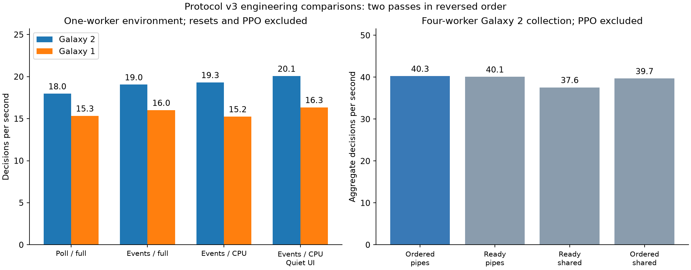

# Protocol v3: event wakeups, native image preparation, and worker barriers

This revision implements three measured engineering experiments: replacing
bridge polling with event wakeups, preparing compact observations in Dolphin,
and profiling/optimizing synchronous vector collection. It retains the same
54 actions, 12 rendered frame-step boundaries per action, reward revision,
PPO rollout size, and five production emulators. It does not claim a learned
course solution or a guaranteed reduction in steps required for learning.

## CPU, GPU, and host synchronization

Protocol v2 used a 1 ms Qt host timer and Python polling. Protocol v3 creates
three private auto-reset Windows events under each random mapping's name:
request, CPU completion, and reply. Qt's `QWinEventNotifier` wakes the host on
requests/completions. Python blocks on the reply event, checking process
liveness and its timeout at most every 50 ms. A 50 ms host watchdog covers boot
readiness and missed notifications. A same-build `bridge_wakeup: poll` option
retains the 1 ms timer for comparisons.

An event is a wakeup, never proof that a transition completed. Sequence, PID,
protocol, CPU completion, frame count, paused state, image freshness and field
invariance checks remain. The host still waits for CPU idle before publishing
the response. Stale reply signals cannot acknowledge a new request. Python and
Dolphin close their own event handles. No additional gameplay network service
or foreground input is involved.

New QPC timings separate request-to-host dispatch, the bounded CPU batch,
CPU-idle acknowledgment, renderer presentation, readback and preprocessing.
Queue-drain calls and cumulative wait are also exposed. These intervals overlap;
the CPU batch contains emulation and renderer work, and readback includes image
preparation. They are not additive percentages or GPU hardware timestamps.
Profiling must identify an actual expensive synchronization before removing it;
no correctness barrier is disabled merely to improve a benchmark.

The additional `quiet_ui` option suppresses only the Qt listener's repeated
menu/dialog redraw notification after a completed native frame batch. The
ordinary Core listeners, CPU timing/throttle hooks, renderer, input, and all
bridge acknowledgments remain. Boot, savestate and explicit pause notifications
remain available. Profiling showed increased dispatch latency after compact
preparation shortened Python work, and source inspection found queued hidden
widget refreshes after each batch. The option tests that suspected source of
delay on/off in the final build rather than assuming it explains all latency.

## Compact observations inside Dolphin

The full reference frame measured 834 x 456 RGBA bytes, or 1521216 bytes. Native
CPU preparation crops the configured region, converts to grayscale using
rounded integer coefficients, then applies separable area averaging to 84 x 84.
Only 7056 bytes cross the bridge. This is about 216 times less observation
payload, not a 216-fold throughput claim. Python receives an owned uint8 array,
checks dimensions and spatial variation, and avoids full-frame conversion and resizing.

The native kernel uses coefficients 9798, 19235 and 3735 with a 15-bit rounding
shift, then cached area weights. The output definition follows the reference
`cv2.COLOR_RGBA2GRAY` followed by `cv2.INTER_AREA`. Portable Python checks cover
compact shape/stride and memory ownership; the live replay checks the actual
compiled kernel against OpenCV.

Each mission replayed 48 identical actions from its training savestate in full,
native CPU and experimental GPU modes. Across 144 full/CPU image pairs, maximum
and mean absolute pixel error were both zero. The maximum coordinate difference
was also zero. The test contract allows at most one grayscale intensity level
for rounding on other supported dimensions; the observed fixtures were exact.
This is bounded validation, not proof of equivalence for every possible image.

The experimental GPU mode crops and reduces through Dolphin's linear texture
scaler before CPU readback. It preserved tested coordinates but changed pixels:
mean absolute errors were 7.72 and 7.80 in Galaxy 2, and 3.89 in Galaxy 1; maximum
errors reached 163. Linear sampling can alias narrow geometry. It is therefore
not the recommended continuation mode, even if its readback is faster. Native
CPU preparation retains full-size GPU readback; GPU traffic is not reduced by
the smaller Python payload. `native_capture: full` retains the reference path,
`cpu` selects area averaging, and `gpu` explicitly selects the changed image
experiment. This distinction is retained in all benchmark metadata.

## Worker waiting and shared observations

Recurrent PPO still dispatches one action to every worker and waits for all
responses before the next policy evaluation. `MeasuredSubprocVecEnv` retains
the pinned SB3 2.6 worker protocol, reset semantics, terminal observations,
scenario ordering, seeds and recurrent rollout boundaries. It does not turn PPO
into an asynchronous/off-policy algorithm.

Worker wrappers timestamp command arrival and response readiness, including
automatic reset and observation preparation. The parent records receipt times,
each worker's compute interval, readiness relative to dispatch, the slowest
worker, and `max(ready) - ready_i` as its barrier idle interval. Parent-side
transfer/receipt time can include head-of-line waiting with ordered receives.
Intervals overlap. They cannot be added to infer independent utilization or
treated as proof that every idle millisecond is removable.

The measured collector can receive ready pipes first and restore original
worker order before returning to PPO. An optional shared observation buffer
gives each worker one fixed-size image slot. A worker writes its uint8 frame
stack before sending its small pipe response; the parent copies that slot into
an owned array after receipt. There is only one outstanding action per worker.
Scenario/reward/info data and rare terminal observations retain the ordinary
pipe protocol. The copied images cannot be overwritten by subsequent steps.
Both cumulative statistics and recent barriers appear in learner status.

The selectable controls are `collector: standard|measured`,
`shared_observations: true|false` and `receive_order: ordered|ready`. A benchmark
compares measured ordered pipes, ready-order pipes, and ready-order shared
images using the same actions/workers. Removing serialization and head-of-line
receipt does not remove the logical wait for the slowest emulator.

## Measured final choices

The same final executable was used for all conditions below. Rates pool total
decisions divided by total step wall time from two reversed-order passes of
128 decisions per condition, with one worker and batch-eight curiosity. No
production learner, portable test suite or compiler ran during these final
comparisons. Startup/reset time and PPO are excluded; host scheduling/thermal
variation and this small sample still limit causal attribution.

| Pipeline condition | Galaxy 2 decisions/s | Galaxy 1 decisions/s |
| --- | ---: | ---: |
| Polling, full RGBA/Python preparation, ordinary Qt notifications | 17.973 | 15.335 |
| Events, full RGBA/Python preparation, ordinary Qt notifications | 19.048 | 16.011 |
| Events, native CPU preparation, ordinary Qt notifications | 19.312 | 15.249 |
| Events, native CPU preparation, quiet native Qt notifications | 20.065 | 16.343 |

The selected pipeline improves the observed rates by 11.6% and 6.6% over the
matched poll/full reference. Python capture/preparation fell from 1.489 to
0.107 ms in Galaxy 2 and 1.569 to 0.109 ms in Galaxy 1. The corresponding
request-to-host dispatch means fell from 747 to 223 microseconds and 703 to
101 microseconds. Compact preparation alone was not consistently faster in
total wall time; quiet Qt notifications addressed a measured remaining delay.
CPU-idle acknowledgment and explicit queue-drain wait were small, so their
correctness barriers remain. No unmeasured GPU/CPU synchronization was removed.

A separate four-worker fixed-action test ran 128 vector steps per condition
twice, reversing order. It includes automatic resets and omits inference/PPO:

| Vector transport | Aggregate decisions/s |
| --- | ---: |
| Ordered pipes | 40.270 |
| Ready-order pipes | 40.093 |
| Ready-order shared images | 37.575 |
| Ordered shared images | 39.702 |

Ordered and ready-order pipes were close enough that the 0.4% difference should
not be treated as a strong statistical ranking. Shared images did not establish
a speed advantage on this machine. Recommended configurations therefore use
`collector: measured`, `shared_observations: false`, `receive_order: ordered`,
with event wakeups, native CPU preparation and `quiet_ui: true`. Alternative
transports remain implemented and covered by equivalence tests. The separate
Dolphin-to-worker compact image mapping remains active regardless of this vector
transport choice. Single-worker collection has no cross-worker barrier to remove.

Raw [pipeline measurements](assets/performance/v3-pipeline-final.json),
[collection measurements](assets/performance/v3-collection-final.json), and
[earlier exploratory comparisons](assets/performance/v3-exploratory.json) retain
negative results. In collection records, the top-level condition flags are the
effective transport overrides; early local config snapshots recorded the base
configuration before those flags were copied into the benchmark snapshot code.
The script now records both the effective configuration and condition fields.



## Validation and experiment boundaries

Both games passed new completion/death/movement/pause calibration using the
compiled v3 executable. Near-star collections remain detector fixtures and are
excluded from training successes. Image replay checks all three full-start
missions. Vector regression tests compare the measured collector directly with
SB3, including automatic truncation/reset, terminal observations, seeds,
observation ownership, environment methods, and a deliberately slow worker.

The final portable suite passed 90 tests and Ruff. Both final compiled games
passed 768 bounded-action commands, 21 resets and 48 paused stability waits.
All 144 full/native-CPU image pairs again had zero pixel and coordinate error.
The selected measured collector also passed a controlled Galaxy 1 emulator
termination/recovery check, resuming a complete pair on attempt two to reach
256 decisions. These results and executable hashes are in
[validation](assets/performance/v3-validation.json),
[image replay](assets/performance/v3-images.json), and
[build provenance](assets/performance/v3-native-build.json).

Production was stopped gracefully at 663248 Galaxy 2 decisions and 174172
Galaxy 1 decisions. The matching policy/curiosity final pairs were retained.
Continuation requested only 337892 and 825828 additional decisions, preserving
the original targets 1001140 and 1000000. Four Galaxy 2 workers and one Galaxy 1
worker were resumed with the selected pipeline and unchanged reward/optimizer
settings. Evaluation/reset distributions and checkpoint limitations remain as
documented in the preceding revision. Calibration, image/transport benchmarks
and recovery fixtures do not count as trained course completions.

An early [production snapshot](assets/performance/v3-runtime-snapshot.json)
verified five live owned emulators, both supervisors on attempt one, exact
12-frame acknowledgments, compact 7056-byte images, and fresh complete
policy/curiosity pairs. It observed 667408 Galaxy 2 and 175628 Galaxy 1 total
decisions, at approximately 31.4 aggregate and 9.7 decisions/s. These concurrent
rates include resets, PPO and checkpoint overhead and are not a controlled
comparison with the preceding training run.

The same snapshot measured mean Galaxy 2 barrier idle intervals of approximately
15.0, 10.9, 15.2 and 10.2 ms per worker. Double Time workers accounted for about
71% of the slowest-worker observations in that early window. This describes
the observed workload, not a permanent property of the missions. Galaxy 1's
single worker has zero cross-worker barrier idle time. Idle intervals overlap
across workers and are not an additive wall-clock saving that was achieved.

Native pipeline comparisons use one worker, 128 decisions per condition, two
repetitions with reversed condition order, identical fixed actions, batch-eight
curiosity and 12-frame actions. They exclude startup/reset time and PPO. The
initial exploratory Galaxy 2 comparison overlapped portable spawn tests and is
retained separately; clean comparisons are used for deployment decisions.
Collection comparisons include resets in wall time but omit policy inference
and PPO updates. Production continuation is a separate validation workload.

ROMs, savestates, compiled executables, full checkpoints and gameplay image
arrays remain local/ignored. The original native kernel, client, collector and
documentation use MIT. The patched Dolphin executable remains GPL-2.0-or-later.
Old patched source checkouts must be upgraded using a fresh pinned checkout;
the preparation script refuses older protocol patches. The original installed
Dolphin is preserved, and the preceding native executable is backed up locally.

Reproduction commands, run separately from production timing:

```powershell
.\.venv\Scripts\python.exe scripts/verify_native_images.py --config config/native.yaml --steps 48
.\.venv\Scripts\python.exe scripts/verify_native_images.py --config config/smg1-native.yaml --steps 48
.\.venv\Scripts\python.exe scripts/compare_native_pipeline.py --config config/native.yaml --steps 128 --repeats 2 --output .local/pipeline.json
.\.venv\Scripts\python.exe scripts/benchmark_collection.py --config config/native.yaml --workers 4 --steps 128 --repeats 2 --output .local/collection.json
.\.venv\Scripts\python.exe scripts/verify_native_protocol.py --config config/native.yaml --steps 256
.\.venv\Scripts\python.exe scripts/verify_native_recovery.py
.\.venv\Scripts\python.exe scripts/plot_native_pipeline.py
.\.venv\Scripts\python.exe -m pytest -q
.\.venv\Scripts\python.exe -m ruff check src tests scripts
```
