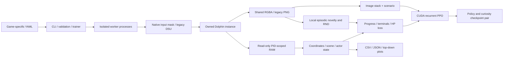

# Reproducibility, architecture and operations

## Documentation map

| Question | Document |
| --- | --- |
| Install and basic commands | [README](../README.md) |
| Native frame bridge, profiling, build provenance, and measured acceleration | [Native backend](native-backend.md) |
| Current protocol, batched optimizer, reward revision, and measured tradeoffs | [Optimization audit](optimization-v2.md) |
| Event wakeups, native image kernel, and synchronous worker transport | [Native pipeline revision](optimization-v3.md) |
| Complete documentation navigation | [Documentation index](README.md) |
| Exact CLI arguments and backend selection | [Command reference](cli.md) |
| Health penalties and supervised recovery | [Damage and recovery](damage-and-recovery.md) |
| Exact model/reward equations and limitations | [Methodology](methodology.md) |
| Controlled experiments, metrics and evidence | [Experimental protocol](experiments.md) |
| Galaxy 2 addresses and derivation | [Memory profile](memory-profile.md) |
| Galaxy 1 assets, addresses and live evidence | [Galaxy 1 integration](smg1.md) |
| Concurrent learners, resource measurement and morning reports | [Concurrent training](concurrent-training.md) |
| Hidden instances, CUDA, throughput and stopping | [Background training](background-training.md) |
| Original desktop validation | [Validation report](validation.md) |
| Practical training guidance | [Training guide](training.md) |
| Bibliographic metadata | [BibTeX references](references.bib) |

## Module responsibilities



| File under `src/smg_rl/` | Responsibility |
| --- | --- |
| `config.py` | YAML loading and project-relative path expansion |
| `profiles.py` | Executable-specific memory layouts and training-enablement guard |
| `memory.py` | Big-endian pointer graph and telemetry predicates |
| `process_memory.py` | Windows read-only memory mappings for an explicit PID |
| `dolphin.py` | Owned profile preparation and visible desktop adapter |
| `dsu.py` | Loopback controller protocol and per-worker input state |
| `native.py` | Versioned shared-memory client, direct capture, bounded-frame commands, and backend selection |
| `vector.py` | Worker barrier/transport profiling and selectable ready-order/shared observation collection |
| `diagnostics.py` | Bounded timing statistics and resilient atomic diagnostic publication |
| `timed_ppo.py` | PPO collection/inference/update timing with checkpoint-compatible policy persistence |
| `benchmark.py` | Fixed-action environment measurements excluded from audited training success |
| `background.py` | Hidden Dolphin lifecycle, pause handshake, fresh renderer capture |
| `actions.py` | Stable 54-action enumeration |
| `curiosity.py` | Inverse features, episodic kNN, RND, optimizer/statistics persistence |
| `rewards.py` | High-water progress, episode novelty budgets, stall gates, and reset-aware HP-loss tracking |
| `env.py` | Observation boundary, resets, episode limits, rewards and logs |
| `train.py` | Desktop recurrent PPO, evaluation, run/config snapshots |
| `parallel.py` | Spawned vector environments, CUDA learning, status and checkpoints |
| `validation.py` | Positive/negative live detector checks and calibration fixtures |
| `plotting.py` | Standalone equal-scale world X/Z figures |
| `cli.py` | User commands, status, graceful stop and training guards |
| `reporting.py` | Audited multi-game success, peak valid progress and measured best trajectories |
| `supervision.py` | Owned-child lifecycle, checkpoint-pair recovery, retry backoff and stop propagation |

There is no writable RAM interface, network gameplay service, cloud learner,
external telemetry upload, multi-machine coordinator or in-game patch.

Parallel runtime profiles are namespaced by verified game ID and then run name,
so equal timestamp names under the two games' run roots cannot share a Dolphin
user directory. Native v2 diagnostics and the full effective reward/novelty
configuration are retained in status/config snapshots. Batched curiosity pairs
also retain pending transitions; a resumed episode still starts from its
configured initial savestate rather than continuing exact game/recurrent state.

Protocol v3 moves crop/grayscale/area preparation into the native renderer
readback path and wakes the host/client with private Windows events. Its CPU
kernel matched 144 reference images exactly in the retained live tests; GPU
linear reduction is a separate changed-observation experiment. Shared vector
image slots are distinct from Dolphin's shared renderer mapping: each worker
publishes one frame stack and the learner takes an owned copy after its pipe
reply. The synchronous PPO barrier and worker ordering remain. The pinned SB3
worker protocol is exercised directly by collector equivalence tests.

## Environment and provenance

The live development environment uses Windows, Python 3.11, Dolphin 2609a,
i9-14900HX, 32 logical CPU threads, approximately 32 GB RAM, and an RTX 4070
Laptop GPU with 8 GB VRAM. The current tested CUDA wheel is Torch 2.14.1+cu126 with
Stable-Baselines3/sb3-contrib 2.9.0. Earlier revisions used Torch 2.6.0+cu124 and
SB3 2.6.0; their historical measurements retain that provenance. The current
[renderer/security revision](optimization-v4.md) documents revalidation and the
remaining trusted-checkpoint boundary. The dependency lock records actual versions.

Use `requirements-gpu.lock.txt` for the CUDA setup and
`requirements-windows.lock.txt` for the older desktop CPU environment. Installing
unconstrained current SB3 after the tested CUDA wheel can upgrade dependencies
and change the environment; use the lock and `--no-deps` project installation:

```powershell
py -3.11 -m venv .venv
.\.venv\Scripts\python.exe -m pip install -r requirements-gpu.lock.txt
.\.venv\Scripts\python.exe -m pip install --no-deps -e .
.\.venv\Scripts\python.exe -m pip check
.\.venv\Scripts\python.exe -m pytest -q
.\.venv\Scripts\python.exe -m ruff check src tests scripts
```

For an archived experiment preserve the exact repository commit, dirty diff if
any, lockfile, run `config.json`, calibration, emulator hash/version, input state
hashes, package versions, hardware and driver information. A config snapshot
alone is insufficient to reproduce changed source code. Useful local commands:

```powershell
git rev-parse HEAD
git status --short
.\.venv\Scripts\python.exe -m pip freeze
Get-FileHash -Algorithm SHA256 'D:\emuladores\Dolphin-x64\Dolphin.exe'
Get-FileHash -Algorithm SHA256 data/SB4E01.s01,data/SB4E01.s02,data/SB4E01.s03,data/SB4E01.s04
Get-FileHash -Algorithm SHA256 data/RMGE01.s01,data/RMGE01.s02
nvidia-smi
```

Hash ROMs locally when archiving a study; do not redistribute them. State files
can contain user game data and are also local-only. An emulator update may make
old savestates incompatible. Do not substitute an unrelated scripting fork and
assume its state format matches; revalidation is mandatory.

Address derivation uses pinned sources: Garigari
`89df1f33c7f6bcf1c159c9f91b0ad76b04a1d84e` for Galaxy 2 and Petari
`bfa933645d969a8f0b4fea24f490370ee85e7c29` for Galaxy 1. Only address/layout facts
and small measured telemetry fixtures are included, not either game executable.

## Configuration contract

`--config` appears before the subcommand. YAML files are complete configurations,
not overlays, and should be kept directly under `config/`: the loader treats the
file's grandparent as the project root. Paths resolve relative to that root and
expand environment variables. `game.id` selects a memory profile;
omitting it preserves the original `SB4E01` default. `variations` specifies names,
scenario numbers and start/goal slots. Profile preparation copies only slots
referenced by those variations. Existing destination state files are not
overwritten; use a new owned profile after replacing source states.

| Section | Meaning |
| --- | --- |
| `paths` | Emulator, source/owned user profile, ROM, assets, runs and calibration |
| `environment` | Capture shape/crop, desktop timing, episode limits and progress gates |
| `rewards` | Completion, death, progress, intrinsic and step coefficients; Galaxy 1 nonfatal `damage` coefficient |
| `novelty` | kNN count/capacity, embedding dimension and lifelong clipping |
| `training` | Seed, learning budget, rollout/minibatch, optimizer settings and device |
| `parallel` | Worker count, emulator speed, approximate frame budget, operation/boot timeouts, startup spacing, hiding and plot cadence |
| `game` | Disc ID and human-readable game title |
| `variations` | Stage missions and local savestate role mapping |
| `validation` (optional) | `death_action`, default `[s]`, for the negative detector test |

`config/native.yaml` and `config/smg1-native.yaml` select the separately built
shared-memory/frame-step backend, with their own calibration files.
`config/default.yaml` selects desktop Galaxy 2. `config/parallel.yaml` selects
hidden parallel Galaxy 2 with CUDA. `config/smg1.yaml` selects a single hidden
Galaxy 1 validation instance and prohibits training via its disabled flag.
`config/smg1-training.yaml` explicitly enables the separately authorized
single-worker learner. The Galaxy 1 command must be passed explicitly. Ordinary
Galaxy 2 training never samples its states.

The Galaxy 2 profile sets `startup_spacing_seconds: 5.0`; worker index zero has
no added delay. `startup_timeout` defaults to 90 seconds when omitted, while
`timeout: 30.0` bounds normal operations. These are distinct from the supervisor's
240-second no-status watchdog. Galaxy 1's one worker needs no startup stagger.

Native frame control and legacy timing have different action-duration
distributions even with the same nominal `frame_skip`. Migrating a checkpoint
is a changed experimental condition; see [migration evidence](native-backend.md).

## Checkpoint semantics and failure recovery

A resumable checkpoint consists of matching `model-N.zip` and
`model-N.intrinsic.pt`. The first contains SB3 policy/value parameters and
optimizer state. The second contains each worker/scenario's learned encoder,
inverse classifier, fixed RND target, predictor, curiosity optimizer and running
RND moments. The newest three completed periodic pairs are retained; a normal
exit additionally saves `model-final`.

Episodic embeddings, emulator state at interruption, LSTM episode state,
partially collected PPO rollouts and random-generator states are not preserved
as an exact replay snapshot. On resume, workers return to their start savestates.
Changing worker count maps saved curiosity states cyclically. Changing scenarios
or the observation/action space is not a supported checkpoint migration.

The two files are saved sequentially, not as one atomic filesystem transaction.
After a crash, choose a pair for which both files exist and load successfully;
avoid an incomplete newest save. A failed worker aborts the run and cleans up
owned descendants. If a model is available, `policy-emergency.zip` preserves it
for inspection; it has no matching curiosity state and is not advertised as a
normal resumable pair. `train-parallel` by itself has no automatic restart. The added `train-supervised` wrapper supplies checkpoint recovery, retry backoff and a 240-second status timeout; see [recovery semantics](damage-and-recovery.md).

```powershell
.\.venv\Scripts\smg-rl.exe --config config/parallel.yaml status
.\.venv\Scripts\smg-rl.exe --config config/parallel.yaml stop
.\.venv\Scripts\smg-rl.exe --config config/parallel.yaml train-supervised --workers 4 --steps 100000 --resume runs/parallel-EXAMPLE/model-2048.zip
```

`status` checks PID creation time, reducing the risk of confusing a recycled PID
with the saved controller. `stop` writes a marker consumed at the next vector
step. Allow time for screenshot/worker synchronization and checkpoint saving.
Do not kill all Dolphin processes to stop one run; the project cleans only its
owned process tree. A hung/crashed worker may prevent a graceful final pair;
periodic pairs remain the recovery point.

`--steps` is an additional aggregate-decision budget, including on resume.
The manager fixes its target once and requests the remaining budget after each
retry. `status`/`stop` take a learner `parallel-*` attempt directory; ownership
metadata connects it to its manager. See [the CLI contract](cli.md).

## Output interpretation

`status.json` records aggregate timesteps, optimizer updates, device, active
worker count, per-worker current-episode best progress, elapsed time and aggregate
new decisions per second. Its elapsed denominator includes callback lifetime,
not full process startup. A resumed timestep count includes earlier training.
Progress values reset on new episodes and are not lifetime record maxima.

Trajectory CSVs record decision step, host time, scenario, action, XYZ, current
and best valid projection, reward, intrinsic reward, death/completion flags,
actor pointer, actor/scene nerves, scene counter and outcome. Galaxy 1 additionally
records `health`, `max_health`, `health_lost`, and `damage_penalty`; older logs
without these fields cannot reveal historical hit counts. Host time is Unix
seconds; world coordinates have game units, not meters. `episodes.jsonl` records
episode summaries. `live.csv` publishes a current-episode snapshot every 16
decisions and on terminal transitions; `report` combines completed and live data
without including calibration fixtures. See [report semantics](concurrent-training.md). JSON/CSV artifacts are the measurement source of truth;
console averages can mix episodes and should not replace per-scenario analysis.

Top-down figures plot actual world X against world Z with equal coordinate
scale and color indicating decision order. They are not collision maps or
reconstructions of unseen floor geometry. World Y is retained in CSV. An
auto-scaled progress chart can make a small percentage look large; inspect its
numeric axis and the full-course annotation. Detector traces without a
`best_progress` field use a raw running maximum for display only.

## Test scope

The portable suite tests terminal predicates, HP bounds and reset-aware damage,
nonfatal/fatal penalty separation, cross-game rejection, pointer
relocation, invalid telemetry, geometric reward safeguards, curiosity behavior
and persistence, observation separation, DSU encoding/isolation, profile
configuration, fresh capture rejection, pause-stall regression, supervised
checkpoint selection/retry budgeting, and report evidence filtering. These tests
do not boot a ROM. Live calibration separately tests the real emulator and
supplied states. CUDA/parallel training and stop/resume require local integration
tests. The CI template is provided in `ci/windows-tests.yml`; its presence does
not mean a hosted GitHub Actions run has executed.

## Repository and artifact policy

The canonical remote is [PedroM2626/smg-rl](https://github.com/PedroM2626/smg-rl).
Source, documentation, small measured fixtures, tests and calibration are
versioned. `data/`, `.local/`, `runs/`, checkpoints, copied profiles and virtual
environments are ignored, except for the explanatory `data/README.md`. Check
staged files before every push. Access requires the owner's GitHub authorization;
a 404 for an unauthenticated visitor does not imply the repository is absent.

Supervised-run metadata and logs live under `supervised-*`; reports expose their
state separately from learner attempts. The report schedule configured for the
owner in the local desktop app is external to this repository and is not
recreated by installing the Python package.

## Licensing and packaging

Original code, tests, configuration, documentation, and project-authored figures
use the [MIT License](../LICENSE). The [third-party notices](../THIRD_PARTY_NOTICES.md)
identify the retained gameplay screenshot and distinguish game content, Dolphin,
dependencies, and upstream research sources. ROMs and savestates remain excluded.

`pyproject.toml` declares SPDX `license = "MIT"`, the README, the canonical remote,
and distribution license files. Setuptools 77.0.3 or later supports this metadata.
An isolated package build may install its own build backend; it need not change
the training environment. To check packaging without replacing installed runtime
dependencies, build a wheel into an ignored local directory and inspect its
`METADATA` and `.dist-info/licenses/` entries:

```powershell
.\.venv\Scripts\python.exe -m pip wheel --no-deps --no-build-isolation --wheel-dir .local/package-check .
```

## Experimental world-model provenance

The new [world-model workflow](world-model.md) has independent architecture,
checkpoints, replay and real/imagined counters. Preserve visual NPZ data alongside
its signature and model manifests; earlier coordinate CSVs cannot reproduce
missing frames. Whole episodes remain in one training/validation split. A checkpoint
saves Torch/CUDA and replay-sampler RNG states, but not exact game/acting hidden
state. Synthetic implementation validation predates the owner's explicit resume
authorization. The authorized online experiment collected new visual replay and
fitted the model with separate counters and held-out policy gates; see the
[live experiment record](world-model-live.md). It was stopped at the owner's
request on October 23, 2026, and all training remains stopped until the owner
explicitly authorizes resuming. At the dated snapshot of
**October 23, 2026, 17:48 UTC**, Galaxy 2 had 732288 real decisions, 1182
imagined actor updates and 1192992 imagined transitions; Galaxy 1 had 229349
real decisions, 421 imagined actor updates and 431104 imagined transitions. The
best verified geometric progress was 19.5304% (`spinning`), 13.7609%
(`double_time`) and 5.0624% (Galaxy 1); no full-start mission has been
completed. The Galaxy 1 learner resumed from the repaired checkpoint
`runs/smg1/world-model-repair-rollout-20261023/world-repaired.pt`. Preserve
dated synthetic evidence as synthetic evidence rather than relabeling it as
gameplay validation.
