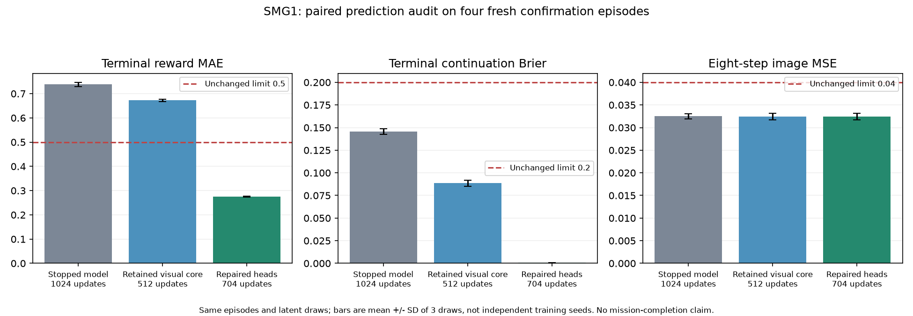

# SMG1 boundary-prediction repair, October 25, 2026

The owner explicitly requested correcting the SMG1 block after the finite
motor8 pilot closed. This is a new bounded repair, not an extension of that
pilot or authorization for indefinite six-agent training. The persistent
terminal-prediction block is repaired: the selected checkpoint passes every
unchanged gate in all three draws on a frozen, fresh four-episode confirmation,
and one gated actor/critic update actually completed.

This result concerns prediction and optimizer eligibility. It does not establish
a safe initial exit, learned star collection, higher training speed or a good
full-course reward. The [known reward-v1 defects](motor8-reward-review.md) remain
a separate reason to revise the online experiment before a long allocation.

## Diagnosis and component isolation

The stopped motor8 SMG1 checkpoint had 4096 new real decisions, 1024 model
updates and zero actor updates. Its failed gates correctly blocked imagination.
Image/action/reward alignment was checked. Terminal images were inspected;
there was no identical observation with conflicting terminal labels in this
small replay. This does not prove all deaths are visually unambiguous.

Even terminal-tail sampling supplies one death among many supervised live
transitions. A 64-batch train-only diagnostic contained 441 terminal labels in
14989 supervised transitions, about 2.94%. Multiplying these errors by five
still diluted them inside a sequence-wide mean. Fixed-feature equal-class
head fitting alone did not solve the held-out errors, and increasing whole-model
updates damaged visual forecasts in some audits.

The new optional `balance_terminal_losses` setting computes the terminal and
nonterminal prediction means separately and averages present classes. Padding
and burn-in do not contribute; absent classes are omitted. Existing terminal
cost weights remain explicit. Reconstruction and reported metrics retain their
definitions. The default is false, preserving historical objective semantics.
This is an original repair option, not a claim to reproduce DreamerV3.

The selected branch retains the first-fit 512-update visual/recurrent model,
whose reused held-out forecasts were better than those of the stopped
1024-update branch. It performs 128 head-only updates at terminal weight 20,
followed by 64 head-only updates at weight 40. Only reward and continuation
parameters are optimized; each stage resets their Adam moments and resamples
real training fragments. Visual/recurrent weights and other optimizer moments
are preserved. Final model counter of 704 is **512 + 128 + 64** on this explicit
branch, not a reset or deletion of the retained checkpoint at 1024 updates checkpoint.

`update_prediction_heads` never observes RAM coordinates or health. It uses
frozen pixel-derived recurrent features, actions/scenarios, and the existing
scalar reward/termination labels from the training split. Held-out or fresh
validation data are never fitted. Its steps increment model updates, not real
or imagined transitions. Optional isolated decoder/prior fitting helpers were
also tested; those candidates were rejected and are not promoted.

## Retained trials, including failures

The [complete trial record](assets/performance/smg1-boundary-repair-trials-20261025.json)
retains every candidate, source hash, settings, checkpoints, intermediate audit
and unsuccessful component refinement. The paired full-model control and
balanced arms each used 256 updates with matched sampler/Torch seeds. Neither
passed all gates. Balancing improved terminal continuation strongly, but did
not solve reward prediction and visual generalization by itself.

Two discarded unsaved cached-feature diagnostics used 256 head optimizer steps
each, recorded separately. Serialized repair trials used 1088 optimizer steps
across different clones; these are experimental compute, not the selected
checkpoint's model counter and never new game decisions. A mistyped source
path failed before one decoder invocation could allocate work; its error log
is retained and it spent zero updates/decisions. The retry read the exact path
from state. Allocation claims are now protected by the existing OS-lock helper
so future concurrent invocations cannot spend one budget twice.

The first four new full-start prior episodes used seeds 101/137/173/211 and 265
physical decisions. The intermediate weight 20 calibration passed only 1/3
latent draws: terminal reward MAE was0.499-0.517 and image MSE0.0390-0.0404.
After observing this failure, that dataset became development evidence and
was never subsequently called unseen. Stronger heads fixed terminal metrics
there, but the frozen visual core still failed image gates in 2/3 draws by a
small margin. Decoder-only and prior-only refinements did not solve that
development visual failure and were rejected. Future hard batches may still
block actor updates, as intended; this is not unconditional model reliability.

## Fresh confirmation and actual actor update

The final weight 40 checkpoint was frozen, hashed and selected before collecting
a second confirmation set: seeds 223/251/277/307, at most256 decisions each.
The actual four episodes used 188, 101, 35 and 43 decisions, respectively, 367 total;
all ended in death, with no stars. They were not used for fitting or subsequent
candidate selection. The real policy was still the untrained eight-action prior.

Validation-only NPZ files have incompatible keys and an explicit
`fresh_validation_never_fit` purpose. They remain local, outside training replay.
There are 632 total new physical validation decisions across both sets, zero
new real training decisions, and a separate 33-decision RAM probe. Original
4096-transition replay, episode splits, quality thresholds and originals remain
unchanged. The confirmation gate uses retained training coverage and the four
new episodes for validation coverage; no new data are smuggled into replay.

Both original baselines and the frozen repair were evaluated on identical
confirmation fragments and latent seeds 11/23/47. These are Monte Carlo draws,
not independent training replications or twelve distinct episodes.

| Mean on the same fresh confirmation | Stopped (1024) | Earlier (512) | Repaired (704) | Limit |
| --- | ---: | ---: | ---: | ---: |
| Terminal reward MAE | 0.7381 | 0.6726 | 0.2750 | 0.5 |
| Terminal continuation Brier | 0.1455 | 0.0885 | 0.000536 | 0.2 |
| Eight-step image MSE | 0.03251 | 0.03242 | 0.03242 | 0.04 |
| Overall reward MAE | 0.09192 | 0.09048 | 0.13493 | 0.5 |
| Overall continuation Brier | 0.02400 | 0.02208 | 0.02507 | 0.1 |
| Complete unchanged gates | 0/3 | 0/3 | 3/3 | All checks |

Overall reward/continuation errors worsened slightly while terminal errors
improved, and eight-step reward MAE increased from 0.234 to 0.364 versus the
earlier 512 branch. Do not describe this as uniform prediction improvement or
globally calibrated probabilities. Class weighting has tradeoffs; all original
required metrics still pass on this confirmation.

After confirming all original gates, one bounded actor/critic optimizer smoke
used nonterminal posterior seeds from original training replay. It completed
one actual actor update and 1024 imagined transitions while every world-model
parameter stayed bit-identical. No emulator collection or world fitting occurred
in this smoke. Its final counters are real 4096 / model 704 / actor 1 / imagined 1024.
One update proves that the previous permanent block is removed; it is not a
navigation result. The [paired confirmation and smoke evidence](assets/performance/smg1-boundary-confirmation-20261025.json)
retain exact hashes, counts and all episode outcomes.

## Operational artifact and remaining work

The strictly matching profile is `config/motor8-smg1-boundary-repaired.yaml`.
The ready local checkpoint is
`runs/m8-smg1-boundary/boundary-heads_strong-20261025-162736-258709/actor-smoke.pt`,
SHA-256 `c42a1b168b7c2bfe9e3857b4f49082ac91576be2a0f07a966dbbf1df14f1f1fe`.
The original stopped checkpoint and all failed branches remain intact.
`.local/smg1-boundary-repair-ready.json` records this pairing. Ordinary resume
still rejects mismatched settings/signatures rather than silently migrating.

No online training or six-emulator run was started. Before a long continuation,
revise reward geometry/scale with a distinct signature/replay, validate safe
ordered route progress and curriculum starts, then measure bounded online
learning. A forecast gate cannot repair an exploitable environment reward.
See [the BTR appendix/code review](btr-research-review.md) for relevant hypotheses.

Reproduction tools are `scripts/repair_smg1_boundaries.py` (requires the exact
finite local allocation), `scripts/validate_smg1_boundary_repair.py` (four fresh
episodes, maximum 256 decisions each), and `scripts/plot_boundary_repair.py`.
No automation was recreated after the previous pilot's follow-up was retired.

Verification for this revision: 155 portable tests and Ruff passed. Tests cover
class normalization, masked gradients, future-image exclusion, component/actor
isolation, unchanged gate thresholds, repaired-profile compatibility, audit
frame alignment and RAM-screening negative controls. These tests are separate
from the live prediction confirmation and establish no trained mission success.
