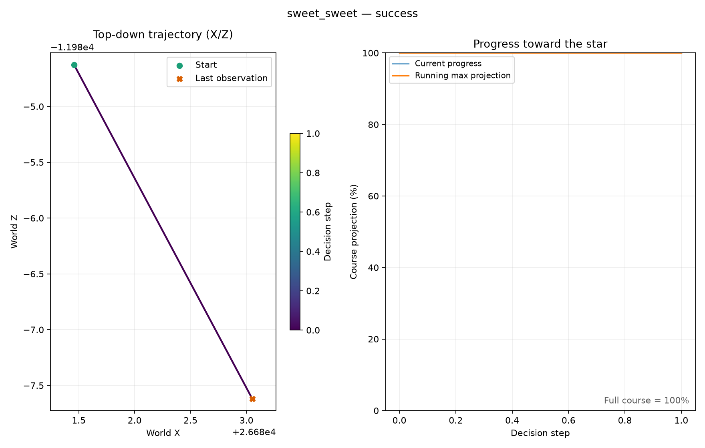
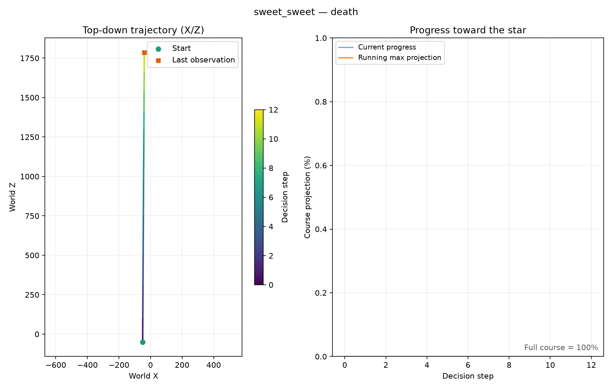

# Super Mario Galaxy: Sweet Sweet Galaxy

## Scope and status

Super Mario Galaxy (USA, `RMGE01`) is integrated for **validation only**. No
policy, inverse-dynamics model, RND model, or training rollout was created for
this game. Both training entry points reject this game before launching workers.
`config/smg1.yaml` also explicitly sets `training.enabled: false`.

The supplied Sweet Sweet Galaxy states identify the stage as
`BeltConveyerExGalaxy`, scenario 1. Slot 1 is the course start; slot 2 is a
near-star detector test. The configuration labels the mission **Rocky Road**.
The local ROM and both states remain excluded from Git.

| Asset | Use |
| --- | --- |
| `data/Super Mario Galaxy (USA) (En,Fr,Es).nkit.iso` | Local game image |
| `data/RMGE01.s01` | Course start and movement/death validation |
| `data/RMGE01.s02` | Jump once to test star collection; never a learning reset |

## Reproduce the validation

```powershell
.\.venv\Scripts\smg-rl.exe --config config/smg1.yaml calibrate-background
```

This creates one temporary, isolated hidden Dolphin instance. It loads both
states while paused, confirms neither is dead or complete, jumps from slot 2,
walks backward from slot 1 to test death, checks movement, and closes its instance.
It does not attach to the Galaxy 2 learner. Its files live under `runs/smg1/`;
its calibration is `config/smg1-calibration.json`. Galaxy 2 continues to use
`config/calibration.json` and its own profiles/checkpoints.

The 2026-10-21 live run passed all four checks with Dolphin 2609a. Evidence was
written to `runs/smg1/background-validation-20261021-183046-092964/`. Portable
copies of the measured traces are in `docs/assets/smg1/`, and the measured
telemetry is retained in the checked-in calibration.

| Check | Observation |
| --- | --- |
| Start | XYZ approximately `(-50, 45, -50)`; incomplete and alive |
| Near-star baseline | XYZ approximately `(26681.46, 950, -11984.63)`; incomplete and alive |
| After jumping | Scene nerve `0x806A1BD8`; complete, not dead |
| Backward fall | Actor nerve `0x8069F040`, scene nerve `0x806A1BE0`; dead, not complete |
| Forward movement | Z changed from `-50` to about `-105.30`; alive and incomplete |
| Pause | Scene counter remained unchanged during the check |



This short trace validates the detector. It is not a learned full-course
completion. Its horizontal motion is tiny because the test begins under the star.



## Independently derived memory profile

These are **emulated Wii addresses**, read as big-endian values. The layout is
derived from [Petari's pinned RMGE01 symbols](https://github.com/SMGCommunity/Petari/blob/bfa933645d969a8f0b4fea24f490370ee85e7c29/config/RMGE01/symbols.txt)
and its corresponding class layouts. It is independent of the Galaxy 2 layout.

```text
U32(a) = big-endian unsigned 32-bit read
game_system      = U32(0x806A1228)
scene_controller = U32(game_system + 0x24)
scene            = U32(scene_controller + 0xAC)
scene_objects    = U32(scene + 0x10)
mario_holder     = U32(scene_objects + 0x50)  # index 0x14
mario_actor      = U32(mario_holder + 0x0C)
actor_spine      = U32(mario_actor + 0x50)
scene_spine      = U32(scene + 0x04)
```

| Signal | Address or rule | Evidence |
| --- | --- | --- |
| Disc ID | ASCII `RMGE01` at `0x80000000` | Live |
| Code signature | `80 63 00 0C 4E 80 00 20` at `0x802E1520` (`MarioHolder::getMarioActor`) | Source and live |
| Scene vtable | `U32(scene) == 0x805BD054` | Symbols and live |
| Stage | ASCII at `scene_controller + 0x20`, length at most 32 | Live |
| Scenario | `U32(scene_controller + 0x40) == 1` | Both states live |
| X / Y / Z | Float32 at `mario_actor + 0x0C / +0x10 / +0x14` | Movement, star, fall live |
| Playing | Scene nerve `0x806A1BD0` | Live |
| Star collection | Scene nerve `0x806A1BD8` | Jump from slot 2 live |
| Abyss death | Actor nerve `0x8069F040` | Backward fall live |
| Game over | Scene nerve `0x806A1BE0` | Backward fall live |
| Grand Star | Scene nerve `0x806A1BDC` | Symbol-derived, not exercised |
| Other death states | Actor nerves `0x8069F03C`, `0x8069F044` through `0x8069F054`, in steps of 4 | Symbol-derived, not exercised |

The current nerve is the pending pointer at `spine + 8` when nonzero, otherwise
the current pointer at `spine + 4`. The counter at `spine + 0x0C` is local to the
current nerve and can restart on a state transition. Completion compares the
scene's nerve pointer with `0x806A1BD8`; it does not read that address as a Boolean.

Only the listed stage/scenario is accepted. Unsupported disc IDs, code
signatures, scene vtables, invalid pointers and non-finite coordinates fail closed.

## Progress and future training readiness

The shared progress function can project X/Z onto the calibrated start-to-star
axis. For Sweet Sweet Galaxy this is only a diagnostic projection. A curved
route can increase that number without following the playable path, or make
legitimate travel temporarily decrease it. No claim is made that the projection
is a verified native course percentage or sufficient future reward design.

Before authorizing training later, inspect the full course, consider ordered
waypoints, validate the height/displacement thresholds over legal jumps and
moving platforms, and define a new experiment and checkpoint namespace. A Galaxy 2
checkpoint has a different scenario space and cannot serve as a ready-made Galaxy 1
policy. The hard validation-only guard is intentional for the current scope.

The short death plot may show increasing geometric projection during a fall.
The live death flag and reward-height/displacement gates prevent interpreting
that raw chart value as earned learning progress. The calibration trace plot
uses the running maximum of raw projection because it is a detector test, not
an environment reward log; training CSVs have a separate `best_progress` column.
