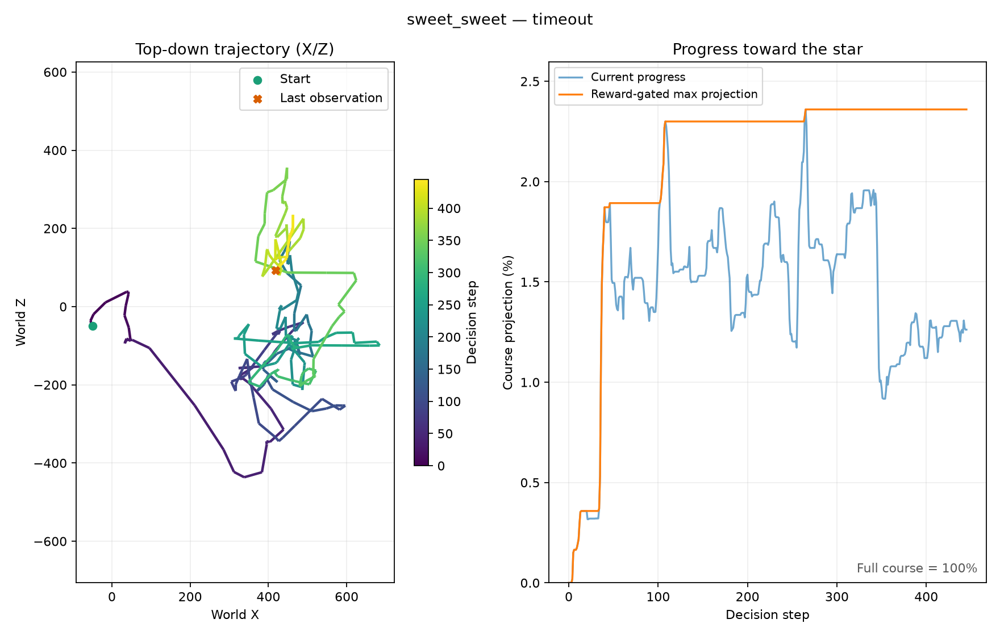
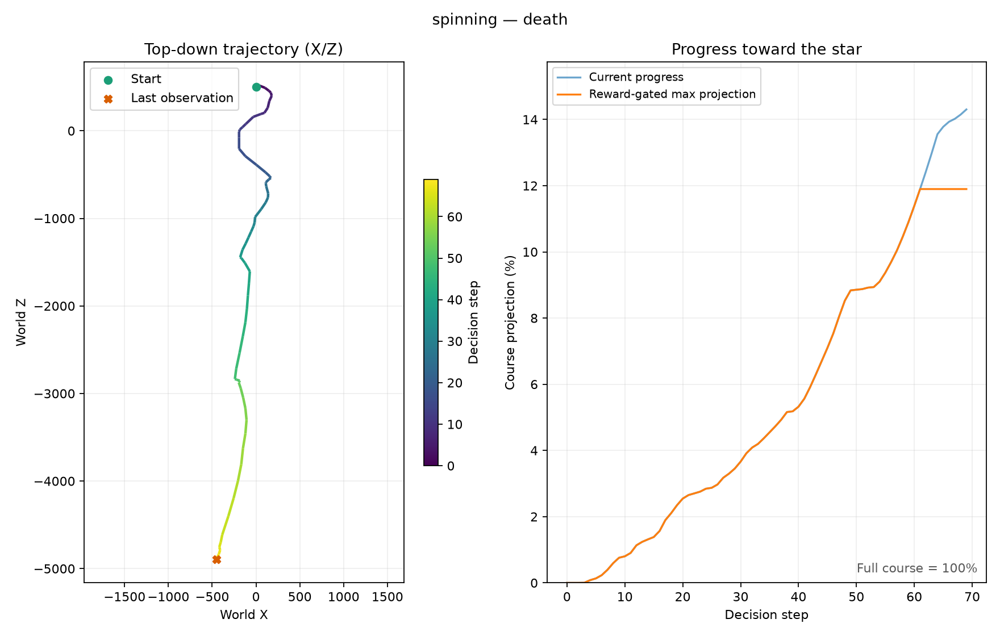
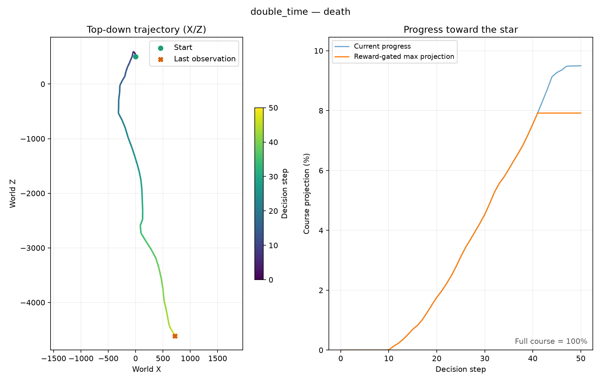

# Staged training continuation

The owner authorized development, fitting and online training on October 24,
2026, with explicit reviews between bounded blocks. The former shutdown hold
is superseded; retained final checkpoints remain immutable starting points.

## First stage

- Galaxy 2: original checkpoint, 1024 model updates per arm, seeds 11, 23, 47;
  compare `continued_baseline` with `terminal_reward_weight` (coefficient 5).
  Use `ablate-world-model --arms continued_baseline terminal_reward_weight`.
  No new Galaxy 2 collection during this frozen-replay comparison.
- Galaxy 1: resume the corrected final checkpoint for 2000 real decisions.
  This is a health check, not evidence of convergence. Save a separate final
  checkpoint and close owned emulator processes at the budget boundary.

The previous audit data are reused for this follow-up and are no longer an
independent unseen test set. Report this selection limitation. Final conclusions
about navigation require fresh real-game episodes. Never select an objective
using pixel reconstruction alone, or weaken quality gates to permit imagination.

## Reviews and subsequent budgets

Inspect progress/status timestamps, controller identity, errors, measured real
decisions per second, replay validity, imagination gate reasons, model and actor
update deltas, deaths, health loss, RAM-confirmed completion and trajectories.
Compare episode progress distributions as well as isolated high-water records.
Geometric progress is not a native completion percentage; falling movement can
mislead. Detector fixtures, near-star states and imagination are never successes.

After a healthy initial block, Galaxy 1 may receive 8000 additional decisions
to reach a 10000-decision first block. Review again before allowing a further
20000 decisions (30000 total). Stop on faults or unresolved measurement issues.

After the Galaxy 2 offline comparison, review all seeds and both scenarios.
Choose an objective only if the trade-offs support a bounded real-control trial.
Use identical starting checkpoints, random seeds, worker allocation and real
budgets when comparing control and candidate; preserve separate replay roots so
one arm does not learn from the other's new trajectories. Any settings migration
must produce a new checkpoint manifest. Begin with a health check, then a
25000-decision first block and at most 100000 decisions per arm after review.
Report each phase separately even though the shared learner budget is aggregate.

These are experiment budgets, not promises of learning. Review checkpoints are
not repeated significance tests. Three seeds describe variability, not proof.
Online A/B fitting is separate from the three offline seed replications.

## Monitoring and stopping

Local `.local/staged-training-state.json` records launched jobs and reviewed
stages. A thread follow-up checks every 15 minutes while this experiment is
active, remaining quiet unless a stage finishes, a failure occurs, or a decision
is required. Each subprocess has its own finite budget: a missed follow-up
cannot silently start another block. No automatic unreviewed stage chaining.
Use the run's `STOP` marker to request an orderly stop and checkpoint save.
Never stop unrelated jobs. Pause the follow-up once this staged experiment ends
or if the owner asks to stop. Log stage decisions and publish results in English;
communicate with the owner in Portuguese.

## Initial Galaxy 1 review (October 24 local time)

Run `runs/smg1/world-model-20261024-225907-822079` completed its exact
2000-decision budget at 280773 lifetime real decisions in 344.766 seconds
(5.80 decisions/s). It added 248 model updates, 15 actor updates and 15360
imagined transitions. The owned emulator closed, stderr was empty and replay
reported no rejected archives. Five episodes timed out; the sixth was interrupted
at the budget boundary. All 2000 logged actions had health 3, with no damage,
death or RAM-confirmed completion. Maximum geometric progress was 2.68%, below
the historical record; this is not evidence of improved navigation.

The last stochastic four-batch gate failed terminal reward MAE (0.570 > 0.5)
and terminal Brier (0.226 > 0.2). Before proceeding, a read-only paired audit
compared the retained source and new checkpoint on identical held-out draws and
Torch seeds 11, 23 and 47, with 16 batches per seed. Both checkpoints passed
two of three audits, failing the same seed on terminal reward MAE. Source
terminal MAE was 0.324/0.515/0.459; current MAE was 0.353/0.519/0.492.
Current terminal Brier was 0.105/0.180/0.150, all below 0.2. The weak terminal
prediction is pre-existing and sampling-sensitive; the small MAE regression in
all three paired draws remains a risk. These are validation seeds, not three
independently trained policies, and no gate threshold was changed.

Decision: allow a bounded 8000 additional decisions, reaching 10000 new
decisions in total, with another review before any extension. Actor updates
continue only on cycles passing every existing quality gate. The diagnostic
is recorded in [the paired audit](assets/performance/smg1-staged-initial-audit-20261024.json).
Galaxy 2 offline fitting remains in progress and no online arm has started.

## Galaxy 2 longer offline comparison review

The 1024-update, three-seed comparison completed all six fits and final audits in
`runs/ablation-20261025-015911-220971`. Relative to the equal-update control,
terminal reward weight 5 reduced terminal reward MAE by a paired mean of 52.34%
for Spinning and 49.81% for Double Time. All three candidate seeds passed every
original gate, compared with zero of three controls. Future-image error changed
by -0.62% and +0.31%, respectively, which does not establish an improvement in
visual prediction or navigation. Continuation Brier increased by 14.41% in
Spinning but remained small in absolute terms (0.00704). Full metrics and
per-seed results are in [the follow-up record](assets/performance/smg2-world-model-followup-20261024.json).

Decision: advance to paired real-control health checks. Use offline seed 11
(the first predeclared seed, rather than the best measured seed) for both arms.
Both checkpoints received exactly 1024 offline model updates from the same
source and retain identical actor weights and real-decision counters. Use
online seed 11 and four workers per arm, with sequential 2000-real-decision
health checks before any longer budget. Each arm receives a separate copy of
the same initial replay, verified with per-file SHA-256 and sizes. Each arm's
new episodes stay within its own replay. The original replay and final source
checkpoint are preserved. Additional data, gate behavior and policy adaptation
will diverge naturally; this is a small adaptive online comparison, not a
three-seed real-control study or proof of reduced time to completion.

## First-block and control-health review (October 25 local time)

Galaxy 1 completed the additional 8000 decisions at 288773 lifetime decisions,
reaching 10000 new decisions across the two stages. The extension took 1940.766
seconds (4.12 decisions/s), added 1000 model updates and 86 actor updates, and
ended with 18 timeout episodes, one death and one budget interruption. Maximum
geometric progress in the extension was 2.36%; the median across 19 completed
episodes was 1.78%. No RAM-confirmed completion or health loss was logged.
The first health check's 2.68% remains the best across these 10000 new decisions;
neither block exceeds the historical record. Replay had no rejected archives,
stderr was empty, and the saved checkpoint digest was verified. The final gate
blocked imagination on terminal MAE 0.5048, keeping the original limit 0.5.

Decision: keep Galaxy 1 stopped at this boundary and diagnose exploration,
reward balance and action behavior before spending the optional 20000-decision
extension. Frequent timeouts indicate a navigation/exploration limitation;
additional elapsed time alone is not evidence of useful learning. The zero
legacy intrinsic reward column is expected when the world-model disagreement
bonus is used only in imagination; it does not mean that bonus was disabled.

The Galaxy 2 continued-control health check completed 2000 decisions in 238.062
seconds (8.40 aggregate decisions/s), ending at 872272 lifetime decisions. It
added 60 model updates and one actor update. Forty-four episodes ended in death,
four were interrupted at the budget boundary, and none completed the mission.
Best geometric progress was 11.90% in Spinning and 7.92% in Double Time; median
completed-episode progress was 6.18% and 3.60%, respectively. The final gate
blocked imagination on Spinning terminal reward MAE. No stderr error or replay
rejection was reported, and the final checkpoint digest was verified.

Decision: start the matching 2000-decision candidate health check; do not extend
either arm until both results have been reviewed. Aggregate speed measurements
include startup and shared hardware contention, so they are not isolated
algorithm benchmarks. Detailed counters and trajectory provenance are in
[the block review](assets/performance/staged-first-block-review-20261025.json).

Trajectory inspection also highlights a measurement limitation: the Spinning
high-water sample is at Y=-1740.68, below the initial Y=-1150, shortly before
death; the Double Time maximum is at Y=-1428.96. The existing minimum reward
height (-1800) does not prove platform contact. These projections can include
airborne/falling motion and must not be interpreted as verified traversed course
segments. Plot legends therefore say "Reward-gated max projection". Review
support/contact or course geometry before treating a geometric gain as navigation
improvement; preserve reward settings throughout the paired health checks.

