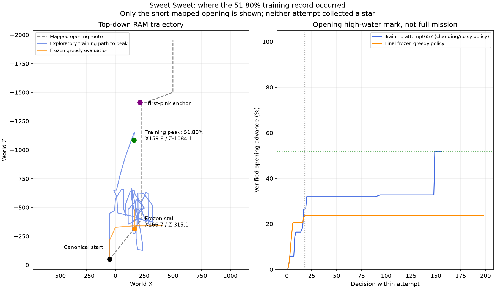

# Frozen stochastic IQN comparison and the Sweet Sweet51.80% location

Date: October26,2026. The owner requested stochastic evaluation after the
[completed greedy evaluations](impala-final-results.md). No training resumed,
weights were not fitted and all original deterministic results remain retained.

## What stochastic means for this IQN

IQN predicts action values, not a PPO-style categorical action policy. This
comparison uses the existing training-time exploration behavior with frozen
parameters: resample NoisyLinear noise and IQN quantiles each decision, take the
maximum sampled expected Q action, and mix the checkpoint's terminal epsilon0.1
uniform random choices. It does not reinterpret Q values as probabilities or
introduce an arbitrary softmax temperature.

`record-dqn --stochastic` enables this explicitly. The default remains frozen
greedy evaluation with fixed midpoint quantiles, parameter noise disabled and
the checkpoint's declared evaluation epsilon (zero for these final profiles).
No optimizer step, replay insertion or real-training counter update occurs.
The network's train-mode flag activates only the existing noisy layers here;
these encoders contain no batch normalization or dropout that could alter
running statistics. Portable tests verify seeded stochastic variation and
unchanged persistent network weights/counters.

Videos show`NOISYNET_EPSILON EVAL` and the actual epsilon. Every two-frame
sidecar sample identifies`epsilon_random` versus`noisynet_argmax`, the actual
Q vector, exact input digest and physically applied controls. The latter source
also includes random IQN quantile approximation. An epsilon-generated action
can coincidentally equal the greedy action; the flag records selection source,
not whether the action changed.

## Finite allocation and completed results

The same final checkpoints, canonical starts, seeds11/23/47 and at most600
decisions per mission/seed were used. This allocated at most5400 evaluation
decisions;935 were executed before the nine episodes terminated. These are
additional evaluation decisions, not additional training. No star occurred.

| Mission | Greedy mean opening advance | Stochastic mean | Stochastic best | Stochastic outcomes |
| --- | ---: | ---: | ---: | --- |
| Sweet Sweet |23.64%|32.42%|35.03%|2 timeouts,1 death|
| Spinning |100%|99.92%|100%|3 deaths|
| Double Time |100%|99.97%|100%|3 deaths|

Sweet's stochastic advances were34.7782%,35.0312% and27.4403%. Execution with
exploration improved this small sample's opening coverage, but it did not
reproduce the earlier51.80% collection record or solve the mission. Both SMG2
policies still died after their local opening behavior. Three rollout seeds
are not independent training replicas or evidence of a general algorithm ranking.
Noise, random quantiles and epsilon were enabled together; their separate causal
contributions were not isolated by this comparison.

The [audit](assets/performance/impala-stochastic-evaluation-20261026.json)
verifies video-frame counts, actual controls, exact-image consistency, finite Q
vectors and action-source counts. Agent files (including saved optimizer state)
and replay hashes remained unchanged. All failures are retained locally.

```powershell
# This declared comparison has completed: do not duplicate it automatically.
.venv\Scripts\python.exe -m smg_rl.cli --config config/impala-iqn-smg1.yaml record-dqn CHECKPOINT --variation 0 --seeds 11 23 47 --max-steps 600 --stochastic
```

## Where51.80% occurred

This was canonical training attempt657, worker00 episode65, at real decision
219858 with54452 optimizer updates. The final evaluated agent instead has296150
real decisions and73525 optimizer updates. Both policy weights and exploration
mode therefore differ between the old collection record and the original final
greedy test; the new stochastic comparison holds the final weights fixed.

At episode decision149, the verified grounded high-water mark was51.7965% of
the **short mapped opening**, at XYZ approximately159.8226,-50.0002,-1084.1265
with HP3. Mario had left the yellow starting platform and reached the straight
first perforated walkway, between route points Z-650 and Z-1400. This is before
the validated`first-pink` anchor near Z-1414 and before the turn toward the first
chocolate approach. The episode ended in death seven decisions later.

The frozen greedy stall was much earlier, near X166.7315/Z-315.1401, on the
starting-platform edge. The two locations must not be conflated. Neither51.80%
nor23.64% is a native whole-course percentage.



The [source-coordinate record](assets/performance/sweet-518-location-20261026.json)
and`scripts/plot_sweet_record.py` reproduce this diagram from retained CSVs.
This is a coordinate plot, not a claimed video screenshot of the historical peak.
No action-trace replay, synthetic completion or new training was used to locate it.

211 portable tests and Ruff passed after the explicit stochastic mode and
provenance fields were added. This finite comparison is closed and allocates no
new training or follow-up. The later owner-requested
[SMG1-only two-hour phase](smg1-six-two-hour.md) has separate state/budgets and
preserves these stochastic results.
