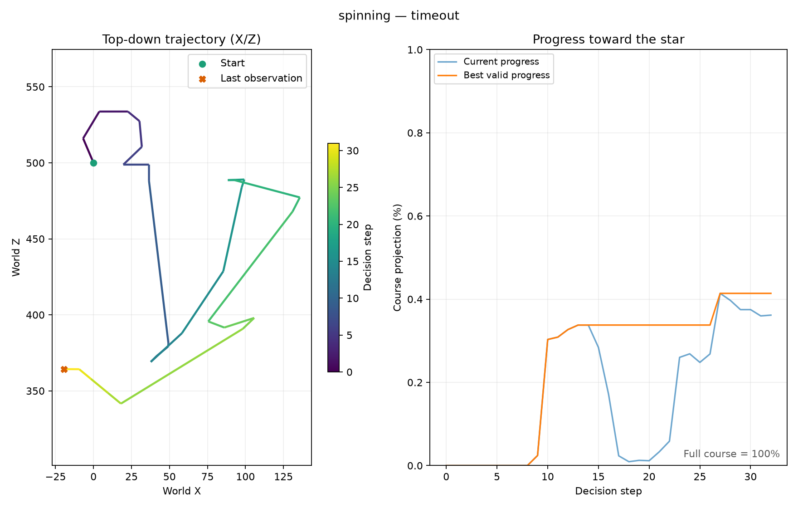
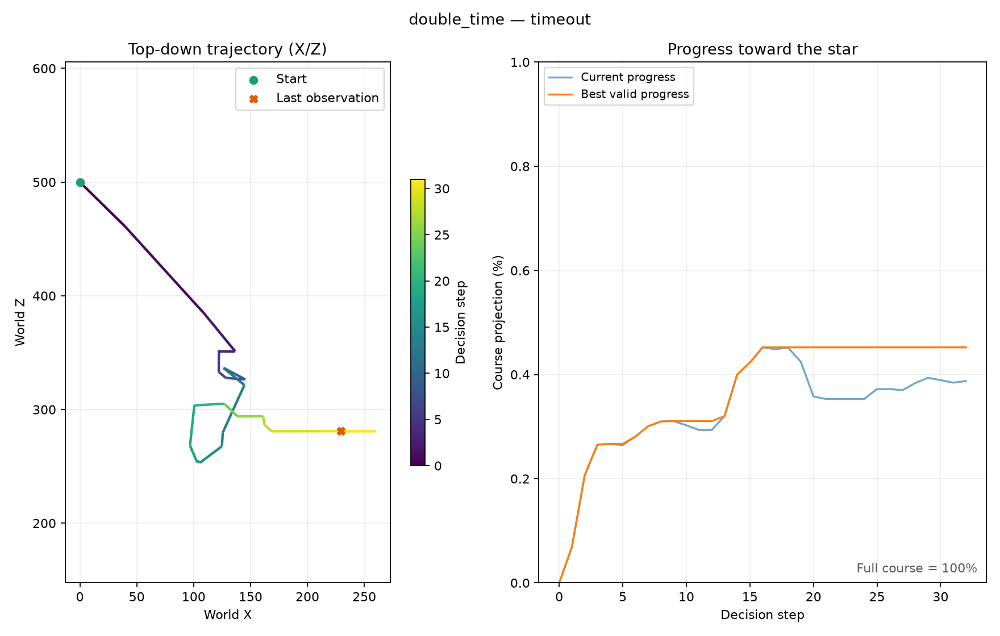

# Local validation report

This is a chronological engineering evidence register. Earlier test counts and
throughput values describe their respective revisions, rather than current
performance guarantees. The [background report](background-training.md) records
hidden star/death checks, CUDA collection, stop/resume, and timing revisions.
The original approximately 8x smoke speedup preceded the stricter pause checks.
The damage/recovery revision contained 66 tests; [damage and recovery](damage-and-recovery.md)
adds live HP evidence and supervised continuation. The report below retains the
original desktop baseline and subsequent failures for comparison. Current
learner counts and maxima belong in generated reports, not this static register.

Validation date: **2026-10-21**, America/Sao_Paulo. Emulator: **Dolphin 2609a**, Windows. Game: **SB4E01**. Python: **3.11**. All tests used the supplied local states; no game asset was uploaded.

## Memory and control validation

All four savestates were loaded. In both scenarios:

- The starting state has Mario near `(0, -1150, 500)` and scene nerve `0x807D5310`.
- The near-star state is initially incomplete.
- A real jump collects the star and changes the scene nerve to `0x807D5318`.
- Walking backward off the starting platform causes actor nerve `0x807D4E3C` and scene nerve `0x807D5320`.
- Forward movement changes the three position floats without claiming death or completion.
- The RAM scene-frame counter stays stable while paused.

The structured evidence is in [`config/calibration.json`](../config/calibration.json). Full initial calibration traces are retained under `runs/validation-20261021-170616-414513/`.

The final configuration was also tested using the **isolated copied profile**: Dolphin was booted through the project's `--user`, `--exec`, and `--save_state` launcher, and all four-state checks passed again. Final evidence is retained under `runs/validation-20261021-172440-122183/`. This run used the 0.25-second action interval and paused state restoration, and left Mario paused at the first starting state.

The star detector uses the current collection sequence rather than total stars in the save file. This also handles replaying a star already collected in the user's save.

## Live training smoke test

Command:

```powershell
.\.venv\Scripts\smg-rl.exe --config .local/smoke-config.yaml train --attach --steps 128 --rollout-steps 32
```

The temporary smoke config uses a 0.10-second held-action interval, a 32-decision episode limit, and a 32-decision idle limit. Production defaults remain in `config/default.yaml` with a 0.25-second held-action interval and longer episode limits. The run took about 129 seconds for 128 decisions, including four PPO rollouts and updates, at roughly one decision per second on CPU.

| Episode | Variation | Decisions | Outcome | Farthest valid progress |
| --- | --- | ---: | --- | ---: |
| 1 | Spinning | 32 | Time limit | 0.414% |
| 2 | Double Time | 32 | Time limit | 0.452% |
| 3 | Double Time | 32 | Time limit | 0.271% |
| 4 | Spinning | 32 | Death | 0.132% |

No full course was completed. These results validate live image observations, nonzero novelty rewards, progress signals, death termination, scenario resets, gradient updates, and checkpoint creation. They do not establish that the agent has learned to beat either course.

Local output: `runs/train-20261021-171440-784733/`. Both `model-final.zip` and the matching `model-final.intrinsic.pt` are retained locally and excluded from Git.

Measured sample trajectories are committed as small, reproducible evidence artifacts:



[Spinning CSV](assets/spinning-smoke.csv)



[Double Time CSV](assets/double-time-smoke.csv)

The progress plot zooms to the observed percentage range and explicitly labels full-course progress as 100%. The top-down view uses equal-scale world X/Z coordinates.

## Evaluation with intrinsic reward disabled

The smoke checkpoint was evaluated deterministically for one 32-decision episode per variation, with intrinsic rewards and curiosity updates disabled:

| Variation | Successes | Farthest valid progress |
| --- | ---: | ---: |
| Spinning | 0 / 1 | 0.958% |
| Double Time | 0 / 1 | 0.601% |

Local evaluation output: `runs/eval-20261021-171702-636139/`. The tiny sample and short timeout are only an integration check, not a reliable policy comparison.

## Resume validation

The 128-decision checkpoint and its matching curiosity state were loaded into a new run, trained for another 32 decisions, and saved successfully at **160 total decisions**. This verifies actual serialization and resumption of PPO and both curiosity models, beyond the unit-test roundtrip.

Latest local smoke checkpoint: `runs/train-20261021-171922-286912/model-final.zip`, with matching `model-final.intrinsic.pt`. This remains a pipeline smoke checkpoint, not a solved-course policy.

A final fresh 32-decision PPO run also passed using the production 0.25-second action interval, the paused reset implementation, and the isolated profile. It reached 0.781% valid progress without completing the course and saved its checkpoint in `runs/train-20261021-172631-112036/`. This is the latest fresh-run checkpoint; the 160-decision checkpoint above is the resume-test checkpoint.

## Automated checks

The test suite covers dynamic pointer relocation, endianness, both scenario IDs, pending nerve precedence, completion/death separation, invalid memory rejection, progress farming prevention, fall/teleport suppression, frozen episodic embeddings, RND checkpoint state, small-distance normalization, policy observation boundaries, episode logging/plots, input release around pause shortcuts, bounded pause retries, and source-profile preservation.

`python -m pytest -q`: **27 passed**. `python -m ruff check src tests`: **passed**. `python -m pip check`: **no broken requirements**.

## Subsequent integration and reliability checks (2026-10-21)

The canonical private repository is `PedroM2626/smg-rl`; its history was transferred from the initially configured account. The expanded portable suite has 43 passing tests, including independent RMGE01 telemetry, cross-game rejection, both CLI training guards, two-slot profile preparation and pause-stall regression. Ruff and dependency consistency checks passed locally.

Galaxy 1 Sweet Sweet Galaxy passed live star collection from slot 2, backward-fall death from slot 1, coordinate movement and pause checks. The full pointer map, fixture telemetry and measured top-down plots are in [the Galaxy 1 report](smg1.md). No Galaxy 1 training was started during that initial validation-only integration. The owner subsequently authorized the separate learner described in [concurrent training](concurrent-training.md).

The first Galaxy 2 long run stopped at 1944 aggregate timesteps on a pause acknowledgment failure. It was resumed from the intact 1140-step paired checkpoint after extending frame-stability detection and reconciling measured pause state. The revised four-worker CUDA run is `runs/parallel-20261021-183228-379160/`. During the subsequent live observation it exceeded 2700 aggregate timesteps, completed further PPO updates and wrote a fresh policy/curiosity pair at 2164. Its measured collection/optimization rate was approximately 4.6 new aggregate decisions per second. This was a contemporaneous training observation, not a claim of an unattended completed experiment or learned full-course success.

A final Galaxy 2 hidden calibration using the revised pause logic passed both star collections, both backward-fall deaths, both movement checks and pause stability. Its source evidence is `runs/background-validation-20261021-183949-902972/`; the calibration JSON was refreshed and portable measured traces were copied to `docs/assets/smg2-calibration/`. These detector checks ran in an isolated instance while the four-worker Galaxy 2 learner continued.

The concurrent-training/report extension passed 51 portable tests. Coverage now includes explicit training enablement, a one-scenario policy observation, in-progress trajectory snapshots, viewer-lock tolerance, exclusion of calibration and near-star fixtures from success reports, game-specific completion evidence and partial-episode plots. The first Galaxy 1 learner completed PPO updates and saved matching policy/curiosity checkpoint pairs while the four-worker Galaxy 2 learner continued. This validates concurrent operation, not full-course learning success.

## Health and recovery validation

Galaxy 1 health was independently checked with a real 3-to-2 nonfatal transition and a return to 3 after resetting slot 1. Reward replay of the measured states charged -0.25 exactly once and no repeated animation penalty. Evidence and the HUD screenshot are in [damage and recovery](damage-and-recovery.md). The expanded suite passed 66 tests, including health bounds, early zero-HP death, reset/healing behavior, no death double charge, unchanged Galaxy 2 behavior, complete-pair selection and supervised retry budget preservation. Both learners were resumed from their last complete pairs after the observed pause failures; their pre-failure progress remains in the report.

A regression test also verifies that a single queued screenshot frame is not accepted as evidence of continuously running emulation. The final pause acknowledgment requires two separate observed changes. A real supervised Galaxy 1 recovery selected timestep 2816 after a frame-advancement failure and continued in a new learner attempt.

## Native bridge revision, 2026-10-22

The separate Dolphin 2609a native build passed both Galaxy 2 star/fall detector
checks and Galaxy 1 star/fall checks, movement, and paused-state baselines. Native
calibration files include backend identity and executable SHA256. Final 128-step
environment benchmarks acknowledged exactly 12 frames each; same-nerve RAM scene
counter deltas matched. Old policy/curiosity pairs loaded in CUDA continuation
smoke runs, PPO updated, and complete final pairs were saved for four Galaxy 2
workers and one Galaxy 1 worker. The expanded portable suite passed 75 tests.
See [raw measurements, build/protocol, and migration limits](native-backend.md).

A controlled native recovery test terminated one test-owned emulator after its
64-step pair was saved. The supervisor resumed that pair on attempt two and
finished the original 256-step target. The isolated fixture and its records are
separate from production course-success claims; see the native evidence guide.

## Protocol v2 and exploration revision, 2026-10-22

The current suite passes 84 portable tests and Ruff. Additional regressions
cover premature CPU-frame acknowledgments, cross-game profile collisions with
identical timestamp names, pending curiosity batch persistence/flush, circular
kNN memory, bounded novelty/stall gates, and timeout costs distinct from RAM
death. Both native games passed refreshed detector calibration, 768 bounded
advance stress commands, 21 resets, and 48 paused stability checks. Controlled
Galaxy 1 process-exit recovery passed again. These remain engineering tests.

The [current audit](optimization-v2.md) retains repeated online-versus-batched
timings and negative evidence from the rejected presentation optimization and
the observed runtime profile collision. Counterfactual replay verifies the new
incentive arithmetic; production continuation verifies fresh paired checkpoints
and capped novelty in real episode logs. Neither establishes course completion
or a better learned policy. The latest audited full-start report at this
revision still found zero successes in all three tasks.

## Protocol v3 pipeline and collector, 2026-10-22

The final revision passed 90 portable tests and Ruff, both games' refreshed
detector calibration, 768 exact-frame stress commands, 21 resets and 48 paused
stability waits. Replayed native CPU preprocessing matched all 144 reference
images and coordinates exactly. GPU-linear reduction changed pixels and remains
an explicit experiment. The measured collector matches SB3 reset/terminal/seed
and ordering behavior, preserves owned observations, and identifies a deliberately
slow environment. Controlled native emulator-exit recovery passed again with
the selected collector, reaching 256 decisions on attempt two.

The [pipeline audit](optimization-v3.md) retains build hashes, final and
exploratory comparisons, and rejected transport settings. The final environment
workload observed about 11.6% higher Galaxy 2 throughput and 6.6% higher Galaxy 1
throughput over same-build poll/full references. Vector shared images did not
establish an advantage. These are engineering results and do not establish
faster sample-efficient learning or course success.
