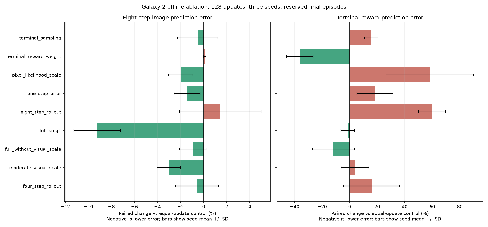

# Galaxy 2 offline world-model ablation

**Completed October 24, 2026:** all 30 predeclared fits and reserved final audits
finished. All 122 portable tests and Ruff passed. Original checkpoints and the
global hold were verified unchanged; the narrow experiment grant is inactive.
No candidate was deployed and no emulator or actor training was started.

## Question and scope

On October 24, 2026 the owner authorized testing whether the Galaxy 1 objective
repairs transfer to Galaxy 2, including additional hypotheses. This authorization
is restricted to a bounded offline experiment on checkpoint copies and existing
visual replay. The global training hold remains active. No Dolphin instance,
new game interaction, imagined actor update or deployed-policy replacement is
part of this experiment.

The source is the intact Galaxy 2 `world-final.pt` checkpoint at 870272 real
decisions. Its SHA-256/signature/settings manifest is checked by the normal model
loader. Each candidate loads that same checkpoint, including optimizer state,
then deliberately changes only the named objective/sampling settings. Original
weights and configuration remain untouched. Final candidate checkpoints have
their own manifests and remain local under `runs/ablation-*`.

## Predeclared screening design

| Arm | Change from the continued baseline | Hypothesis |
| --- | --- | --- |
| `continued_baseline` | None | Control for the benefit of additional fitting |
| `terminal_sampling` | Terminal-tail sampling probability 0.5 | Rare terminal examples need more exposure |
| `terminal_reward_weight` | Terminal reward error coefficient 5 | Terminal penalties are underweighted |
| `pixel_likelihood_scale` | Reconstruction coefficient 3528 | Pixel-mean loss is underweighted against KL |
| `one_step_prior` | Prior prediction objective coefficient 0.5 | Posterior-only supervision misses the prior |
| `eight_step_rollout` | Eight-step rollout objective coefficient 0.5 | Direct horizon supervision improves imagination |
| `full_smg1` | All six Galaxy 1 settings together | The complete repair transfers across games |
| `full_without_visual_scale` | Complete repair, reconstruction coefficient kept at 1 | Large image gradients may hurt useful predictions |
| `moderate_visual_scale` | Reconstruction coefficient 100 | A moderate visual weight may suit Galaxy 2 better |
| `four_step_rollout` | Four-step rollout objective coefficient 0.5 | Shorter supervision may offer a cheaper compromise |

Each of the 10 arms receives exactly 128 model optimizer updates for each seed
in `{11, 23, 47}`: 3840 additional model updates across 30 isolated candidates.
There is no early stopping or arm selection based on intermediate metrics.
Architecture, batch size 8, sequence length 32, burn-in 8, learning rate,
optimizer state at initialization, reward labels and all quality gates are held
constant. Each model retains the source real-decision/actor/imagined counters;
the experiment explicitly records zero new counts for those quantities.

Single-change arms estimate that change's short-run effect at the baseline
settings. They do not identify every interaction in the full package; this is
not a complete factorial experiment. `full_without_visual_scale` additionally
tests visual scaling conditional on the other repair settings. A large image
coefficient can also change the relative effect of other heads through the
existing global gradient-norm clipping; this is part of the tested intervention.

The replay sampler is reset to the same seed for every arm. Arms without a
sampling change receive the same sequence draws. The terminal-sampling arm
intentionally changes its training distribution. Torch/CUDA RNG seeds reset
for each update, so one arm's extra random operations cannot change subsequent
updates' seed schedule. Different objectives can still consume different random
draws inside one update; these are paired seed replications, not identical
latent samples at every operation.

## Data separation and audits

Whole-episode training/validation assignment is inherited from the recorder.
Only the existing training episodes enter optimizer updates. The existing
held-out episodes are split again by a deterministic, separately salted
episode-ID hash into development and final-audit partitions. Every chunk from
an episode stays in that episode's partition. Both partitions must cover both
Twisty Trials scenarios.

Eight fixed batches are materialized per partition, shared across all arms and
seeds. Four batches sample ordinary held-out fragments and four use the normal
0.75 terminal-tail preference. The final partition is evaluated only after
every candidate has finished fitting; it is not used to stop/select a fit.
This is a partition reserved for this experiment, not newly collected external
data. Its episodes may have appeared in historical online validation.

A replay manifest records paths, episode/split identity, lengths, sizes and
modification times. Every archive is validated during indexing; sizes and times
are checked again after the experiment. Neither game is collecting new data,
so the bounded replay cannot be evicted by an active writer during the test.

For each scenario, the audit records raw posterior image MSE, eight-step
open-loop image MSE, reward MAE, terminal reward MAE, continuation Brier score
and terminal Brier score. Image persistence and original all-scenario quality
gates are retained. Reported percent changes are paired against the same-seed
**continued baseline**, rather than an unfitted starting model. Lower error is
better; positive percent change means regression. Seed means and standard
deviations describe this small sample, not statistical significance or a
confidence interval. Relative changes in tiny Brier errors need particular
care; absolute errors remain available.

## Cost and interpretation

An additional read-only diagnostic, declared before the final audit was inspected,
measures frozen-actor action-distribution drift. It feeds the same real sequences
through the source and candidate worlds with deterministic posterior means, then
compares the unchanged actor's action probabilities using source-to-candidate KL
and greedy-action agreement. It excludes burn-in, padding and true terminal
states. Two final-partition batches are used, one ordinary and one terminal-biased.
This is a proxy for representation compatibility, not a sampled acting rollout
or a policy-quality score: a large drift can indicate the need for actor
readaptation, but is not by itself positive or negative behavior.

Fitting time includes replay sampling, tensor transfer, forward/backward passes
and optimizer steps, with CUDA synchronization at the timing boundary. It
excludes checkpoint I/O and development/final audits. Peak allocated CUDA
memory is measured during fitting, not total GPU memory including Dolphin or
desktop apps. Arms execute sequentially in the declared order for each seed;
cache warm-up, thermals and other desktop work can affect timing. It is an
engineering cost observation, not a dedicated isolated-hardware speed benchmark.

This short warm-start screen measures adaptation over 128 updates, not eventual
convergence. In particular, changing the reconstruction coefficient by several
orders of magnitude may require substantially longer optimization. A negative
short-run result cannot establish that a method is fundamentally unsuitable.
Similarly, better prediction or more gate passes cannot establish better real
control. No arm is deployed automatically. A future real-control comparison
requires separate owner authorization, matched real-interaction budgets,
full-start RAM completion checks and actual trajectory/progress evidence.

## Operation and authorization

```powershell
.\.venv\Scripts\python.exe -m smg_rl.cli --config config/world-model.yaml ablate-world-model --checkpoint runs/world-model-20261022-200121-619365/world-final.pt --updates 128 --seeds 11 23 47 --validation-batches 8
```

The command requires a narrow local
`.local/world-ablation-authorization.json` grant for the specific experiment,
source checkpoint hash, seed list and maximum per-arm update budget. It never
removes `.local/training-hold.json`. Ordinary online training and offline fitting
remain blocked. The grant is deactivated after completion or a caught execution
failure. Do not recreate it without explicit owner authorization.

The isolated run contains `replay-manifest.json`, incremental `results.json`,
candidate `.pt`/JSON pairs and, on failure, `error.json`. Creating `STOP` in the
run directory stops the experiment during fitting or before the next arm. Previous completed
candidates and the production checkpoint remain preserved.

The offline runner disables redundant PyTorch distribution-constructor argument
checks within its own process and restores their previous setting on exit.
Without this, Normal-distribution checks synchronize CUDA at every recurrent
step and are especially expensive when other GPU jobs are active. Archive
validation, nonfinite loss/gradient rejection and finite final-audit checks
remain enabled. Model equations and quality-gate thresholds are unchanged.

Portable tests verify the scoped grant cannot release the general hold,
episode-level audit separation, unchanged real/actor counters, paired control
deltas, finite metrics and grant deactivation. They do not count synthetic data
or prediction improvements as real mission completions.

## Measured screening results

[Full dated evidence](assets/performance/smg2-world-model-ablation-20261024.json) retains raw per-seed metrics and all-scenario gate outcomes.

| Arm | Spinning future MSE change | Double Time future MSE change | Spinning terminal MAE change | Double Time terminal MAE change | Gate passes / 3 |
| --- | ---: | ---: | ---: | ---: | ---: |
| `continued_baseline` | +0.0% | +0.0% | +0.0% | +0.0% | 0 |
| `terminal_sampling` | -0.6% | -0.5% | +20.4% | +11.0% | 0 |
| `terminal_reward_weight` | +0.3% | -0.1% | -37.0% | -35.4% | 2 |
| `pixel_likelihood_scale` | -1.1% | -2.9% | +57.1% | +59.6% | 0 |
| `one_step_prior` | -0.6% | -2.2% | +12.3% | +24.5% | 0 |
| `eight_step_rollout` | +2.1% | +0.8% | +43.1% | +76.7% | 0 |
| `full_smg1` | -6.9% | -11.6% | -3.8% | +1.0% | 0 |
| `full_without_visual_scale` | +1.4% | -3.2% | -17.1% | -6.5% | 0 |
| `moderate_visual_scale` | -4.3% | -1.8% | +3.8% | +4.2% | 0 |
| `four_step_rollout` | -1.4% | +0.2% | +21.8% | +10.0% | 0 |

Negative values mean lower error than the equal-update control. These are exploratory seed means, not evidence of statistical significance or real-game improvement.



The original checkpoint and global hold were verified unchanged; the scoped grant was consumed. All candidates remain isolated. Other training jobs shared the hardware, so fitting times are retained as observations without attributing their differences solely to an objective change. A cancelled pilot was excluded before this consistent full rerun.


## Frozen-actor representation compatibility

This read-only diagnostic uses identical actor weights and deterministic posterior means on two fixed final-partition batches. It excludes true terminal/padded states. Larger KL and lower agreement mean a larger action-distribution change, not necessarily worse real control.

| Arm | Source-to-candidate KL (nats) | Greedy action agreement |
| --- | ---: | ---: |
| `continued_baseline` | 0.02328 | 95.1% |
| `terminal_sampling` | 0.01535 | 95.2% |
| `terminal_reward_weight` | 0.02503 | 95.0% |
| `pixel_likelihood_scale` | 0.06568 | 85.9% |
| `one_step_prior` | 0.02083 | 95.7% |
| `eight_step_rollout` | 0.04555 | 90.4% |
| `full_smg1` | 0.08062 | 83.4% |
| `full_without_visual_scale` | 0.04394 | 89.8% |
| `moderate_visual_scale` | 0.01951 | 93.9% |
| `four_step_rollout` | 0.04028 | 86.1% |

## Interpretation of the observed effects

- **Terminal reward weight 5 is the strongest actionable screening signal.**
  Relative terminal reward MAE fell by 37.0% in Spinning and 35.4% in Double
  Time. Every paired seed improved in both scenarios. Two of three candidates
  passed the original combined gate, versus zero of three controls. Eight-step
  image error stayed approximately unchanged. Frozen-actor greedy agreement was
  95.0%, close to the continued control's 95.1%. This motivates a longer
  controlled follow-up; it does not establish better real navigation.
- **The full SMG1 package had the largest mean improvement in future images:**
  6.9% and 11.6% lower eight-step MSE, respectively, with all paired seeds
  improving both scenarios. Terminal reward effects were mixed across seeds,
  and none passed every gate. Frozen-actor agreement fell to 83.4%, so improved
  prediction should not be confused with compatibility with the trained actor.
- **Large visual weighting alone produced a trade-off:** posterior image MSE
  improved by 15.5% and 17.4%, while terminal reward MAE worsened by 57.1% and
  59.6%. All paired seeds showed the terminal regression in both scenarios.
  The full-package interaction differs from this isolated effect.
- **Eight-step rollout supervision alone regressed in this short adaptation:**
  terminal reward MAE rose by 43.1% and 76.7%, across all paired seeds, while
  future image MSE showed no consistent benefit. This differs from the Galaxy 1
  repair and cannot establish its eventual-convergence behavior.
- **Additional hypotheses had no clear all-metric winner.** Moderate visual
  scaling reduced mean future MSE by 4.3% and 1.8%, but terminal effects varied.
  Four-step supervision and one-step prior supervision had small/inconsistent
  image effects with higher mean terminal error. Sampling terminal tails alone
  worsened terminal MAE by 20.4% and 11.0%; increasing exposure is different from
  changing the loss coefficient.

These directions describe this checkpoint, fixed data and 128-update warm-start
screen. Three seeds and a reused historical replay are not evidence of
statistical significance, convergence, real mission improvement or reduced time
to completion. The prediction/cost/drift metrics remain separate; no arbitrary
weighted score was used to declare a universal winner. Further offline
hypotheses include longer matched fitting budgets and a terminal-weight sweep,
but no additional fitting or online experiment is scheduled by this report.
