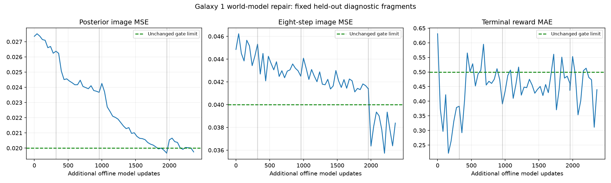

# Galaxy 1 imagination repair, October 23, 2026

## Observed failure

The resumed Galaxy 1 learner reached approximately 174000 real decisions and
21000 model updates without a permitted imagined actor update. Replay had both
episode splits and no rejected archives. Held-out posterior image MSE,
open-loop image MSE and terminal reward MAE remained above their limits. This
was a prediction-quality failure rather than a missing policy-update call.

Three training-objective issues were addressed:

1. Training sampled uniform fragments while validation emphasized terminal
   tails. Rare deaths therefore received little supervised training exposure.
   The Galaxy 1 profile now draws terminal-tail fragments with probability 0.5
   from the training split and weights terminal reward error by 5.
2. Reconstruction used a pixel mean, with numerical magnitude near 0.02, against
   KL terms of order one. The Galaxy 1 reconstruction coefficient is now 3528,
   half the 84 x 84 pixel count, corresponding to the squared-error term of a
   summed unit-variance Gaussian image likelihood.
   This changes optimization balance, not the definition of reported image MSE.
3. Prediction heads were supervised on posterior states, whereas imagination
   uses prior states without the real next observation. A 0.5-weight one-step
   prior objective now supervises the actual next image, reward and continuation
   using only the preceding state, action and scenario to form that prior.
   An additional 0.5-weight eight-step open-loop objective directly trains the
   rollout horizon used in imagination, starting from a real posterior context
   and predicting future targets without observing their images.

These changes are optional, with legacy defaults preserving the Galaxy 2
objective. No architecture or action-space change was made. RAM health and
coordinates remain reward/check labels, not neural policy inputs.

## Controlled repair procedure

Only Galaxy 1 was stopped gracefully. Its final checkpoint at 174229 real
decisions retained all model/actor/critic and optimizer weights. Its source run
is `runs/smg1/world-model-20261023-005245-482560`. Galaxy 2 remained running.

The repair uses existing real replay without collecting new decisions. Evaluation
resets the replay-sampler and Torch RNG states to compare the same held-out
fragments, restores those RNG states afterward, and never fits held-out targets.
There are four batches of eight sequences per evaluation. A fixed diagnostic
set is useful for development but is not an independent final test; subsequent
online validation draws fresh batches.

A first 320-update trial used reconstruction weight 5 and established improved
terminal reward prediction without solving the visual gates. A second trial
uses weight 100; the third uses likelihood-scale coefficient 3528. The final
trial adds explicit eight-step rollout supervision to address the remaining
multi-step prediction gap.
Original and repaired checkpoints are preserved separately;
neither offline model updates nor imagined transitions increase `real_decisions`.
There are no policy updates during this offline repair.

Checkpoint settings remain strictly checked on ordinary resume. This deliberate
migration first loads the old checkpoint with its original manifest/settings,
then assigns the new objective settings to the agent and world model and saves
a new immutable checkpoint with a new SHA-256 manifest. Parameter shapes and
optimizer state are preserved. The evidence retains the source hash and both
settings dictionaries rather than editing the original manifest.

All original gates remain in force: posterior image MSE <= 0.02, open-loop MSE
<= 0.04, open-loop prediction better than image persistence, terminal reward MAE
<= 0.5, continuation/terminal Brier limits and real-data coverage requirements.
The actor is permitted to learn only when the complete online gate passes.

## Verification boundaries

The final offline diagnostic passed every original gate after 400 rollout-repair
updates. The complete repair comprised 2360 additional model updates and zero
new real decisions. Comparing the original diagnostic with the final one:

| Metric | Original | Repaired | Unchanged maximum |
| --- | ---: | ---: | ---: |
| Posterior image MSE | 0.02735 | 0.01975 | 0.02000 |
| Eight-step open-loop image MSE | 0.04485 | 0.03838 | 0.04000 |
| Terminal reward MAE | 0.63083 | 0.43959 | 0.50000 |

At approximately 10:42 America/Sao_Paulo, online run
`runs/smg1/world-model-20261023-104046-961482` had 174373 real decisions, 23636
model updates, **2 imagined actor updates and 2048 imagined transitions**.
The learner process identity, checksum manifests and absence of a run error
were verified. Online updates use newly sampled held-out batches and remain
conditional: a subsequent failing batch pauses further imagined updates without
discarding the actor or stopping collection. Both games were left running.

See the [dated evidence and trial curves](assets/performance/smg1-world-model-repair-20261023.json).
The curve includes the unsuccessful intermediate coefficients rather than
reporting only the successful endpoint:

Portable tests cover finite gradients through the prior objective, zero direct
loss on masked burn-in targets, terminal-only reward weighting, replay splits,
future-image exclusion from one-step and multi-step predictions, frozen model
parameters during actor updates and checkpoint integrity. All 119 portable tests
and Ruff passed. Passing
these tests does not demonstrate a solved level or a speed advantage.

Measured repair results and online restart evidence are retained with the dated
performance records. A reduction in prediction error is separate from successful
real control. Full-start star collection must still be established by RAM and
the real trajectory.
