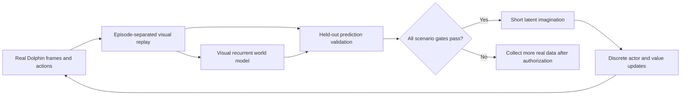

# Visual world-model experiment

> **Historical context:** Experiment status, authorizations, schedules and live counters in this document refer to their stated dates. Later work may supersede them; consult [current evidence and next experiments](current-status.md) and check actual process state before acting.

## Current status and authorization

On October 22, 2026 the owner first stopped training during implementation, then
explicitly authorized continuing Dreamer-inspired collection and training. The
hold was archived locally before launching the two world-model jobs. Both
supervised PPO jobs remain stopped; their final policy/curiosity pairs remain local:

| Agent | Confirmed real decisions | Retained final pair |
| --- | ---: | --- |
| Galaxy 2, both Twisty Trials variations | 824416 | `runs/parallel-20261022-191244-766492/model-final.zip` and `.intrinsic.pt` |
| Galaxy 1, Sweet Sweet Galaxy | 220891 | `runs/smg1/parallel-20261022-191244-766492/model-final.zip` and `.intrinsic.pt` |

The local `.local/training-hold.json`, when present, blocks all training commands
before environment creation. It was absent while the authorized October 22-23
experiment ran. The October 23 hold was superseded by subsequent owner-authorized
bounded work; check the actual hold file and [current evidence](current-status.md)
before a new allocation.

Two online jobs started at approximately 20:01 America/Sao_Paulo on October 22
with independent budgets of 1,000,000 new real decisions: four Galaxy 2 workers
covering both variations, and one Galaxy 1 worker. Galaxy 1 was stopped for the
objective repair described below and resumed on October 23 from its repaired
checkpoint. Model fitting starts after 4096 replay transitions; imagined actor
updates require every held-out scenario gate to pass.

At the dated snapshot of **October 23, 2026, 17:48 UTC**, Galaxy 2 had 732,288
real decisions, 22,748 model updates, 1,182 imagined actor updates and 1,192,992
imagined transitions. Galaxy 1 had 229,349 real decisions, 30,508 model updates,
421 imagined actor updates and 431,104 imagined transitions. The best verified
geometric progress was 19.53% (`spinning`), 13.76% (`double_time`) and 5.06%
(Galaxy 1); the Galaxy 1 world model remains below the preserved PPO record of
7.15%. Both gates were blocked only by terminal-reward prediction at that
snapshot; earlier and later validation cycles can differ. No full-start mission
has been completed.

At the owner's request, both jobs were stopped on October 23, 2026 before the
PC was shut down, and the local training hold is active again. Their final
checkpoints are retained at 870,272 Galaxy 2 and 278,773 Galaxy 1 real decisions,
with 27,060/36,688 model updates, 1,291/1,017 imagined actor updates and
1,302,360/1,041,408 imagined transitions respectively. At the final stop the
Galaxy 1 gate passed, while both Galaxy 2 scenarios remained blocked by
terminal-reward prediction only.

The [live experiment record](world-model-live.md) keeps the dated counters,
per-scenario metrics and best-evidence paths; `status.json` is the live source.
**No learning-speed advantage or learned mission completion has been
established.** Earlier PPO runs retained trajectories and metrics, but not pixel
sequences. Coordinate CSVs cannot reconstruct these observations, and PPO
weights cannot resume this different architecture.

## Why a world model may help

The previous bottleneck is expensive real Dolphin interaction. A learned visual
dynamics model can reuse a real transition many times and improve a policy using
cheap imagined latent trajectories. This is the motivation behind
[Dreamer](https://arxiv.org/abs/1912.01603),
[DreamerV3](https://arxiv.org/abs/2301.04104), and
[Plan2Explore](https://arxiv.org/abs/2005.05960). Their published results motivate
an experiment; they do not establish results for these Mario missions.

For a target performance level, total wall time is approximately

\[
T_{WM}=N_{real}/s_{real}+U_{model}t_{model}+U_{actor}t_{actor}+T_{validation,IO}.
\]

The approach is faster only if the reduction in required real interactions
outweighs the additional fitting, validation and inference costs. An imagined
transition does not replace a real step one-for-one. This model does not make
Dolphin's actual 12-frame advancement cheaper. It may run slower per collected
step while requiring fewer collected steps overall; that tradeoff remains untested.

## Implemented architecture

`world_model.py` implements an original, compact Gaussian recurrent state-space
model (RSSM), a discrete actor and a value network in the existing PyTorch stack.
It is **Dreamer-inspired, not a DreamerV3 reproduction**. It uses Gaussian rather
than categorical stochastic states, scalar symlog regression rather than two-hot
distributional reward/value targets, and score-function discrete policy gradients.
No JAX runtime, downloaded pretrained model or new dependency is introduced.



The model's inputs are the latest cropped 84 x 84 grayscale frame, the action,
and the scenario one-hot vector. Its recurrence replaces the PPO policy's fixed
four-frame visual history. The environment keeps the same observation interface;
the new actor reads only its latest frame and scenario identity. Coordinates,
health, RAM pointers and detector flags never enter the encoder or actor.
Real RAM remains responsible for reward labels, checks, mission reporting and
top-down trajectory plots.

| Component | Default |
| --- | --- |
| Encoder | Three strided convolutions, SiLU, adaptive pooling, 128-dimensional embedding |
| Deterministic state | 256-unit GRU |
| Stochastic state | 32-dimensional diagonal Gaussian, minimum standard deviation 0.1 |
| Conditioning | 54 unchanged actions and game-specific scenario identity |
| Decoder | Transposed convolutions followed by bilinear sizing to 84 x 84 |
| Prediction heads | Scalar symlog reward and Bernoulli continuation |
| Exploration ensemble | Five independently initialized next-embedding predictors |
| Actor / critic | Two 256-unit hidden layers, categorical action distribution / scalar value |
| Target critic | Exponential averaging, coefficient 0.01 |
| Imagined horizon | 8 decisions, or 96 emulated frame boundaries at the current action repeat |

There is one model conditioned on the two Galaxy 2 variations and a separate
model for Galaxy 1. Checkpoint/replay signatures prevent accidental cross-game,
action-order, crop, image-size, frame-repeat or reward-configuration mixing.

For deterministic state \(h_t\), stochastic state \(z_t\), embedding \(e_t\),
scenario \(c\) and action \(a_t\), the learned transitions are

\[
h_{t+1}=GRU(h_t,[z_t,onehot(a_t),c]),\quad
p(z_{t+1}|h_{t+1},c),\quad q(z_{t+1}|h_{t+1},e_{t+1},c).
\]

Real observations use the posterior; imagination uses the prior without future
pixels. Actual episode starts reset deterministic state before posterior inference.
Arbitrary replay chunks use a bounded context burn-in; they are not assumed to
have the true full-episode hidden state. Exact long-history inference is therefore
an approximation in this baseline.

## Model and behavior objectives

The world-model loss combines mean grayscale reconstruction error, squared symlog
reward error, terminal-weighted continuation cross-entropy, balanced Gaussian KL,
and next-embedding ensemble prediction error. Dynamics KL stops gradients through
the posterior; representation KL stops gradients through the prior. Their weights
are 0.5 and 0.1, with one free nat after summing stochastic dimensions. Each
ensemble head trains on its own randomly bootstrapped 80% subset of valid targets.

The Galaxy 1 repair profile weights pixel-mean reconstruction by 3528 rather than
1, terminal reward squared error by 5, and adds a 0.5-weight one-step prior
prediction objective. The latter predicts the real next image, reward and
continuation from the prior available without the next observation. Its image
term uses the same reconstruction weight. These coefficients balance losses
with different numerical scales; they do not change any held-out gate.
For 84 x 84 images, 3528 is half the pixel count: this is the squared-error term
of a unit-variance Gaussian image likelihood summed over pixels, with its
parameter-independent constant omitted. Raw reported image MSE remains a mean.
An additional 0.5-weight eight-step open-loop objective rolls the prior forward
from a real posterior context and supervises real future images, rewards and
continuation without feeding future images into that rollout. Terminal-tail
windows include the terminal event when available. Supervised masks exclude
burn-in and padded transitions. Auxiliary training losses are omitted from
validation computation; the unchanged held-out prediction metrics are still
computed directly on sampled dynamics.
Galaxy 2 retains its original objective when these optional settings are absent.
Galaxy 1 training draws terminal-tail fragments with probability 0.5 when true
terminal examples exist in the training split; other fragments remain sampled
normally. Timeout-only fragments are not classified as true terminals. The
held-out sampler and whole-episode separation remain unchanged.

`symlog(x)=sign(x) log(1+|x|)`. Reconstruction and prediction losses apply only
to valid supervised transitions. Burn-in and padding receive no direct loss.
The continuation target is \(1-terminated\): RAM death and star collection stop
continuation; a time/stall truncation keeps the underlying bootstrap target alive.
Neither automatic reset pixels nor a subsequent episode may become a terminal
transition's next observation.

The reward predictor learns actual scalar reward **minus legacy intrinsic reward**.
The default world-model profiles disable legacy RND/kNN updates to avoid spending
emulator-worker CPU on a bonus this actor does not use. Progress, death, completion,
step, timeout and Galaxy 1 damage labels retain the existing environment rules.
Progress remains a geometric high-water proxy. Its per-episode history and stall
penalty make reward prediction partly history-dependent; a short replay context
may not recover that hidden history completely.

Imagined reward adds `0.01 * min(ensemble_disagreement, 1)` to predicted external
reward. Disagreement is the mean standard deviation of predicted next embeddings
across ensemble members. This draws on Plan2Explore's exploration idea, but it
does not implement that paper's full separate exploration/adaptation algorithm.
Repeatedly visited observations can reduce disagreement as predictors fit them.
The bonus can still be exploited or calibrated poorly; an ablation with its scale
set to zero is part of the future experiment.

Predicted external rewards are clipped to the range actually observed in real
training batches, initially zero. An untrained head therefore cannot invent a
star-sized reward before one has been observed. This bound prevents that specific
extrapolation, not all model exploitation. Unknown areas and unobserved successes
remain unknown; the model cannot supply reliable experience for unvisited 95% of
a course merely by generating more dreams.

Actor/critic updates start from detached, real posterior states, excluding actual
terminal states. Imagined trajectories use the frozen world model and a fixed
short horizon. The actor uses categorical log probabilities and lambda-return
advantages, plus entropy regularization. The critic fits lambda returns using
smooth-L1 loss and a target critic. Defaults are gamma 0.997, lambda 0.95,
entropy coefficient 0.003, normalized/clipped advantages and return clipping
to [-100,100]. Gradients do not update the world model through the actor/critic
loss. Imagination does not advance Dolphin or increment real-decision counters.

## Replay data and its boundaries

The native profiles now opt into replay recording for future authorized runs.
`replay.py` stores uncompressed, atomic NPZ chunks with 256 transitions and 257
uint8 frames. Consecutive chunks overlap by exactly one observation. Metadata
includes schema/signature, episode UUID, chunk index, scenario and real-training
source. Arrays include actions, external reward labels, legacy intrinsic labels,
terminated/truncated flags and actual episode-start flags. There are no RAM
coordinates, health values, Python objects or imagined samples in these archives.

Only training environment directories enable the recorder. Benchmarks,
calibration and evaluation directories are excluded. Recording happens before
terminal logging/reset. Shutdown flushes the remaining partial chunk. The
per-worker, per-run default retention budget is 256 MiB, approximately 1 GiB
across four Galaxy 2 workers plus 256 MiB for Galaxy 1. Older runs are retained;
this is not a global disk budget across every historical experiment. Existing
ROM/savestate/profile directories are never pruned. Retention removes only the
recorder's own completed chunk files.

Archive readers reject unexpected ZIP members, excessive expanded size, object
arrays, signature mismatches, invalid actions/rewards and crossed episode
boundaries. Pixel archives are local/ignored because they contain game imagery.
They are not authenticated data from an untrusted third party.

A SHA-256 hash of the episode UUID assigns the entire episode to an 80/20
training/validation split. All of its fragments stay in the same split. Sampling
stratifies by scenario, uses up to eight context decisions before 32 supervised
decisions, and masks padding for short fragments. Validation favors terminal
fragments so a good average on ordinary frames cannot hide bad death prediction.
Partitions are stable for a retained dataset; newly collected episodes have new
UUIDs even when the policy seed is the same.

## Readiness gates

Before any actor update in imagination, the current model is evaluated on held-out
episodes for every scenario. These are conservative engineering defaults, not
validated thresholds for Mario:

| Requirement | Default |
| --- | ---: |
| Real replay transitions | At least 4096 |
| Distinct training / validation episodes | At least 10 / 4 |
| Per-scenario training / validation transitions | At least 256 / 64 |
| Posterior reconstruction MSE | At most 0.02 |
| Open-loop prediction MSE, up to eight decisions | At most 0.04 |
| Open-loop relative to repeating the seed image | At most 0.98 times persistence MSE; 1e-6 floor |
| Reward MAE / terminal reward MAE | At most 0.5 / 0.5 |
| Continuation Brier / terminal-only Brier | At most 0.1 / 0.2 |
| Held-out terminal targets per scenario | At least two across the validation batches |

Continuation and terminal-reward metrics cover all supervised held-out targets.
Terminal fragments also position the open-loop window to include the terminal
event, rather than validating only its preceding safe frames. Validation samples
latent dynamics as imagination does, rather than testing only a mean-state
reconstruction. Four validation
batches are the default. Missing coverage, nonfinite predictions or failed
thresholds block imagination and produce explicit English reasons in status.
The model may keep collecting/fitting after authorization while the actor remains
random; no actor improvement is advertised during that blocked period.

These checks cover visited states and observed terminal events. If the replay has
only deaths, passing them does not validate prediction of star collection. Low
whole-image MSE may also hide a wrong Mario pose, narrow platform or landing.
Future visual/semantic diagnostics and real-policy evaluation remain necessary.

## Workflows and counters

The new profiles are `config/world-model.yaml` and `config/smg1-world-model.yaml`.
They explicitly copy the current native settings and add the model parameters;
they do not dynamically inherit later edits to the PPO profiles.

Read-only replay inspection:

```powershell
.\.venv\Scripts\python.exe -m smg_rl.cli --config config/world-model.yaml inspect-replay
.\.venv\Scripts\python.exe -m smg_rl.cli --config config/smg1-world-model.yaml inspect-replay
```

Commands for an authorized experiment follow. Do not launch duplicate jobs while
a learner for the same game is still running. The short budgets below are
examples; the October 22-23 experiment used 1,000,000 new real decisions per
game:

```powershell
.\.venv\Scripts\python.exe -m smg_rl.cli --config config/world-model.yaml train-world-model --steps 4096
.\.venv\Scripts\python.exe -m smg_rl.cli --config config/smg1-world-model.yaml train-world-model --steps 4096
.\.venv\Scripts\python.exe -m smg_rl.cli --config config/world-model.yaml fit-world-model --cycles 100
```

Online mode uses the same owned native workers, RAM checks and real CSV trajectory
logging. It collects 32 vector steps between fitting cycles. Each cycle performs
four model optimizer updates, validates the model, and performs one imagined
actor/critic update only if every gate passes. The default batch is eight replay
sequences. Online warm-up uses random actions until the first permitted actor
update; afterward it uses the stochastic learned actor with 5% random action
exploration. It does not reuse the previous PPO policy implicitly.

Offline mode requires compatible replay and both episode splits, creates no
emulator, and does not collect new real decisions. A cycle is not a single
optimizer step. Online status distinguishes `real_decisions` (also `timesteps`),
`model_updates`, `actor_updates` and `imagined_transitions`. Dataset transition
counts are separate from newly collected real decisions. An offline fit can
therefore have many model updates and zero newly collected real decisions.

New online runs start their own real-decision budget; the previous PPO counts
are not added as if the world model had observed those pixels. Vector budgets
may round up by at most workers minus one. Offline runs and imagined trajectories
are excluded from the mission-success report. Online successes still require a
full-start real trajectory and the existing game's RAM completion predicate.
Top-down maps continue to use actual Mario coordinates, never invented latent
coordinates.

`--resume` accepts this agent's immutable `world-*.pt` checkpoint with its JSON
checksum/signature manifest. Model, actor, critic, target critic, optimizers,
counters, Torch/CUDA RNG and replay-sampler RNG state are saved. Loading uses
`weights_only=True`, checks SHA-256/schema/signature/settings and rejects PPO ZIP
checkpoints. Preserve the replay files separately; checkpoints do not embed the
dataset. Runtime game state, recurrent acting state and in-flight worker commands
are not resumed exactly. Workers restart from their configured initial savestates.

Periodic online checkpoints retain three complete files plus the final checkpoint.
Exceptions save a final model checkpoint/status and close owned workers. The
existing PPO auto-supervisor is not repurposed for this different checkpoint
format; world-model recovery is an explicit `--resume` command after diagnosis.
`status`/`stop` recognize online/offline world-model run directories. Global user
hold is checked before either online collection or offline fitting can start.

## Validation and experiment interpretation

The original implementation was validated with 115 portable tests, Ruff and
`pip check`; the Galaxy 1 repair added tests, and the current suite collects 119
tests. New
tests exercise transition alignment, terminal images before reset, padding,
episode-level partitioning, retention, rejected imaginary data, finite model
gradients, model-frozen actor updates, real/imagined counters, model checkpoint
round-trips, mocked online collection/resume, policy input exclusion, quality-gate
failures and the global training hold. Default 84 x 84 geometry also receives a
synthetic forward check. Small synthetic optimizer steps verify software only;
they are not game-model training, a learned dynamics benchmark or a mission result.
See the [validation record](assets/performance/world-model-validation.json).

The authorized first experiment is being run in stages: collect
a bounded visual dataset from full-start savestates; inspect coverage and disk
cost; fit and validate predictions; inspect multi-step errors near landings and
deaths; then enable gated imagination and evaluate its real behavior. The dated
snapshot above shows collection, fitting and gated imagination active; it does
not show a controlled comparison. Compare against the preserved PPO baseline
under matched hardware load, real interaction budgets and total wall-clock
budgets, separately for all three missions. Include multiple seeds and an
ensemble-bonus ablation. Report time to the same verified progress/success
criterion, real decisions, GPU time, fitting time and imagined transitions
separately. No 10x/100x acceleration estimate is justified yet.
